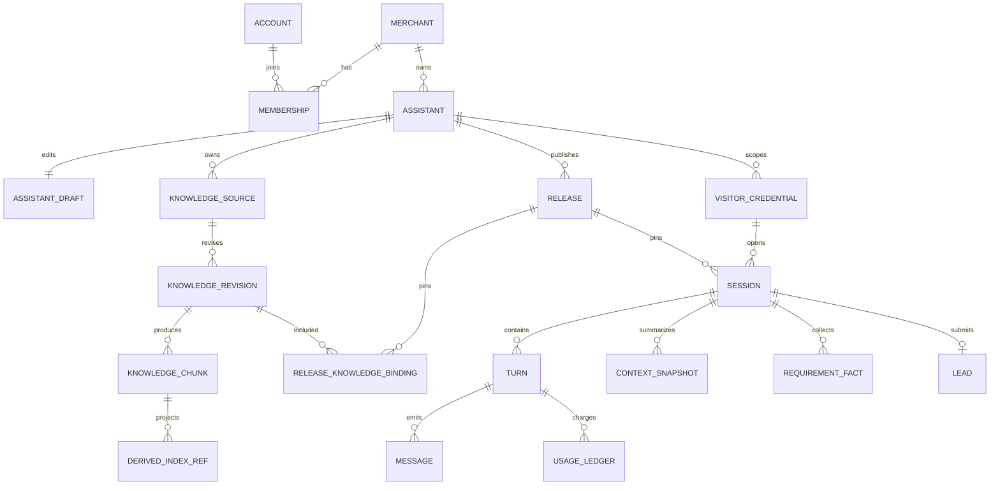
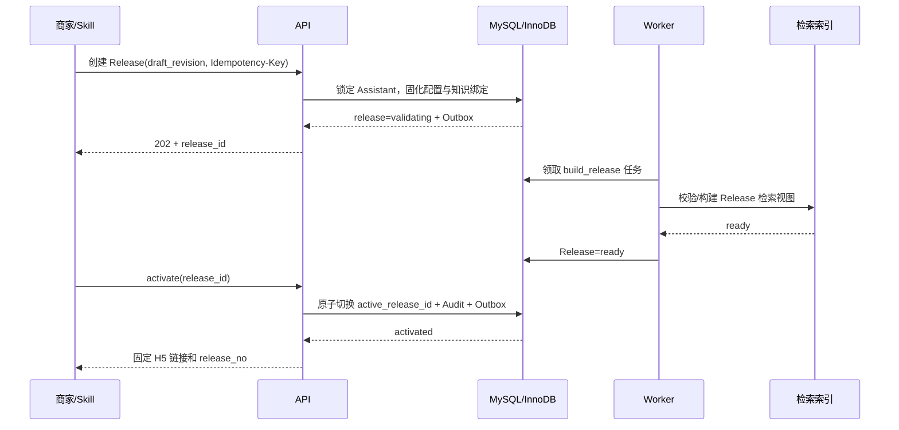
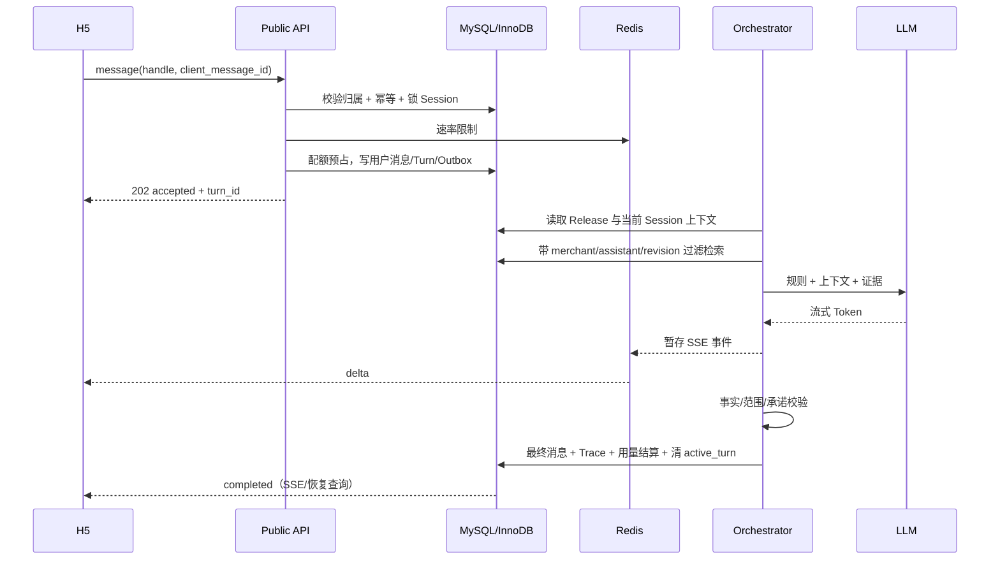
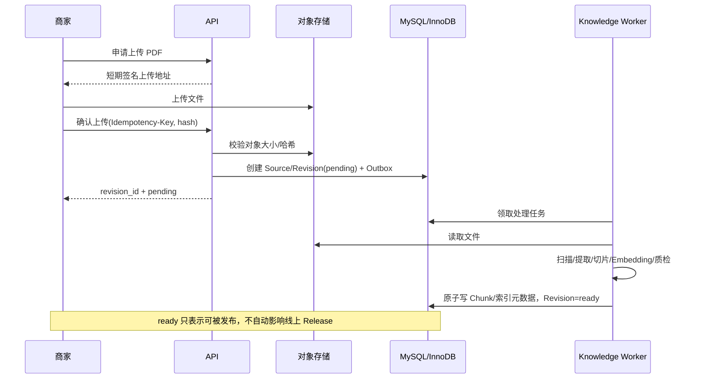
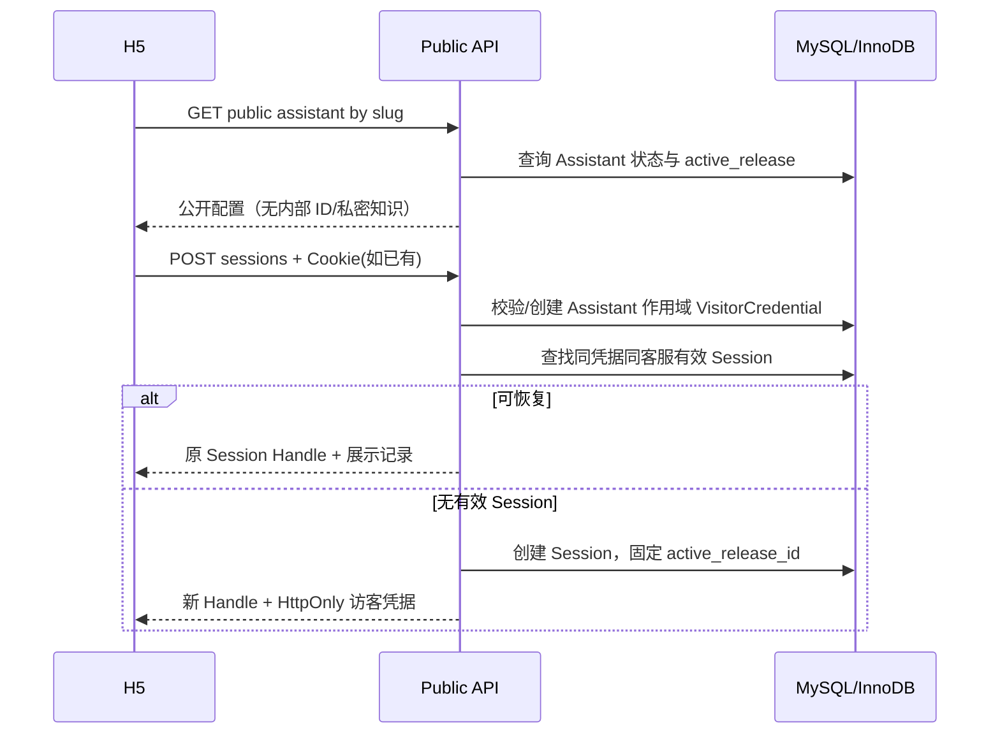

# H5 AI 客服生成与管理平台：后端、数据与 AI/RAG 架构设计

> - 文档状态：V1.1 设计草案（已纳入 MySQL 主存储裁决）
> - 设计日期：2026-09-21
> - 输入依据：《H5 AI客服生成与管理平台_产品需求分析_V1.0》、`00-work-division.md`
> - 架构裁决：主业务存储使用 MySQL/InnoDB；Redis、搜索和向量索引均不是业务事实源。
> - 本文范围：后端模块、数据模型、API、租户与 Session 隔离、发布、知识处理与检索、对话编排、一致性、用量、事件与存储。本文不包含功能代码、页面视觉和生产部署实施。

## 1. 标记约定与设计目标

本文使用以下标记，避免把架构建议误解为已经确认的产品承诺：

- **[已明确]**：来自需求文档，设计必须满足。
- **[建议]**：首版推荐基线，适合 4 至 7 周小规模试用目标，评审通过后进入实现基线。
- **[待验证]**：需要产品决策、技术试验、模型评测或容量测试后才能确定。

### 1.1 首要不变量

1. **[已明确] 商家级知识共享、消费者会话隔离。** 商家资料可以被该商家的已发布客服版本使用；消费者消息、摘要、需求状态不能跨 Session、访客、客服或商家泄漏。
2. **[已明确] 公开客服标识只定位客服。** `public_slug`、二维码和固定 H5 链接不是读取会话、管理配置或访问知识的凭据。
3. **[已明确] 草稿和线上版本分离。** 发布得到不可变 Release；固定 H5 地址不变；新 Session 绑定当前发布版本。
4. **[已明确] 关键业务事实必须可追溯。** 价格、库存、可预约性、订单、支付及退款结果不得由模型补造。
5. **[已明确] WorkBuddy Skill 只是受限 API 调用方。** 在线消费者对话不依赖 WorkBuddy 进程或订阅额度。
6. **[建议] 同一 Session 同时只处理一个生成中的 Turn。** 这是首版实现顺序一致性和控制成本的最小可靠边界。

### 1.2 首版质量目标

- 任意数据读取都能证明“调用主体、商家、客服、Session/版本”的完整归属链。
- 重试不重复创建消息、需求、发布版本、任务或用量扣减。
- 发布切换为单次原子操作，线上请求永远只看到完整旧版本或完整新版本。
- 检索结果可追溯到知识修订和来源，回答可回放到具体 Release、模型和提示模板。
- 模型失败、检索失败、暂停或额度不足均返回明确状态，不写入虚假成功结果。

## 2. 总体架构基线

### 2.1 形态选择

**[建议] 首版采用模块化单体 API + 独立异步 Worker，不采用微服务。** API 进程和 Worker 可以共用代码仓库与数据库，但运行职责分离：

```text
商家后台 ─┐
消费者 H5 ├─> API/BFF ─> 领域模块 ─> MySQL/InnoDB（唯一业务事实库）
运营后台 ─┤       │          │       ├─ Redis（缓存/限流/短期流事件）
WB Skill ─┘       │          │       ├─ 对象存储
                  │          │       └─ 派生搜索/向量索引
                  │          └─> 模型网关 ─> LLM / Embedding
                  └─> MySQL Outbox / Job ─> Worker
```

采用该形态的原因：

- P0 业务存在较多跨域事务，例如发布时同时固化配置、知识清单和活动版本指针；单库事务更容易保证正确性。
- 试点阶段规模和团队不足以抵消微服务的部署、观测、分布式事务和契约治理成本。
- 通过模块边界、内部端口和 Outbox 事件保留以后拆分知识处理、对话、用量服务的可能性。

**[已明确] MySQL/InnoDB 保存所有权威业务状态和事务 Outbox/Job。** Redis、对象存储中的处理产物以及搜索/向量索引可以丢失后重建，不能反向覆盖 MySQL 中的来源、修订、发布绑定、Session、消息或用量账本。

**[待验证]** 预期商家数、并发 Session、文档总量、峰值生成请求和模型供应商限制尚未给出；达到第 13 节拆分触发条件后再独立服务化。

### 2.2 系统责任边界

平台负责：身份权限、商家与客服配置、知识处理、版本发布、公开入口、Session、消息、RAG、模型调用、需求记录、用量、限流、审计和任务。

平台首版不负责：真人坐席路由、实时订单/库存/预约、支付退款执行、消费者跨 Session 长期记忆、把消费者发言自动变成正式知识、为每个客服单独部署 H5。

外部能力通过端口适配：

- `ModelProvider`：聊天模型、Embedding、可选重排模型。
- `ObjectStorage`：源文件和处理产物。
- `NotificationProvider`：P0 可为空实现；以后承接需求通知。
- `BusinessToolProvider`：P2 订单、预约等真实执行工具；首版不向模型暴露。

## 3. 后端模块边界

| 模块 | 核心职责 | 拥有的数据 | 允许依赖 | 后续拆分候选 |
| --- | --- | --- | --- | --- |
| Identity & Access | 商家账号、成员、角色、Token、运营授权 | Account、Membership、RoleGrant | Merchant | 否，先保留核心内 |
| Merchant | 商家档案、状态、联系渠道、额度方案引用 | Merchant、ContactChannel | 无 | 否 |
| Assistant | 客服聚合、公开标识、草稿配置、暂停状态 | Assistant、AssistantDraft | Merchant | 否 |
| Knowledge | 知识来源、修订、解析、切片、向量及质量状态 | KnowledgeSource、KnowledgeRevision、Chunk、ProcessingJob | Merchant、Assistant | 是，计算/存储增长时 |
| Release | 发布候选、不可变快照、知识绑定、激活与回滚 | Release、ReleaseKnowledgeBinding | Assistant、Knowledge | 否；属于一致性核心 |
| Conversation | Visitor、Session、消息、Turn、上下文摘要、需求槽位 | VisitorCredential、Session、Message、Turn、ContextSnapshot | Release、Usage、AI Orchestrator | 是，高并发时 |
| AI Orchestrator | 检索、提示构建、策略判断、模型调用、输出验证 | InvocationTrace、RetrievalTrace | Knowledge、Release、Model Gateway | 是，供应商或吞吐增加时 |
| Inquiry | Lead、未解决问题、人工跟进状态、反馈 | Lead、UnresolvedIssue、Feedback | Conversation | 可选 |
| Usage & Limit | 配额预占、结算、账本、速率限制 | Quota、UsageReservation、UsageLedger | Merchant | 是，计费上线时 |
| Operations & Audit | 运营查看授权、审计、模板、异常查询 | AuditLog、AccessReason、IndustryTemplate | 各模块只读投影 | 可选 |
| Task & Event | 事务 Outbox、任务调度、重试、死信、去重 | OutboxEvent、Job、ConsumerReceipt | 所有产生事件模块 | 是，任务量增加时 |

### 3.1 模块依赖规则

- 领域模块不能直接查询其他模块私有表；通过应用服务接口或只读投影访问。
- `Conversation` 只接收已经发布的 `ReleaseSnapshot`，不读取可变草稿。
- `AI Orchestrator` 无权修改客服配置、知识或权限；知识内容和用户消息都作为不可信数据输入。
- `Knowledge` 负责“资料处理正确”，`Release` 负责“哪些修订上线”，两者不能用单一 `is_published` 字段混合。
- 所有外部调用在数据库事务提交后发生，或以任务驱动；禁止持有数据库事务等待模型生成。

## 4. API 分层与契约

### 4.1 API 面划分

| API 面 | 路径建议 | 调用方 | 认证 | 特点 |
| --- | --- | --- | --- | --- |
| 商家管理 | `/api/v1/merchant/*` | 商家后台 | 登录 Token + Membership | 只允许当前商家；写操作支持乐观并发 |
| 消费者公开 | `/api/v1/public/*` | H5 | 公开客服标识 + 匿名访客能力凭据 | 不暴露内部 ID；严格限流 |
| 平台运营 | `/api/v1/ops/*` | 运营后台 | 运营身份 + RBAC + 访问理由 | 敏感读取强制审计 |
| Skill 管理 | `/api/v1/skill/*` | WorkBuddy Skill | OAuth/受控 API 凭据 + 商家 Scope | 能力与商家 API 对齐，但使用更窄 Scope |
| 内部回调 | `/internal/v1/*` | Worker、模型适配器 | 服务身份/mTLS 或同进程端口 | 不经公网暴露 |

**[建议]** 商家后台和 Skill 最终调用同一组应用用例，API 层只做不同认证、字段整形和 Scope 限制，避免形成两套业务规则。

### 4.2 核心资源接口建议

以下是设计级资源清单，不是最终 OpenAPI：

| 能力 | 接口示例 | 关键语义 |
| --- | --- | --- |
| 创建客服 | `POST /merchant/assistants` | `Idempotency-Key`；返回草稿，不自动发布 |
| 获取/更新草稿 | `GET/PATCH /merchant/assistants/{id}/draft` | `ETag` + `If-Match` 防覆盖 |
| 自然语言生成配置 | `POST /merchant/assistants/{id}/draft:generate` | 生成建议字段与缺失项；真实事实保持空缺 |
| 新增 FAQ/文本 | `POST /merchant/assistants/{id}/knowledge-sources` | 创建 Source 和首个 Revision |
| 上传 PDF | `POST .../knowledge-uploads` + 对象存储直传 | 先申请上传，确认完成后创建处理任务 |
| 查询处理状态 | `GET /merchant/knowledge-revisions/{id}` | 返回 pending/processing/ready/failed 和原因码 |
| 重试知识处理 | `POST /merchant/knowledge-revisions/{id}:retry` | 幂等生成新的 Attempt，不复制 Revision |
| 试聊 | `POST /merchant/assistants/{id}/preview-sessions` | 绑定草稿候选；与线上 Session/用量维度分开 |
| 发布 | `POST /merchant/assistants/{id}/releases` | 固化草稿和 ready 知识修订；幂等 |
| 激活/回滚 | `POST /merchant/assistants/{id}/releases/{rid}:activate` | 原子切换活动版本；校验状态 |
| 暂停/恢复 | `POST /merchant/assistants/{id}:pause|:resume` | 立即影响所有 Session，不产生 Release |
| 解析公开入口 | `GET /public/assistants/{public_slug}` | 仅公开展示配置和可用状态 |
| 建立/恢复 Session | `POST /public/assistants/{public_slug}/sessions` | 使用访客能力凭据；返回不透明 Session Handle |
| 发送消息 | `POST /public/sessions/{handle}/messages` | `client_message_id` 幂等；成功后通过 SSE 获取状态/增量 |
| 订阅事件 | `GET /public/sessions/{handle}/events?after={event_id}` | SSE；支持断线续传和最终结果恢复 |
| 新建咨询 | `POST /public/sessions/{handle}:restart` | 结束旧 Session，创建不继承上下文的新 Session |
| 提交需求 | `POST /public/sessions/{handle}/leads` | `Idempotency-Key`；一次逻辑提交一条 Lead |
| 咨询查询 | `GET /merchant/sessions`、`GET .../{id}` | 按当前商家强制过滤；字段脱敏由权限决定 |

### 4.3 通用协议规则

- 写请求使用客户端生成的 UUID 作为 `Idempotency-Key` 或资源级 `client_*_id`；服务端按“调用主体 + 操作 + Key”去重。
- 可变管理资源返回 `ETag`；更新必须带 `If-Match`，版本不符返回 `409 VERSION_CONFLICT`。
- 错误响应统一包含 `code`、面向用户的 `message`、`request_id`、可选 `retryable` 和字段错误；不得返回模型密钥、提示词、SQL 或堆栈。
- 列表使用不透明 Cursor，不用可猜测的自增 ID 翻页。
- 时间统一存 UTC，MySQL 使用 `DATETIME(6)` 保存微秒精度时间，连接会话固定 `time_zone='+00:00'`；API 使用 RFC 3339，展示时由前端按商家时区转换。业务顺序依靠版本号、`seq` 或 UUIDv7，不能只按时间戳排序。
- 内部实体用 UUIDv7/ULID，MySQL 建议以 `BINARY(16)` 保存 UUID 原始字节；公开 `slug`、Session Handle 和访客凭据使用独立高熵随机值，不能由内部 ID 推导。

### 4.4 SSE 事件建议

`accepted` → `retrieving`（可选不展示）→ 多个 `delta` → `completed`，异常为 `failed`，服务端取消为 `cancelled`。每个事件包含单调递增 `event_id`、`turn_id` 和服务端时间。

**[建议]** `delta` 仅用于界面展示；数据库只把经过最终校验的完整回答标记为 `completed`。断线后客户端先按 `event_id` 续传，缓存过期则读取 Turn 最终状态，不能重新发送同一消息来“补流”。

## 5. 核心领域模型与关系

### 5.1 关系总览



### 5.2 聚合与关键字段

#### Merchant、Account、Membership

- `Merchant(id, name, status, timezone, data_retention_policy_id, quota_plan_id, created_at)` 是租户根。
- `Account(id, auth_subject, status, ...)` 是自然人/登录主体。
- `Membership(merchant_id, account_id, role, status)` 表达一个账号在不同商家的权限；唯一键 `(merchant_id, account_id)`。
- 平台运营身份与 Merchant Membership 分开，不通过伪造商家成员实现运营访问。

#### Assistant 与草稿

- `Assistant(id, merchant_id, public_slug, status, active_release_id, draft_revision, created_at)`。
- `AssistantDraft(assistant_id, merchant_id, revision, config_json, validation_json, updated_by, updated_at)`。
- `public_slug` 全局唯一且可轮换；内部接口仍使用 `assistant_id`。
- `status` 建议为 `draft_only | active | paused | archived`；`paused` 是运行态开关，不改变 Release 内容。
- 草稿 `revision` 每次成功写入递增；保存不影响 `active_release_id`。

#### KnowledgeSource、KnowledgeRevision、Chunk

- `KnowledgeSource` 是商家看到的逻辑资料，类型为 `faq | text | pdf | structured_fact`，支持归档但不原地覆盖历史。
- `KnowledgeRevision` 是不可变内容修订，包含内容哈希、来源、适用范围、有效期、处理状态、对象存储版本和解析器版本。
- `KnowledgeChunk` 绑定 Revision，在 MySQL 保存序号、规范原文、标题路径、页码/FAQ 标识、token 数和内容哈希。Embedding 模型/版本、生成状态和派生索引引用由 `EmbeddingArtifact/DerivedIndexRef` 记录；向量本体可在专用/托管向量索引或可重建产物中，不把某种数据库内向量类型当成业务真值。
- 结构化事实另存 `StructuredFact`，至少包含 `fact_type`、值、单位、条件、有效期和确认状态；检索时优先于自由文本推断。

#### Release

- `Release(id, merchant_id, assistant_id, release_no, status, config_snapshot_json, prompt_template_version, retrieval_policy_version, model_policy_version, created_by, created_at, activated_at)`。
- `ReleaseKnowledgeBinding(release_id, knowledge_revision_id, scope, sort_order)` 固定该版本可用知识集合。
- Release 一旦进入 `ready/active/retired` 不允许修改快照；修正只能创建新 Release。
- `release_no` 在 Assistant 内单调递增，唯一键 `(assistant_id, release_no)`。

#### VisitorCredential 与 Session

- `VisitorCredential(id, merchant_id, assistant_id, secret_digest, status, expires_at, last_seen_at)`；数据库只保存随机秘密的 HMAC/哈希，不保存明文。
- `Session(id, merchant_id, assistant_id, visitor_credential_id, release_id, status, last_activity_at, next_seq, active_turn_id, expires_at, ended_reason)`。
- `Session Handle` 是对外不透明能力句柄，可单独撤销；请求必须同时证明有效访客凭据，不能只提交 `session_id`。
- Session 绑定创建时 Release，进行中不随新发布漂移；紧急暂停在 Release 之外实时检查。

#### Turn、Message、上下文与需求

- `Turn(id, session_id, merchant_id, client_message_id, ordinal, state, user_message_id, assistant_message_id, release_id, request_hash, started_at, completed_at)`。
- `Message(id, session_id, turn_id, seq, role, content, state, created_at)`；唯一键 `(session_id, seq)`。
- `ContextSnapshot(session_id, through_seq, summary, summary_model, source_message_ids, created_at)` 只压缩原会话，不作为独立业务事实源。
- `RequirementFact(session_id, field_key, value_json, state, source_message_id, supersedes_id, updated_at)` 保留来源；纠正通过新记录覆盖当前投影，不改写历史消息。
- `Lead(id, merchant_id, assistant_id, session_id, idempotency_key, payload, contact_consent, status, created_at)`；联系方式字段可加密并限制查询权限。

#### 追溯与用量

- `InvocationTrace` 记录 Turn、Release、模型、参数版本、检索 Trace、耗时、结果状态，不默认记录完整敏感提示文本。
- `RetrievalTrace` 记录查询改写、过滤范围、候选 Chunk、分数和最终采用来源，便于回答抽检。
- `UsageReservation` 在调用前预占预算；`UsageLedger` 在调用后按实际 Token/调用/存储结算，是不可变账本。

### 5.3 数据库级约束

**[建议]** 所有租户业务表显式带 `merchant_id`，即便能沿外键间接得到，目的是强制过滤、分区、审计和复合外键。MySQL/InnoDB 中为被引用列建立相同顺序、相同类型和相同字符集/排序规则的复合唯一键，再建立复合外键。单列 `id` 可以继续作为物理主键，但租户资源同时建立 `UNIQUE(merchant_id, id)`；客服下资源建立 `UNIQUE(merchant_id, assistant_id, id)`，所有子表优先引用这些租户前缀键。例如：

- Message/Turn 的 `(merchant_id, assistant_id, session_id)` 必须引用同归属 Session。
- Session 的 `(merchant_id, assistant_id, release_id)` 必须引用同归属 Release。
- ReleaseKnowledgeBinding 中 Revision 的 `merchant_id` 必须与 Release 一致。
- `active_release_id` 必须属于当前 Assistant 且状态可激活。

应用层验证不能替代这些数据库约束。MySQL 没有本设计可依赖的原生 PostgreSQL 式行级安全策略；租户隔离必须由复合主外键/唯一约束、Repository 强制 `TenantContext`、API 归属链验证和自动化越权测试共同实现，不能假设数据库会自动追加租户条件。

**[待验证]** 若 ORM 对 MySQL 复合外键支持不足，必须通过版本化迁移 SQL 和受控 Repository 补齐；不建议用触发器隐藏核心归属关系，也不能因此放弃数据库约束。

### 5.4 MySQL 字段、字符集与索引约定

- 所有业务表使用 InnoDB；库表默认字符集使用 `utf8mb4`。普通中文展示/检索前文本建议采用 MySQL 8 的 `utf8mb4_0900_ai_ci`，但最终排序规则需用真实商家数据验证。
- UUID 使用 `BINARY(16)`；SHA-256/HMAC 摘要使用 `BINARY(32)`；枚举代码、状态、外部请求 ID 和幂等 Key 使用 ASCII/二进制排序规则。`public_slug` 在应用层先规范为小写，再用区分字节的唯一索引，避免不同环境的大小写语义漂移。
- JSON 只保存结构可变且不承担核心关联的数据，例如配置快照。热路径过滤、排序、唯一性和外键字段必须提升为普通类型列；确需查询 JSON 路径时使用生成列或函数索引并写入迁移，不在热路径执行无索引 `JSON_EXTRACT` 全表扫描。
- 大文本使用 `TEXT/MEDIUMTEXT` 并单独评估行大小；联系方式等敏感字段使用应用层信封加密后存二进制列，检索需求用独立盲索引，不对密文做模糊查询。
- 唯一键的列顺序与查询前缀一致。租户资源常用索引以 `merchant_id, assistant_id, ...` 开头；所有状态轮询、保留清理和 Job 领取查询必须有覆盖其过滤与排序条件的组合索引。
- `created_at/updated_at/run_after/lease_until` 使用 `DATETIME(6)` UTC；数据库连接初始化时校验时区。审计和消息顺序使用单调序号，不以两个时间戳相等时的隐式行顺序为准。

## 6. 租户、访客与 Session 隔离

### 6.1 四层隔离

1. **入口层**：从认证 Token/访客凭据解析可信 `merchant_id` 和 `assistant_id`，忽略客户端主动传入的租户字段。
2. **应用层**：Repository 方法必须以 `TenantContext` 为首参；禁止 `findById(id)` 形式的无租户查询。
3. **数据库层**：MySQL/InnoDB 使用 `merchant_id/assistant_id` 复合主外键、唯一约束和显式带租户前缀的查询；MySQL 没有本设计可用的原生 RLS，不能依赖会话变量自动隔离租户。
4. **存储与索引层**：对象键、缓存键、向量/全文索引均包含 `merchant_id`、`assistant_id` 和 `release_id/revision_id`；检索过滤由服务端构造且不可被模型覆盖。

Repository 层应把 `TenantContext` 作为不可省略的类型参数，集中生成租户谓词；代码检查禁止无作用域的通用 `findById`/`updateById`。后台任务从 Job 的可信 `merchant_id` 重建上下文，并再次与目标业务行复合关联校验，不能信任 Payload 内任意租户字段。

### 6.2 访客能力凭据

**[建议]** 首次打开 H5 时由服务端下发高熵随机访客秘密，优先放在 `Secure + HttpOnly + SameSite=Lax` Cookie；同时返回只用于前端展示/路由的不透明 Session Handle。服务端保存秘密摘要，并绑定 Merchant + Assistant。

- 切换商家或客服必须创建对应的新 VisitorCredential 或独立作用域，不能复用一个能力令牌查询所有客服。
- 匿名凭据丢失后不得以旧 Session Handle、手机号或公开链接恢复私密记录。
- 多标签页在同一浏览器、同一客服下可恢复同一未过期 Session；并发消息仍按第 9 节串行。
- 所有 Session 接口先校验 `handle → session → visitor_credential → assistant → merchant` 完整链。

**[待验证]** H5 是否跨自定义域名部署、微信内置浏览器 Cookie 行为、是否需要前端持有短期 Bearer 能力令牌。若使用 Bearer，须避免写入 URL、日志和本地明文长期存储，并采用短期访问令牌 + 可撤销服务端凭据。

### 6.3 缓存、对象和日志隔离

- Redis Key 统一前缀：`env:module:merchant_id:assistant_id:resource:id`；禁止只用 `session_id` 或 `public_slug`。
- Redis 只承载可丢失的缓存、速率桶、短期 SSE 事件和失效通知；Session、幂等结果、配额、任务状态和最终回答必须以 MySQL 为准。Redis 不可用时可以降级或拒绝高风险请求，不能把缓存内容当成权威记录回写 MySQL。
- 文件路径建议：`merchants/{merchant_id}/knowledge/{source_id}/revisions/{revision_id}/...`；下载通过短期签名 URL 且服务端先鉴权。
- 派生向量查询必须同时过滤 `merchant_id + assistant_id + revision_ids`，返回的 Chunk ID 还要回到 MySQL 校验当前 Release 绑定和有效状态。仅依赖向量库 Namespace 而不带元数据过滤不够稳妥。
- 日志记录 ID、错误码和量化信息；默认不写消息正文、联系方式、访客秘密、模型密钥和完整提示词。
- 运营读取消费者正文必须携带业务理由，写 AuditLog；普通故障排查优先使用脱敏 Trace。

## 7. 发布与回滚版本设计

### 7.1 生命周期

```text
draft（可变）
  └─ create release candidate
       ├─ validating ──> failed
       └─ building index ──> ready ──> active ──> retired
                                      ▲              │
                                      └── rollback ──┘
```

发布不是“把草稿加一个已发布标志”，而是生成一份不可变闭包：

- 客服配置快照；
- 提示模板、检索策略和模型策略版本；
- 已确认且处理为 ready 的知识修订 ID 清单；
- 结构化事实快照/修订绑定；
- 需要时预构建的检索清单或 Namespace。

### 7.2 发布步骤

1. 在短事务中锁定 Assistant，读取指定 `draft_revision`，创建 `validating` Release；同一幂等键只创建一次。
2. 校验发布最低字段、禁止项、知识数量、所有 Revision 归属和状态；无可用业务知识则失败。
3. 异步构建/校验 Release 检索视图，执行样例问题和越权过滤冒烟检查。
4. 标记 `ready`；发布请求可选择“构建成功后自动激活”或等待用户确认。
5. 激活时短事务锁定 Assistant，验证 Release 仍属当前客服并为 ready/retired，将 `active_release_id` 原子指向它，同时写 Outbox。
6. 新 Session 读取新的 `active_release_id`；旧 Session 继续绑定原 Release。

**[建议]** 回滚不复制数据，只把 `active_release_id` 指向仍完整可用的历史 Release，并产生新的激活审计记录。历史 Release 依赖的知识修订和对象不能在仍被引用时物理删除。

### 7.3 暂停与紧急失效

- `Assistant.status=paused` 是独立、强一致的运行开关；每次新建 Session 和发送消息都检查，缓存 TTL 应短且支持主动失效。
- 普通知识删除只影响未来 Release；已绑定旧 Release 的 Session 仍可使用旧知识。
- **[待验证]** “必须立即失效”的事实是否需要首版支持。建议模型为 `KnowledgeRevocation`：实时拒绝命中被撤销 Revision，并结束受影响旧 Session，提示用户重新咨询；这会增加检索与缓存复杂度，不应隐式等同普通删除。

### 7.4 发布关键时序



## 8. 知识处理、索引与检索

### 8.1 摄取处理流水线

```text
上传/录入
→ 内容哈希与格式/大小校验
→ 恶意文件扫描接口
→ 文本提取
→ 规范化与结构识别
→ 切片及元数据
→ Embedding
→ 派生关键词/向量索引
→ 质量检查
→ ready / failed
```

每一步写入可重试的 `ProcessingAttempt`，记录处理器版本、开始/结束时间、输入/输出哈希和错误码。任务采用至少一次投递，步骤必须按 `(revision_id, processor_version, input_hash)` 幂等。

P0 类型处理建议：

- FAQ：问题、同义问法和答案形成一个逻辑单元，避免把问答拆散。
- 文本：按标题层级和语义段落切片，保留相邻窗口和原文定位。
- PDF：只接受可提取文字的 PDF；页码进入元数据。扫描件/OCR 标记不支持或进入后续能力。
- 结构化事实：不依赖通用切片，写入类型化事实表并生成可检索表达。

**[待验证]** 单文件大小、页数、总知识量、切片长度/重叠、Embedding 模型和批处理吞吐，需用首批行业真实资料评测后设定。

### 8.2 状态与可见性

- Revision 状态：`pending | processing | ready | failed | superseded | archived`。
- Source 编辑产生新 Revision，旧 Revision 不原地改写。
- 只有 `ready` 且经商家确认的 Revision 能进入 Release。
- 失败需提供稳定错误码，例如 `UNSUPPORTED_PDF`、`NO_EXTRACTABLE_TEXT`、`FILE_TOO_LARGE`、`EMBEDDING_FAILED`，并允许重试。
- 消费者消息、模型总结和未解决问题只能生成知识草稿，不得直接进入 ready 或发布版本。

### 8.3 混合检索流程

**[建议]** P0 使用“结构化事实优先 + 经 PoC 选定的中文关键词检索 + 可重建向量检索 + 轻量融合”。MySQL 保存 Source、Revision、Chunk 原文、元数据、Embedding 模型/版本、内容哈希和派生索引引用；搜索系统只保存可从这些记录重建的副本。向量后端在以下两类方案中评测后选择，不预设数据库内置向量能力：

- 专用或托管向量检索服务；
- 经目标 MySQL 版本与生产形态 PoC 验证、在过滤正确性和性能上达标的 MySQL 向量能力。

1. 从 Release 得到允许的 Revision ID 闭包，构造强制过滤条件。
2. 基于当前问题、最近上下文和需求槽位生成检索查询；查询改写不能扩展租户/版本范围。
3. 按事实类型查询当前有效 StructuredFact。
4. 对 Chunk 同时做关键词和向量 Top-K 检索，以 RRF/加权分数融合；派生索引返回 Chunk ID 后，按 MySQL Release 绑定做最终交集校验。
5. 按来源确认状态、有效期、适用条件、重复度和冲突标记过滤。
6. **[可选/待验证]** 对候选做 Cross-Encoder/LLM 重排；只有真实评测证明收益高于延迟和成本时启用。
7. 输出“证据包”：原文片段、来源、修订、条件、有效期和内部引用 ID。

检索结果不能直接等同可回答：策略层需要区分“资料充分、缺必要条件、资料冲突、无依据、超范围”。

派生索引以 `DerivedIndexManifest(backend, namespace, schema_version, embedding_model_version, last_synced_event_id, state)` 记录构建状态。Release 只有在对应 Manifest 为 ready 且抽样校验通过后才能激活；索引丢失或版本不匹配时由 MySQL Outbox/Job 重建，不能从索引反向生成知识真值。

### 8.4 冲突、有效期与引用

- 同一结构化事实按“已确认、适用条件匹配、有效期当前、修订更新”排序；不能仅以向量相似度决定价格等事实。
- 无法消解的冲突设置 `conflict=true`，回答必须转为不确定表述或人工确认，不得任选其一。
- 后台回答详情保存使用过的 Revision/Chunk ID，供商家追溯；消费者端首版可不展示内部引用，但答案仍必须可审计。
- 过期事实默认不作为确定依据；可用于说明“历史资料显示”仅在产品明确允许后开放。

### 8.5 RAG 安全边界

- 系统提示、Release 规则、知识证据和用户消息使用明确分区；知识和用户文本一律标记为不可信内容，不执行其中的“忽略规则”“调用管理接口”等指令。
- 模型只收到当前租户、客服、Release 过滤后的证据。
- P0 不给模型任何管理写权限或真实交易工具。
- 输出校验器检查禁止承诺词、无依据价格/库存/预约断言、AI 身份和联系渠道一致性；命中高风险规则时回退到“暂无法确认 + 联系方式/需求登记”。
- **[待验证]** 输出校验使用确定性规则、二次模型或组合方案，以及各行业的误杀率。

## 9. 对话编排与上下文

### 9.1 单 Turn 编排

1. 验证 VisitorCredential、Session Handle、Assistant 状态和完整归属链。
2. 以 `(session_id, client_message_id)` 查幂等记录；已有 Turn 则返回其当前/最终状态。
3. 获取 Session 行锁或分布式单飞锁；若已有生成中 Turn，返回 `409 TURN_IN_PROGRESS` 及可订阅的 Turn ID。
4. 检查 Session 是否超时；若超时则创建新 Session 并明确告知客户端，不能静默继承旧需求。
5. 校验输入长度与内容，预占调用配额；失败则不创建模型调用。
6. 在短事务中分配 `ordinal/seq`、保存用户消息、创建 `Turn=accepted`、更新 `active_turn_id` 和 Outbox，随后提交。
7. Orchestrator 读取绑定 Release、近期消息、需求状态和有效摘要，完成意图/范围判断与检索。
8. 资料不足时生成最小澄清问题；越界时引导；依据充分时调用模型生成。
9. 流式片段写入短期事件缓存；生成完成后执行输出校验。
10. 在短事务中写最终助手消息、来源 Trace、需求事实变更、未解决原因、实际用量和 Turn 最终状态，清空 `active_turn_id`，写 Outbox。
11. 若失败，记录稳定错误状态并结算实际已发生用量；失败回答不进入已完成上下文。

### 9.2 对话关键时序



### 9.3 上下文预算

按以下优先级组装，不简单截取全部历史：

1. 当前 Release 的系统规则和回答边界；
2. 当前已确认 RequirementFact；
3. 最近若干完整消息；
4. 更早历史的 ContextSnapshot；
5. 本 Turn 检索证据。

摘要必须包含 `through_seq` 和源消息范围，不能覆盖尚未总结的新消息。摘要不得创造事实；与原消息或 RequirementFact 冲突时，以可追溯原消息/最新纠正为准。

**[建议]** 摘要任务在消息数或 Token 阈值到达后异步执行，使用乐观条件 `current_snapshot.through_seq = expected` 写入，防止并发摘要覆盖。**[待验证]** 最近消息数量、摘要阈值和总体上下文 Token 预算由模型实测确定。

### 9.4 Session 生命周期

- 首次访问创建匿名凭据和 Session；不要求联系方式。
- **[建议]** 30 分钟无用户互动后，在下一次提交时结束旧 Session 并创建新 Session；时长待产品确认。
- 主动“新建咨询”立即结束旧 Session；新 Session 不复制 RequirementFact 或摘要。
- Session 结束与数据删除是两件事；结束只禁止继续追加消息，保留期按数据策略执行。
- 发布更新不迁移进行中 Session；暂停实时生效。

## 10. 幂等、顺序与一致性

### 10.1 写操作幂等

建立通用 `IdempotencyRecord`：

```text
(actor_scope, operation, idempotency_key) UNIQUE
request_hash, state(in_progress/completed/failed), resource_type, resource_id,
response_code, response_body_or_pointer, expires_at
```

- 同 Key、同请求体：返回原资源/原结果；进行中返回当前状态。
- 同 Key、不同请求体：返回 `409 IDEMPOTENCY_KEY_REUSED`。
- 业务表仍需唯一约束兜底，例如 `(session_id, client_message_id)`、`(session_id, lead_idempotency_key)`。
- 已发生外部副作用的失败不能简单删除幂等记录；应保留可恢复状态。

MySQL 实现中，先把外部 Key 规范化并限制长度，保存原 Key 或其 SHA-256 摘要到 ASCII/二进制排序规则列；唯一索引必须覆盖 `actor_scope + operation + key_digest`。`request_hash` 基于规范化请求体计算。插入冲突以 MySQL 唯一键错误为并发胜负依据，随后读取已有记录，不采用“先查后插”的竞态流程。

幂等范围至少覆盖：创建客服、知识导入确认、重试处理、发布、激活、发送消息、提交 Lead、Skill 写操作。

### 10.2 Session 顺序

**[建议] P0 采用数据库 Session 行锁 + 单活 Turn：**

- 在 MySQL/InnoDB 短事务中按 Session 主键执行 `SELECT ... FOR UPDATE`，检查 `active_turn_id` 并分配递增 `ordinal` 和消息 `seq`；精确主键命中避免无谓范围锁。
- 一个 Turn 的用户消息先落库，助手消息完成后分配下一 `seq`。
- 新用户消息在上一 Turn 生成中返回明确冲突，不排入无界队列；前端禁用发送并同步多标签页状态。
- 若进程崩溃，Watchdog 将超时 Turn 标为 `failed/recoverable` 并释放 `active_turn_id`；重复请求同 `client_message_id` 读取该 Turn，不另建消息。

该方案优先保证语义顺序。**[待验证]** 是否要求“用户连续发送多条消息自动排队”；若要求，应引入每 Session FIFO Inbox 和取消/合并规则，不能只提高并发数。

### 10.3 一致性边界

| 场景 | 一致性策略 |
| --- | --- |
| 草稿保存 | 单行乐观锁，冲突返回 409 |
| Release 固化 | 单数据库事务固定配置与知识绑定 |
| 激活/回滚 | 锁 Assistant，原子替换活动指针 |
| 消息入站 | Session 锁 + 消息/Turn/配额预占/Outbox 同事务 |
| 模型调用 | 事务外执行，结果以 Turn 状态机恢复 |
| 消息完成 | 最终消息/Trace/需求投影/用量结算/Outbox 同事务或可补偿步骤 |
| 异步任务 | 至少一次投递 + 消费去重；不假设 exactly-once |
| 缓存 | MySQL 为事实源；事件失效 + TTL 双保险，Redis 内容可丢弃重建 |

### 10.4 状态机与恢复

Turn 状态建议：`accepted → processing → streaming → completed`，异常进入 `failed_retryable | failed_final | cancelled`。只能按允许的边迁移；更新附带旧状态条件，防止迟到 Worker 把已失败 Turn 覆盖成成功。

服务重启后扫描过期 Lease：

- 尚未调用模型：可由 Worker 重新领取。
- 模型调用结果不确定：若供应商支持请求幂等/结果查询则恢复；否则标记失败，不自动产生第二个可能重复计费的回答。
- 已有完整候选但未落库：按输出哈希和 Turn ID 幂等提交。

## 11. 用量、配额与限流

### 11.1 三层控制

1. **滥用速率限制**：Redis Token Bucket/滑动窗口，维度包括 IP、VisitorCredential、Session、Assistant 和 Merchant。
2. **业务配额**：数据库权威额度，按 Merchant 的日/月 Token、调用次数、知识处理量等检查。
3. **运行保护**：单输入长度、上下文 Token、文件大小、并发 Turn、任务并发和模型超时上限。

公开入口的 IP 限流只能作为辅助；运营商 NAT/微信环境可能共享 IP，不能只按 IP 封禁。

### 11.2 预占与结算

1. 估算本次最大输入/输出成本，事务内创建 `UsageReservation` 并增加预占额。
2. 额度不足立即返回 `QUOTA_EXHAUSTED`，不调用模型；H5 展示可理解提示和已配置联系入口。
3. 调用完成按供应商返回的实际 Token/调用量写不可变 `UsageLedger`，释放差额。
4. 超时/失败仍结算实际发生部分；完全未调用则释放全部。
5. Reservation 设过期时间，由 Reconciler 回收孤儿预占，但回收前需确认 Invocation 状态。

`UsageLedger` 唯一键建议 `(provider, provider_request_id, usage_type)` 或 `(turn_id, invocation_attempt, usage_type)`，防止回调和重试重复记账。

### 11.3 口径建议与待验证

- **[建议]** 试点同时保存原始单位（input/output token、embedding token、存储字节、解析页数）和按调用时价格计算的成本快照，避免未来价格变化导致历史成本漂移。
- **[建议]** 试聊、线上咨询、知识处理分别记 Usage Purpose，便于运营核算。
- **[待验证]** 套餐周期、超额策略、并发上限、免费试用、模型降级和是否允许人工加额。
- **[待验证]** 限流阈值必须通过模型延迟、成本和真实 H5 流量压测确定，本文不虚构数值。

## 12. 事件与任务机制

### 12.1 首版实现

**[建议]** 使用 MySQL/InnoDB Transactional Outbox + 持久 Job 表。业务行与 Outbox 在同一事务提交；Job 状态、重试次数、租约和死信记录全部以 MySQL 为真值。Redis 只用于短期流事件、缓存和限流，不作为可靠任务队列或恢复依据。

`OutboxEvent` 至少包含：`event_id`、`event_type`、`aggregate_type/id`、`merchant_id`、`occurred_at`、`schema_version`、`payload`、`trace_id`。Payload 只放必要 ID 和非敏感字段。

`Job` 至少包含：`job_id`、`type`、`dedup_key`、`merchant_id`、`payload_pointer`、`state`、`attempt`、`max_attempts`、`run_after`、`lease_owner/until`、`last_error_code`。

Worker 领取采用 MySQL 8 支持的 `FOR UPDATE SKIP LOCKED` 与短事务租约：

1. 专用 Worker 事务使用 `READ COMMITTED`；按覆盖索引查询 `state='pending' AND run_after<=UTC_TIMESTAMP(6)`，排序后小批量 `FOR UPDATE SKIP LOCKED`。
2. 同一短事务把选中行更新为 `running`，写入 `lease_owner`、`lease_until` 和 attempt，然后立即提交；实际解析、Embedding 或模型工作在事务外执行。
3. 心跳按 `job_id + lease_owner + state='running'` 条件延长租约；完成/失败也使用相同所有权条件更新，迟到 Worker 不能覆盖已被重新领取的任务。
4. Reclaimer 只把已过期租约转回 pending 或 dead-letter；任务业务副作用仍按 dedup_key/目标资源状态幂等。

Job 领取索引建议以 `(state, run_after, priority, job_id)` 开头，实际顺序以最终查询计划验证。采用 `READ COMMITTED`、可命中索引的有界范围和小批量，是为了减少 InnoDB 在默认 `REPEATABLE READ` 下的 next-key/gap lock 竞争；禁止在没有合适索引时扫描领取，也禁止持锁执行外部工作。**[待验证]** 目标 MySQL 版本、隔离级别、执行计划以及多 Worker 并发下是否仍出现 gap lock/饥饿，必须用生产相同版本压测。

### 12.2 主要事件与消费者

| 事件 | 主要消费者 | 用途 |
| --- | --- | --- |
| `knowledge.revision.created` | Knowledge Worker | 解析、切片、Embedding、索引 |
| `knowledge.revision.ready/failed` | 管理通知、发布校验投影 | 更新状态和提醒 |
| `release.created` | Release Builder | 校验检索闭包、冒烟测试 |
| `release.activated` | Cache Invalidator、Audit Projection | 失效公开配置缓存、记录发布 |
| `assistant.paused/resumed` | Cache Invalidator | 立即刷新运行开关 |
| `turn.accepted` | Conversation Worker | 开始 RAG/模型编排 |
| `turn.completed/failed` | Metrics、Unresolved Detector | 指标、未解决问题、质量抽样 |
| `lead.submitted` | Merchant Notification（可选） | 触发商家通知，不等同已联系 |
| `quota.threshold_reached` | Ops Alert | 用量提醒/保护 |
| `retention.delete_due` | Data Lifecycle Worker | 删除消息、对象、索引并记录结果 |

### 12.3 重试与死信

- 瞬时错误指数退避加抖动；永久错误直接失败并显示可理解原因。
- 消费者以 `event_id + consumer_name` 或业务 `dedup_key` 去重。
- 超过次数进入 Dead Letter 状态，不自动无限重试；运营可查看、修复后显式重放。
- 重放事件不绕过当前租户/状态校验，例如已归档知识不会因旧事件重新上线。
- 任务大 Payload 放对象存储或业务表，只在 Job 中保存指针和内容哈希。

## 13. 存储选型建议

| 能力 | P0 建议 | 选择理由 | 升级/拆分触发条件 |
| --- | --- | --- | --- |
| 事务与业务真值 | MySQL 8.x + InnoDB | 已确认主存储；事务、复合约束、成熟运维与 binlog | 写吞吐、地域或恢复目标超出单主形态 |
| 向量检索 | 专用/托管向量服务，或经 PoC 验证的 MySQL 能力 | 索引是可重建派生数据，不绑定未经验证的实现 | 数据量、过滤正确性、召回、P95 或成本不达标时更换后端 |
| 中文关键词检索 | MySQL FULLTEXT `ngram` 与独立搜索服务对比后选择 | 以真实中文样本验证，避免默认分词假设 | MySQL 召回/排序/扩展性不达标时采用 OpenSearch 等独立搜索 |
| 缓存/限流/SSE 临时事件 | Redis | 原子计数、短期状态、Pub/Sub/Stream | 高可用与容量按压测配置；不得作为唯一事实源 |
| 文件 | S3 兼容对象存储 | 大对象、版本、生命周期和签名下载 | 按云环境选具体产品 |
| 任务/事件 | MySQL Outbox + Job 表 | 与业务写入同事务，首版组件少 | Worker 吞吐、跨服务订阅增多时引入消息队列 |
| 模型接入 | 服务端 Model Gateway/Adapter | 统一超时、重试、用量、脱敏和供应商切换 | 多供应商路由复杂时独立服务化 |

### 13.1 中文检索注意项

不能假设 MySQL 默认 FULLTEXT 分词即可达到中文检索质量。**[待验证]** 用首批行业的真实问题、FAQ、长文本构建检索评测集，对以下组合比较 Recall@K、答案正确率、P95 延迟、索引重建时间和成本：

- 仅向量；
- MySQL InnoDB FULLTEXT `ngram`；
- MySQL `ngram` 关键词 + 派生向量检索；
- OpenSearch/BM25 + 向量混合。

MySQL `ngram_token_size` 是实例级/服务级配置并影响索引结果，变更后需要重建 FULLTEXT 索引；必须把取值、停用词和解析配置纳入部署与评测版本。若目标托管 MySQL 不允许配置或过滤/排序质量不达标，应使用独立搜索服务。向量索引无论落在哪个后端都不是知识真值，必须可由 MySQL Chunk 与 Embedding 版本重新构建。

### 13.2 MySQL 运行、迁移与恢复基线

- **事务隔离：** 普通业务事务按最终压测选择；Session/发布等精确行锁事务保持短小。Job 领取连接明确使用 `READ COMMITTED`，不把某个连接池的默认隔离级别当成隐式保证。
- **Schema 迁移锁：** 禁止应用实例启动时各自自动迁移。发布流水线只运行一个 Migrator，并使用项目专属 MySQL 命名锁 `GET_LOCK('h5cs:schema:migrate', timeout)` 的专用连接作二次互斥；该锁是连接级而非事务级，DDL 又可能隐式提交，因此必须在 `finally` 中 `RELEASE_LOCK`，连接断开仅作为兜底。迁移版本仍由 `schema_migrations` 唯一键记录，不能把命名锁当成迁移成功证明。
- **DDL 与 metadata lock：** 上线前检查长事务和表规模，显式选择目标版本支持的 `ALGORITHM/LOCK`，对大表使用兼容的在线变更方案；若不能安全在线执行则安排维护窗口。迁移脚本必须可前向恢复，不能假设所有 DDL 都可事务回滚。
- **binlog：** 生产启用 `binlog_format=ROW`、GTID 和足以覆盖恢复目标的 binlog 保留；Server ID、复制和备份账号独立管理。具体托管 MySQL 参数以生产服务能力核验。
- **备份/PITR：** 定期全量物理/托管备份与连续 binlog 共同实现时间点恢复。恢复流程先还原最近基线，再重放到目标 UTC 时间或 GTID；至少在隔离环境定期演练并核对商家、Release、Session、Outbox 和用量账本一致性。未做恢复演练不能宣称满足 RPO/RTO。
- **派生存储恢复：** Redis 不纳入事实恢复；关键词/向量索引根据恢复后的 MySQL `DerivedIndexManifest` 和 Outbox 重建。PITR 后必须防止旧消费者继续提交高水位之后的派生事件。

**[待验证]** MySQL 的具体部署形态、版本、主从/高可用、备份保留、RPO/RTO、命名锁权限和在线 DDL 能力由平台设计与生产环境 PoC 确认。

### 13.3 数据生命周期

- 数据保留策略按 Merchant 配置/平台最低要求生成 `delete_due_at`，覆盖消息、摘要、RequirementFact、Lead、源文件、处理产物、Chunk 和向量。
- Release 引用计数阻止知识修订被提前物理删除；到期旧 Session 和历史 Release 需按合规策略共同清理或匿名化。
- 数据库删除、对象删除、索引删除以任务 Saga 执行，记录每一步；失败可重试且不能提前宣称已完全删除。
- **[待验证]** 正式保留天数、备份保留与擦除 SLA、联系方式加密和脱敏规则需由产品/合规确认。

## 14. 关键补充时序

### 14.1 知识导入与生效



### 14.2 匿名 Session 建立与恢复



## 15. AI 可观测、质量与评测

### 15.1 最小 Trace

每个 Turn 贯穿 `request_id / trace_id / turn_id`，至少记录：租户和客服 ID、Session ID、Release ID、模型与参数版本、检索策略版本、候选/采用来源 ID、各阶段耗时、Token、重试、最终策略分支和错误码。

消息正文和完整提示词不进入普通 APM 标签。需要质量回放时，从受权限控制的业务库按 Trace ID 读取，并记录审计。

### 15.2 离线评测集

**[建议]** 首批行业建立带期望行为的版本化数据集，至少覆盖：

- 直接可答、需要澄清、资料不足、资料冲突、过期资料；
- 越界问题、提示注入、跨商家/跨 Session 猜测；
- 价格条件、库存、周六营业与可预约性区别；
- 多轮省略指代、消费者纠正需求字段；
- 中文口语、错别字和同义表达。

评测输出分开计算检索召回、事实正确、边界遵守、需求槽位正确、无依据承诺率、延迟和单 Turn 成本，避免用单一“回答感觉不错”验收。

### 15.3 在线质量闭环

无帮助反馈、资料不足、冲突和输出校验回退产生 `UnresolvedIssue`；商家可从它创建知识草稿。原消息和原回答保持不可变，修正不会回写历史。知识草稿仍需确认、处理和新 Release 发布才生效。

## 16. 验收要求到后端设计映射

| 验收项 | 主要设计保障 |
| --- | --- |
| A01 创建与生成 | AssistantDraft、缺失项校验、生成不补造结构化事实 |
| A02 处理失败 | KnowledgeRevision 状态机、错误码、幂等 ProcessingAttempt |
| A03 发布与链接 | 不可变 Release、原子激活、固定 public_slug、写幂等 |
| A04 范围与资料不足 | Orchestrator 策略分支、证据包、输出校验 |
| A05 连续上下文 | RequirementFact、近期消息、带来源摘要 |
| A06 同商家不同访客 | VisitorCredential + Session 归属链、复合约束 |
| A07 跨商家隔离 | TenantContext、MySQL 复合约束、Repository 强制作用域、派生索引二次校验、对象前缀 |
| A08 刷新与新咨询 | 能力凭据恢复、Session 生命周期、不继承重启 |
| A09 版本更新 | Session 固定 Release、active_release 原子切换 |
| A10 需求与联系 | Lead 唯一键、联系渠道真实配置、不伪造转接 |
| A11 异常与暂停 | 运行态开关、Turn 失败状态、配额预占、降级提示 |
| A12 Skill 闭环 | 独立 Skill API 面、同一应用用例、受限 Scope |
| A13 重试与并发 | IdempotencyRecord、Session 单活 Turn、Usage Ledger 去重 |
| A14 权限与指令攻击 | 管理/公开 API 分面、模型无管理工具、RAG 不可信输入边界 |

## 17. 建议决策清单

以下项目建议作为首版技术基线进入总体架构评审：

1. 模块化单体 API + 独立 Worker，共享 MySQL/InnoDB 业务事实库。
2. MySQL + Redis + S3 兼容对象存储 + 可重建派生搜索/向量索引；任务先用 MySQL Transactional Outbox/Job 表。
3. Release 是配置、规则和知识修订的不可变闭包；Assistant 仅持活动指针。
4. 新 Session 固定当前 Release，旧 Session 不漂移；暂停独立实时生效。
5. 匿名访客使用不可猜测、可撤销、按客服作用域绑定的能力凭据；公开链接不具备读取权限。
6. 每 Session 单活 Turn，数据库行锁分配消息顺序；重试通过客户端消息 ID 幂等。
7. 结构化事实优先，全文与向量混合检索；所有查询强制按租户、客服和 Release 知识闭包过滤。
8. 调用模型前预占用量、调用后实际结算；账本不可变且外部请求去重。
9. 业务写入与 Outbox 同事务，异步处理按至少一次投递和消费去重设计。
10. 消费者反馈只形成改进草稿，不自动改变知识或历史回答。

## 18. 待验证与待决策项

| 项目 | 当前建议 | 验证方式/决策方 | 影响 |
| --- | --- | --- | --- |
| 首批行业与样本 | 先选单一、资料清晰行业 | 产品提供真实资料和问答 | Schema、事实类型、评测集 |
| 模型与 Embedding | 由 Model Gateway 抽象，暂不锁供应商 | 质量/延迟/成本对比测试 | 提示、Token、用量成本 |
| 中文混合检索实现 | 对比 MySQL FULLTEXT `ngram`、独立搜索及派生向量后端 | 真实评测集 Recall@K/正确率 | 搜索/向量组件与运维成本 |
| Session 30 分钟超时 | 下一次发言创建新咨询 | 产品体验确认 | 恢复逻辑、成本、提示 |
| 多条消息排队 | P0 单活 Turn，生成中拒绝新消息 | 产品交互评审 | 是否需要 FIFO Inbox/取消语义 |
| 紧急知识撤销 | 暂停客服或结束受影响 Session | 产品确认首版是否需要细粒度撤销 | 检索热路径、缓存与审计 |
| 匿名凭据载体 | HttpOnly Cookie 优先 | 域名方案和微信浏览器实测 | CSRF、恢复、多标签页 |
| SSE 基础设施 | Redis 临时事件 + DB 最终状态 | 断线/多实例/峰值压测 | 是否采用 Redis Streams/专用网关 |
| 文件限制与 PDF 能力 | 可提取文字 PDF | 样本测试与运营成本评估 | 上传校验、失败率、OCR 范围 |
| RAG 参数 | 不在设计阶段写死 | 行业评测 + 线上观测 | Top-K、切片、重排、上下文预算 |
| 输出校验 | 规则 + 可选二次模型 | 安全/正确率评测 | 延迟、成本、误杀率 |
| 用量阈值与套餐 | 先计量、人工配额 | 商业与压测结果 | Quota Schema、用户提示 |
| 保留和删除 | 全实体统一生命周期任务 | 产品/法务/合规 | 表分区、备份、删除 SLA |
| WorkBuddy 认证 | 独立受限 Scope | 目标客户端实际接入验证 | OAuth/API Key、回调与分发 |
| 容量/SLA | 未给定，不虚构承诺 | 试点规模 + 压测 | 是否拆分服务与存储 |

## 19. 从原 PostgreSQL 假设迁移到 MySQL 的影响清单

本项目当前只有设计文档、没有已实现数据库或线上数据，因此本次是设计基线迁移，不需要执行数据搬迁。后续实现必须按下列变化落地：

| 受影响面 | 被取代的假设 | MySQL 基线 | 必须补做的工作 |
| --- | --- | --- | --- |
| 业务事实库 | PostgreSQL 作为共享事务库 | MySQL/InnoDB 是唯一业务事实库 | ORM/驱动、连接池、健康检查、迁移工具改为 MySQL 方言 |
| 租户隔离 | PostgreSQL RLS 纵深防御 | MySQL 无可依赖的原生 RLS | 复合主外键、Repository TenantContext、越权测试和查询审计 |
| 半结构化数据 | JSONB 及其操作符/索引 | MySQL JSON + 生成列/函数索引 | 提取热路径字段，逐条验证执行计划 |
| 关键词检索 | `tsvector/GIN` | MySQL FULLTEXT `ngram` 或独立搜索 | 用中文评测集确定 token size、停用词和最终后端 |
| 向量检索 | pgvector 与业务表同库 | 专用/托管向量服务或经 PoC 验证的 MySQL 能力；一律为派生存储 | 增加 DerivedIndexManifest、同步/重建任务和 MySQL 二次归属校验 |
| 行锁/任务领取 | PostgreSQL 锁行为假设 | InnoDB 行锁；Job 用 READ COMMITTED + `SKIP LOCKED` 短租约 | 设计覆盖索引，压测 next-key/gap lock、饥饿与租约回收 |
| 标识与排序 | 通用 UUID/文本语义 | UUID `BINARY(16)`；Key/摘要用 binary/ASCII collation | 明确编码转换、规范化、唯一键大小写语义 |
| 时间 | 泛化 UTC 字段 | `DATETIME(6)` UTC + 连接时区校验 | 清理隐式本地时区和只靠时间戳排序的代码 |
| Schema 迁移 | 未指定或数据库 advisory-lock 假设 | 单 Migrator + MySQL `GET_LOCK` 专用连接 + migration history | 处理 DDL 隐式提交、metadata lock 与在线变更 |
| 事件任务 | 数据库 Outbox/Job | MySQL 事务内 Outbox/Job 仍为真值 | SQL 改为 MySQL 语义，建立租约条件更新与消费去重 |
| 备份恢复 | 未具体化 | MySQL ROW binlog + GTID + 全备 + PITR 演练 | 确认保留期、RPO/RTO、恢复脚本与派生索引重建 |
| Redis | 可能被误用为队列/状态 | 明确只做非真值缓存、限流和短期流事件 | 设计 Redis 丢失/故障下的降级与 MySQL 恢复路径 |

实现前需要增加一组 MySQL 专项契约测试：复合外键与排序规则、幂等唯一键并发、Session 行锁、Job 多 Worker 领取、gap lock、Outbox 原子性、JSON 生成列索引、FULLTEXT 中文召回、备份恢复和派生索引全量重建。

## 20. 后续设计交付建议

本文通过评审后，按顺序补充以下实现前工件，但本轮不开发代码：

1. OpenAPI 契约：管理、公开、运营和 Skill 四个 API 面，含错误码与幂等规则。
2. 数据字典和 MySQL 迁移设计：InnoDB 复合外键、字符集/排序规则、JSON 生成列、唯一键、索引、状态约束和保留字段。
3. 模型与 RAG 评测方案：真实样本、基准答案、边界用例和成本/延迟门槛。
4. 状态机契约：KnowledgeRevision、Release、Session、Turn、UsageReservation、Job。
5. 威胁模型与隐私清单：公开链接、匿名凭据、提示注入、对象访问、运营越权和日志脱敏。
6. 容量模型：商家数、知识量、同时在线 Session、Token 预算、Worker 并发、MySQL/Redis/派生索引存储增长和 binlog 增量。

在这些待验证项未完成前，本文的组件选择和参数均是推荐基线，不代表已通过生产容量或特定模型供应商验证。
