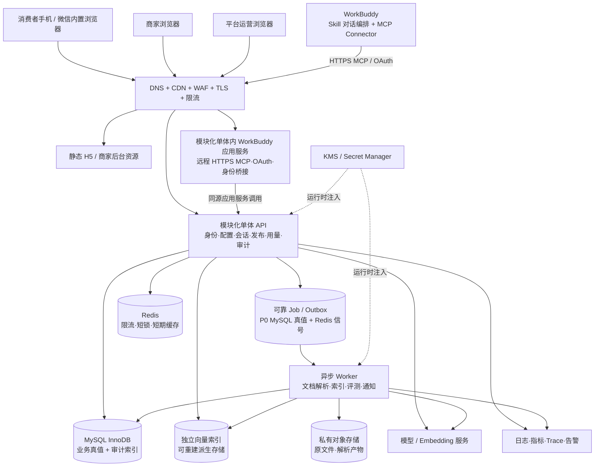

# H5 AI 客服生成与管理平台：平台、安全、交付与 WorkBuddy Skill 设计

> - 文档状态：持续演进的设计基线，供产品、研发、安全、测试和运维评审；WorkBuddy Skill、Connector 非秘密元数据、本地 Streamable HTTP MCP 四工具适配层、OAuth MySQL仓储及第三方应用身份桥安全骨架已形成，完整生产 OAuth/身份适配、远程部署、上架审核与实机验证尚未完成。
> - 需求依据：`H5_AI客服生成与管理平台_产品需求分析_V1.0.md`（2026-09-20）。
> - 首版目标：在 4～7 周参考窗口内形成 3～5 家同类商家可试用的最小闭环；时间目标不是交付承诺。
> - 术语：本文的“租户”即 `Merchant`；“客服”即 `Assistant`；“发布版本”即不可变 `Release`。

## 1. 设计目标、边界与基线

### 1.1 必须保持的产品不变量

1. **商家级知识共享、消费者会话隔离**：同一商家的已发布知识可被其消费者会话使用；任何访客上下文、消息、摘要和需求状态不得跨 Session 或跨商家流动。
2. **公开入口不等于授权**：公开客服标识只负责定位 H5 客服，不授予会话读取、后台访问或管理 API 权限。
3. **草稿与线上版本分离**：编辑、知识处理和 AI 整理先落草稿；只有显式发布成功后才生成不可变 Release。固定 H5 地址不随发布改变。
4. **事实有据、执行有真值**：价格、库存、预约、订单和退款等事实只能来自已确认资料或真实业务接口；检索、模型或外部系统失败不得被包装成成功。
5. **在线接待独立运行**：消费者 H5、Session、模型调用和用量均由在线平台承载；关闭 WorkBuddy、关闭 Skill 或 WorkBuddy 额度耗尽均不得中断已发布 H5。
6. **所有写操作可重试**：创建、消息提交、需求提交、知识导入、发布与回滚均须有幂等键或等价的唯一约束；并发更新须检查版本冲突。

### 1.2 P0 范围与非目标

P0 平台能力包含：商家后台、消费者 H5、运营入口、管理 API、对话编排、知识处理、版本发布、异步任务、用量、审计和 WorkBuddy 接入。首版采用模块化单体，不为“以后可能扩容”提前拆成微服务。

以下不在 P0：语音/数字人、跨 Session 个人长期记忆、自动将消费者发言升级为知识、真人坐席系统、订单/预约/支付/退款执行、多区域双活、复杂团队组织模型。设计可预留实体与接口，但不得让预留项扩大首版攻击面或测试面。

### 1.3 建议值与待确认值

文中标注“建议基线”的数值用于让设计可测试，并非已经批准的业务承诺。上线前必须确认：部署地域与合规要求、身份供应商、数据保留期、可用性目标、RPO/RTO、模型供应商、商家额度规则、首批行业、WorkBuddy 目标客户端版本，以及第三方应用/Connector 的注册、审核和上架排期。上架 WorkBuddy 的产品方向已确定，未决的是实现与平台准入细节，而不是是否接入。

## 2. 部署拓扑与运行边界

### 2.1 P0 逻辑拓扑



部署单元建议只有三类：静态前端、API 进程和 Worker 进程。图中的 WorkBuddy 应用服务是模块化单体 API 进程内的逻辑接入模块，与商家后台共用身份、权限、业务服务、审计和事实存储，不是第四类部署单元，也不另建业务真值。API 与 Worker 可来自同一代码库和镜像，但使用不同启动入口、资源配额和网络权限。业务事实库使用**托管私网 MySQL InnoDB**，应用以校验服务端证书的 TLS 连接；对象存储和缓存也优先采用托管服务。P0 可靠任务以 MySQL Transactional Outbox/Job 表为真值，Redis 只做短期唤醒/流信号，吞吐证明需要后再迁移托管消息队列。所有数据服务位于私网，不直接暴露公网。

### 2.2 信任区与网络策略

| 信任区 | 组件 | 入站 | 出站 | 强制控制 |
| --- | --- | --- | --- | --- |
| 公网不可信区 | 消费者、商家浏览器、WorkBuddy | 无 | 仅 HTTPS | 所有输入不可信；不得接受客户端声明的租户权限 |
| 边缘区 | CDN/WAF/网关 | 443 | 到 Web/API | TLS 1.2+；请求体与速率限制；统一请求 ID；拒绝异常 Host |
| 应用区 | API、Worker | 仅网关或队列 | 数据层、受控第三方 | 最小网络出口；API 与 Worker 使用不同服务身份 |
| 数据区 | MySQL、向量索引、Redis、对象存储 | 仅应用区 | 必需的备份目标 | 私网；MySQL TLS 且校验证书；静态加密；租户过滤；无公共桶；短期签名 URL |
| 管理区 | CI/CD、观测、密钥与堡垒入口 | 受控身份 | 部署与只读诊断 | MFA、审批、审计、生产写权限临时化 |

生产环境默认拒绝任意公网出站，只允许模型、Embedding、短信/通知（若启用）以及经实机验证后选定的 WorkBuddy 认证/接入域名。文档解析器不得直接访问上传内容中的 URL；未来若支持网页抓取，应放入独立沙箱并配置 DNS/IP 双重 SSRF 防护。

### 2.3 运行与扩展策略

- API 无状态化；实例水平扩展。Session 真值在数据库，短期流式连接状态可位于单实例但不得成为恢复依据。
- 同一 Session 的消息写入通过 MySQL InnoDB 事务、单调序号、唯一约束与短锁/队列串行化，不能依赖负载均衡会话粘滞；死锁或锁等待超时时只按幂等规则做有界重试。
- Redis 仅保存限流、短锁、幂等热点缓存和可重建缓存，不能保存唯一业务真值。
- 知识解析、Embedding、批量评测均经可靠 Job/Outbox 异步执行；任务至少一次领取/投递，Worker 必须幂等，Redis 丢失不能造成任务真值丢失。
- 向量索引是可重建派生物，不与 MySQL 业务事务绑定，也不默认采用 `pgvector`。原始知识、分块版本、Embedding 模型版本和索引 manifest 以 MySQL/对象存储为准；索引丢失时可重建且未就绪版本不得发布。
- 模型供应商通过服务端适配层接入。密钥、基础 URL 与模型名称不得进入前端、客服配置、知识内容或 Skill 包。

## 3. 环境、配置与密钥

### 3.1 环境划分

| 环境 | 用途 | 数据规则 | 外部调用 | 发布规则 |
| --- | --- | --- | --- | --- |
| Local | 单元开发和本机联调 | 仅合成数据 | 默认 Mock | 开发者本机，不共享密钥 |
| Dev | 持续集成后的共享联调 | 合成/脱敏种子数据 | 沙箱模型或严格小额度 | 自动部署，可随时重建 |
| Test | 自动化集成、安全和性能测试 | 固定夹具，多租户数据集 | Mock + 少量真实模型评测 | 由流水线创建/销毁或重置 |
| Staging | 生产同构、发布演练、WorkBuddy 测试商家 | 禁止复制未脱敏生产数据 | 供应商测试账号 | 与生产同构的受控发布 |
| Production | 正式试点/服务 | 真实数据 | 正式受控账号 | 审批门禁、渐进发布、可回滚 |

各环境使用独立 MySQL 实例/集群、对象桶、向量索引、缓存、加密密钥、域名和第三方凭据。生产密钥不得下发到 CI 普通 Job；非生产环境不得连生产 MySQL、生产向量索引或生产对象桶。

### 3.2 配置分类

| 类别 | 示例 | 存储与变更方式 |
| --- | --- | --- |
| 非敏感部署配置 | 日志级别、超时、任务并发、域名、功能开关 | 版本化环境配置；Schema 校验；评审后发布 |
| 密钥 | DB 密码、模型密钥、OAuth 签名密钥 | Secret Manager/KMS；运行时按服务身份读取；禁止进 Git |
| 商家业务配置 | 欢迎语、风格、范围、营业时间 | 业务数据库草稿；通过 Release 发布 |
| 运行策略 | 限流、额度、最大输入、文件大小 | 平台配置，变更留审计；高风险项双人复核 |
| 功能开关 | 新解析器、新模型、Skill 写操作 | 环境与租户级开关；有所有者、失效日期和回退值 |

应用启动时对必需配置做类型、范围和依赖校验，关键配置缺失应拒绝启动；不得静默使用不安全默认值。密钥支持轮换和双密钥过渡；日志只记录密钥引用版本，不记录密钥值。

### 3.3 建议基线参数

以下数值先作为试测起点，必须由容量、模型和目标 WorkBuddy 客户端测试确认：API 普通请求 15 秒；远程 MCP 单次工具调用服务端硬上限先设 25 秒；模型首段超时 5 秒、完整生成上限 60 秒；上传 PDF 20 MB/200 页；用户单条文本 4,000 字符；请求体总上限 25 MB。异步任务超过同步窗口立即返回 `job_id`，不得让任何 WorkBuddy 调用长时间悬挂。

## 4. 身份、权限与租户隔离

### 4.1 身份类型

| 主体 | 身份方式 | 会话/令牌 | 主要权限 |
| --- | --- | --- | --- |
| 消费者访客 | 随机匿名访客凭据 | `HttpOnly + Secure + SameSite` Cookie；服务端只存哈希 | 仅创建/恢复自己在指定客服下的 Session、发送消息、提交需求 |
| 商家用户 | 经批准的 OIDC/OAuth 或邮箱验证登录 | 短期访问会话 + 可撤销刷新机制 | 仅本租户配置、知识、发布、咨询和用量 |
| 平台运营 | 企业身份源 + MFA | 短时会话；高风险操作再认证 | 按岗位访问；查看会话正文需业务理由并留痕 |
| WorkBuddy 用户 | 目标为 WorkBuddy 第三方应用 OAuth 主体经安全网页绑定到平台用户；`open_id` 只取服务端换票结果，身份桥接细节待验证 | WorkBuddy Open API 票据只在服务端使用；Connector 通过 OAuth 2.1 + PKCE 获取本平台短期、可撤销、限 audience/商家/scope 的令牌 | scope 与商家角色交集，不获得平台运营能力；不得用昵称、手机号或用户自报 `open_id` 认领账号 |
| 服务身份 | 云工作负载身份 | 短期凭据 | API、Worker、CI 各自最小权限 |

匿名访客凭据至少 128 bit 随机，不包含租户、手机号等可读信息。后端恢复 Session 时必须同时校验访客凭据哈希、`merchant_id`、`assistant_id`、Session 状态和有效期；只提供 `session_id` 永远不足以读取数据。

### 4.2 权限模型

P0 可先实现以下角色，UI 是否全部开放由产品决定：

| 角色 | 配置/知识 | 测试 | 发布/回滚 | 咨询正文 | 商家成员与额度 |
| --- | --- | --- | --- | --- | --- |
| MerchantOwner | 读写 | 是 | 是 | 是 | 是 |
| MerchantEditor | 读写 | 是 | 需授权或是 | 是 | 否 |
| MerchantViewer | 只读 | 只读 | 否 | 按需只读 | 否 |
| PlatformSupport | 否 | 否 | 紧急暂停可选 | 临时授权、说明理由 | 只读状态 |
| PlatformAdmin | 模板/状态 | 否 | 紧急暂停 | 仍需受控访问 | 平台管理 |

最终决策为 `allow = identity有效 ∧ action在role/scopes内 ∧ subject.merchant_id == resource.merchant_id ∧ resource状态允许 ∧ 高风险条件已满足`。权限校验必须在服务层统一执行，不能只在前端隐藏按钮或只依赖 API 路由分组。

### 4.3 数据层隔离的纵深防御

1. 所有租户实体以不可变 `merchant_id` 为首要归属字段；子实体同时保留必要的 `assistant_id/session_id/release_id` 外键。
2. Repository/DAO 接口要求显式传入租户上下文；禁止通用 `findById(id)` 直接访问租户实体。
3. **MySQL 不提供本项目可依赖的原生 Row Level Security 兜底。** 每次租户数据访问必须由服务层建立不可为空的 `TenantContext`，Repository 查询把 `merchant_id` 作为强制谓词；代码评审、静态规则、SQL/ORM 集成测试和跨租户攻击测试共同阻断裸主键查询。
4. 所有复合唯一键、复合外键与索引包含 `merchant_id` 或可证明的完整归属链，例如子表引用 `(merchant_id, parent_id)`；防止跨租户父 ID 被错误关联。MySQL DDL 必须验证列类型、长度、字符集和排序规则一致，确保复合外键真实生效。
5. 向量检索先由服务端注入 `merchant_id + assistant_id + release_id` 过滤，不接收模型或客户端自报的过滤条件；检索结果返回后再次校验归属。
6. 对象键使用内部随机 ID 和租户前缀；上传、下载采用短期签名 URL，且下载签发前重新授权。桶默认私有。
7. 缓存键、限流键、分布式锁和队列 payload 都包含租户维度；消费任务时重新从数据库校验归属和目标状态。
8. 分析与日志中的租户、访客和 Session 标识使用内部 ID 或稳定哈希，不将手机号、Cookie、Token 当标签。
9. MySQL 账号按用途分离：在线 API 和 Worker 仅有必需 DML 权限且无 DDL/授权能力，迁移账号仅在发布窗口临时使用，备份/只读诊断使用独立账号；禁止应用使用 `root` 或通配全库高权限账号。

### 4.4 发布与敏感操作授权

- 发布、回滚、紧急暂停、恢复服务、导出/删除数据、查看消费者正文属于敏感操作。
- 商家发布必须指定准确的 `draft_revision`，展示差异摘要并进行显式确认；平台不得替 Skill 猜测确认。
- 平台运营查看会话正文需要工单/原因、有限时间授权和审计；默认列表可显示聚合状态而非正文。
- 紧急暂停可立即影响所有 Session，但恢复、结束旧 Session 等后续动作必须单独确认。

## 5. 审计、隐私与数据治理

### 5.1 数据分级

| 级别 | 数据 | 处理要求 |
| --- | --- | --- |
| S0 公开 | 已发布 H5 展示配置、公开客服标识 | 可经 CDN；仍需防篡改和版本控制 |
| S1 内部 | 模板、聚合指标、非敏感运行配置 | 登录后访问，最小共享 |
| S2 商业敏感 | 商家知识、配置草稿、发布差异、用量 | 租户隔离、静态/传输加密、访问审计 |
| S3 个人/高敏 | 消费者消息、联系方式、需求、访客凭据、密钥 | 最少收集、字段级遮罩、严格访问、密钥单独管理 |

消费者不应被强制留下联系方式才能咨询。需求表单在收集前展示用途；每个字段说明必填性，业务不需要的字段不得收集。模型供应商的数据保留、训练使用和地域条款必须在选型评审中确认。

### 5.2 审计事件

审计记录与普通应用日志分开，至少包含：`audit_id`、UTC 时间、actor 类型与 ID、角色/scopes、`merchant_id`、动作、资源类型与 ID、请求/trace ID、结果、失败码、来源 IP/客户端（最少化）、变更前后摘要、理由/工单号。不得记录 Token、Cookie、完整密钥、完整文件内容或无必要的消息正文。

必须审计：登录与失败、授权/撤销、角色变更、知识导入/删除、配置修改、发布/回滚/暂停、额度调整、正文查看、数据导出/删除、密钥轮换、Skill 意图、MCP 工具名、管理 API 调用及其真实执行结果。审计库采用追加写；删除/篡改权限不授予在线应用。建议将每日摘要哈希写入独立受限存储，便于发现篡改。

### 5.3 保留与删除

保留期是上线阻断决策。建议先定义按数据类配置的策略，而非一个全局天数：消息/摘要/Lead、原文件、解析产物、向量、操作日志、审计、用量、备份各自有期限。删除流程必须：

1. 验证请求者和作用域，记录删除任务；
2. 删除在线业务数据及派生摘要、Embedding、缓存和对象；
3. 对依法/合同需保留的审计或结算记录做最少化保留并与正文解耦；
4. 备份不做在线点删时，明确不可恢复性隔离和最长自然过期时间；恢复备份后重新执行删除墓碑；
5. 产出可查询的完成/部分失败状态，不返回虚假“已删除”。

在法务确认适用地域和主体角色前，本文不对具体法律保留期限作结论。

## 6. 威胁模型与防护

### 6.1 主要威胁与控制

| 威胁 | 典型路径 | 预防控制 | 检测/响应 |
| --- | --- | --- | --- |
| 跨租户 IDOR | 替换 merchant/session/assistant ID | 强制 TenantContext、服务层 ABAC、所有查询含 tenant 谓词、MySQL 复合归属外键/唯一键、不可枚举 ID；明确无 RLS 兜底 | 跨租户拒绝指标；SQL/ORM 租户断言；同源大量 403 告警 |
| 匿名 Session 劫持 | 猜测或泄露 session ID | 高熵访客凭据、Cookie 安全属性、只存哈希、短期有效 | 异常设备/IP 变化与恢复失败监控 |
| 提示词注入越权 | 消费者或知识内容要求泄露密钥/改配置 | 对话服务无管理工具；系统规则与资料分层；外部内容标记不可信 | 越权意图评测、敏感输出扫描、样本复盘 |
| RAG 数据泄露 | 向量过滤缺失或缓存串租户 | 服务端强制租户/版本过滤、结果二次校验、租户缓存键 | Canary 文档跨租户测试、检索审计 |
| 发布篡改/误发布 | 重放发布、并发覆盖、Skill 自行确认 | 凭据 scope、If-Match、幂等键、差异预览、显式确认 | 发布审计、异常频率告警、快速回滚 |
| 重试导致重复副作用 | 网络超时后重复建客服/Lead/记账 | `Idempotency-Key`、MySQL 唯一约束、同事务 Outbox、幂等消费者 | 重复键冲突指标、账务对账 |
| 消息乱序 | 多标签/快速重发 | Session 级序号、期望版本、短锁、失败不写完成结果 | 序号缺口/冲突指标 |
| 文件攻击 | 恶意 PDF、压缩炸弹、解析器漏洞 | 类型/魔数/大小/页数校验、恶意软件扫描、无网沙箱、资源限制 | 解析崩溃/超限告警；隔离文件 |
| SSRF/内网探测 | 文档链接、模型工具、回调 URL | P0 不抓外链；出口白名单；阻断私网/metadata IP；DNS 重绑定防护 | 出口日志、被拒目的地址告警 |
| XSS/内容注入 | 模型回复或商家文本含 HTML | 默认纯文本渲染；Markdown 白名单净化；CSP；禁内联脚本 | CSP report、前端安全测试 |
| CSRF/CORS | 诱导商家执行管理写操作 | SameSite、CSRF Token/Origin 校验、精确 CORS；Bearer 不放 URL | Origin 异常和 CSRF 失败监控 |
| DoS/费用消耗 | 匿名刷模型、超长上下文、批量上传 | IP+访客+商家多维限流、配额预检、输入/上下文限制、队列背压 | Token/成本突增、429、队列深度告警 |
| 密钥泄露 | 前端包、日志、Skill 包、CI 输出 | Secret Manager、扫描、脱敏、短期凭据、最小权限、轮换 | Secret 扫描、异常调用；立即吊销轮换 |
| 供应链攻击 | 依赖、镜像、第三方 Skill 脚本 | 锁定依赖、SCA/SBOM、签名制品、最小 `allowed-tools`、来源审查 | CVE 门禁、制品校验、连接器紧急下架 |
| 运营滥用 | 无理由查看消费者消息 | 岗位分权、临时授权、正文遮罩、不可变审计 | 定期访问复核、异常查询告警 |
| 日志隐私泄露 | 请求体/Token 进入日志 | 结构化字段白名单、集中脱敏、生产禁 body dump | DLP/关键模式扫描、日志访问审计 |
| 第三方不可用 | 模型、Embedding 或 WorkBuddy 故障 | 超时、熔断、退避、异步任务、清晰降级；H5 不依赖 WorkBuddy | 供应商 SLI、熔断告警、状态页与运行手册 |

### 6.2 AI 特有防线

- 系统指令、商家配置、检索资料、Session 消息分层组装；知识与用户内容均作为数据，不得被解释为平台授权指令。
- 对话运行身份不具有配置修改、知识写入、发布、租户枚举或密钥读取能力。即使模型被诱导，也没有可调用的管理工具。
- 输出前执行事实与动作边界检查：无依据价格、实时库存/预约/订单/退款成功等必须转为“不确定/需联系/仅登记”。
- 记录引用的内部知识 chunk/release ID 供后台追溯，但不向消费者泄露内部对象路径、其他资料或系统提示词。
- 模型安全测试使用固定攻击集并版本化；模型、Prompt、检索或模板升级均重新运行回归集。

### 6.3 安全响应最低闭环

准备以下运行手册：疑似跨租户泄露、密钥泄露、恶意文件、模型成本失控、认证故障、数据库故障、发布错误、第三方大面积超时。每份手册包含：分级标准、当班负责人、止血开关、证据保全、密钥轮换、租户通知决策、恢复验证和复盘模板。

## 7. 可观测性与告警

### 7.1 统一关联模型

所有入口生成或校验 `request_id`，全链路携带 W3C Trace Context。日志/Trace 可记录：`trace_id`、`request_id`、服务、环境、路由模板、actor 类型、`merchant_id`/`assistant_id`/`session_id` 的内部 ID 或哈希、`release_id`、`job_id`、模型/Prompt 版本、耗时、状态码、稳定错误码、输入/输出 token 数和费用估算。

禁止记录：Authorization、Cookie、OAuth code、访客原始凭据、模型密钥、完整手机号/邮箱、文件正文、默认完整消息或 Prompt。错误堆栈进入受限日志；展示给用户的是稳定错误码和安全文案。

### 7.2 指标

| 层面 | 核心指标 |
| --- | --- |
| 边缘/API | 请求量、2xx/4xx/5xx、P50/P95/P99、429、在途请求、连接中断、流式首段耗时 |
| 会话 | Session 创建/恢复/过期、新咨询、消息成功/失败/重复/顺序冲突、平均轮数 |
| AI/RAG | 检索耗时与命中数、无依据率、拒答/越界率、模型首 Token/总耗时、供应商错误、token/成本 |
| 知识任务 | 队列深度/最老任务年龄、解析/索引成功率、重试与死信、每文件耗时 |
| 发布 | 草稿到发布转化、发布成功/失败、回滚、版本冲突、链接探活 |
| 安全 | 登录失败、403、跨租户归属拒绝、CSRF、恶意文件、Secret/DLP 命中、运营正文访问 |
| MySQL | 连接池占用/等待、`Threads_connected`/连接错误、QPS/TPS、事务提交/回滚、行锁等待、死锁、慢查询与执行计划退化、InnoDB buffer pool 命中/脏页、临时表、复制延迟、binlog 生成/保留/应用状态、存储使用与增长 |
| 其他资源 | API/Worker CPU/内存、Redis 命中/淘汰/内存、Outbox/Job 积压、向量索引延迟/容量、对象存储错误与容量 |
| 业务 | PRD 定义的发布完成率、回答正确率、未解决比例、需求提交率、单次有效咨询成本 |

高基数字段不得作为指标标签；Session、访客和请求 ID 只进入可采样日志/Trace。

### 7.3 建议 SLI/SLO

| SLI | 建议初始目标 | 统计口径 |
| --- | --- | --- |
| 消费者入口可用性 | 月度 99.9% | 排除计划维护后，H5 配置加载和消息受理成功 |
| 管理 API 可用性 | 月度 99.5% | 合法请求非 5xx/非平台超时 |
| 首段回复延迟 | P95 ≤ 5 秒 | 已约定网络/模型/负载，排除客户端主动断开；对应 PRD 待试测目标 |
| 消息持久化正确性 | ≥ 99.99% | 受理成功的消息可按序读取且无重复副作用 |
| 知识任务时效 | 95% 在约定窗口完成 | 按文件大小分桶，具体窗口经试测确定 |
| 发布一致性 | 100% | 发布成功时 Release、索引和固定链接指向一致；否则整体失败 |

SLO 未经评审前仅用于压测和告警调优。采用错误预算后，预算耗尽时暂停高风险功能发布，优先可靠性修复。

### 7.4 告警分级

| 等级 | 示例 | 响应 |
| --- | --- | --- |
| P0 | 已确认跨租户泄露、密钥泄露、数据不可恢复、全站不可用 | 立即通知值班与负责人；先隔离/止血；持续同步 |
| P1 | 5xx/延迟持续超 SLO、模型调用大面积失败、MySQL 连接耗尽/复制或 binlog 异常/死锁突增、Job 积压、数据层逼近容量、成本突增 | 15 分钟内响应，按运行手册处置 |
| P2 | 单租户任务积压、解析失败率上升、备份或证书临近失败 | 工作时段处理并跟踪根因 |
| P3 | 趋势、容量预测、低频错误 | 纳入计划，不触发夜间通知 |

告警以“影响用户且可行动”为原则，使用多窗口燃烧率减少抖动；每个 P0/P1 告警必须链接运行手册、仪表盘和近期变更。

## 8. 备份、恢复与业务连续性

### 8.1 数据恢复分级

| 数据 | 真值/派生 | 备份策略 | 建议 RPO / RTO |
| --- | --- | --- | --- |
| MySQL InnoDB 业务数据（含 Outbox/Job） | 真值 | 托管私网高可用；自动快照；持续 binlog 并启用 PITR；备份加密；恢复凭据隔离 | RPO ≤ 15 分钟 / RTO ≤ 4 小时 |
| 审计记录 | 真值 | 独立追加写存储 + 定期归档 | RPO ≤ 15 分钟 / RTO ≤ 8 小时 |
| 私有对象 | 真值/可重处理输入 | 版本控制或不可变备份、生命周期管理 | RPO ≤ 24 小时 / RTO ≤ 8 小时 |
| 向量索引 | 派生 | 可选快照；必须可从 MySQL 中的 Release/知识 manifest 与对象存储重建 | RPO 不单独承诺 / 重建 ≤ 24 小时 |
| Redis/缓存 | 非真值 | 不要求业务备份 | 丢失后自动恢复 |
| CI 制品与配置 | 发布依据 | 不可变制品库、Git 与签名元数据 | RPO ≤ 24 小时 / RTO ≤ 4 小时 |

以上为建议基线，需根据试点损失评估确认。MySQL 客户端连接强制 TLS 并校验证书；备份与 binlog 加密，访问权与生产运维分离；至少一个快照/备份副本与主账号或主故障域隔离。binlog 保留时间必须覆盖承诺的 PITR 窗口和发现数据损坏所需时间，不能只按成本默认缩短。

### 8.2 恢复流程

1. 判断故障范围并冻结可能扩大损害的写入；保全日志和审计证据。
2. 从 MySQL 快照恢复后在隔离网络按目标 binlog 位点/时间完成 PITR；禁止直接覆盖在线实例。验证 Schema、字符集/排序规则、复合归属外键与唯一键、租户计数、Release/索引引用、Outbox/Job、幂等记录和审计连续性。
3. 确认隔离恢复库无应用写流量，再重建派生向量索引与缓存；恢复数据删除墓碑，避免被删除数据因备份恢复重新可见。
4. 切流前执行 A03、A05～A09、A13 的关键冒烟；确认固定 H5 链接和当前 Release。
5. 恢复后对账消息、Lead、Usage 与模型调用；记录实际 RPO/RTO 和改进项。

每日自动验证 MySQL 快照与 binlog/PITR 链路，首版上线前至少完成一次“快照 + binlog 到指定时间点”的隔离恢复演练；试点阶段每季度演练，重大 Schema/拓扑变更后追加演练。只看到“备份成功”不算恢复能力已验证。

## 9. CI/CD 与发布治理

### 9.1 流水线门禁


最低门禁：代码评审、锁定依赖、许可证策略、Secret 扫描、SAST、SCA、容器与 IaC 扫描、单元/集成/契约测试、MySQL 迁移前后兼容测试、SBOM、不可变镜像摘要和制品签名。租户 Repository 静态规则、真实 MySQL 跨租户测试、复合归属约束检查任一失败均阻断发布；高危漏洞或 Secret 命中同样阻断，例外必须有所有者、风险说明和到期日。

### 9.2 发布规则

- 主干保持可发布；短分支 + PR。生产只能部署流水线生成的已签名制品，禁止在服务器手工改代码。
- 应用发布与商家 Release 是两条独立版本链：前者改变平台程序，后者改变某客服配置/知识；两者都可追溯，但不可混用版本号。
- MySQL 迁移遵循 expand → 双读/双写（若需要）→ 分批回填 → 切换 → contract，禁止新版本尚未稳定就删除旧字段。迁移须在与生产相同 MySQL 主版本、`sql_mode`、字符集和排序规则上验证，并评估 DDL 元数据锁、表重建、复制/binlog 压力和回滚路径。
- 生产变更前验证连接/事务余量、慢查询基线、复制状态、binlog/PITR 连续性和最近可恢复快照。大表 DDL 或回填使用在线/分批方案并设置停止阈值；不能以“可回滚应用镜像”代替数据恢复计划。
- 先部署向后兼容的 API/Worker，再切流；队列 payload 带 schema version，滚动升级期间新旧消费者均可安全处理。
- 生产先内部/测试租户灰度，再按小流量或租户分批；观察错误率、延迟、成本、跨租户拒绝和消息重复后扩大。
- 自动回滚只用于已知安全的应用制品；数据库破坏性迁移、数据修复和商家知识发布使用专门恢复流程。
- Feature Flag 必须有默认值、环境/租户范围、负责人、清理日期和审计。紧急 Kill Switch 覆盖新模型、新解析器、Skill 写操作和消费者新消息受理。

### 9.3 生产变更权限

CI 服务身份只能部署指定环境，不可读取业务正文。生产部署需要至少一名非提交者批准；安全热修可走应急流程，但事后补审计与复盘。云控制台长期管理员最小化，日常运维使用临时提权。

## 10. 测试策略

### 10.1 测试金字塔

| 层级 | 重点 | 执行频率 |
| --- | --- | --- |
| 静态与 Schema | 类型、Lint、OpenAPI/JSON Schema、依赖、Secret、IaC | 每次提交/PR |
| 单元/属性测试 | 权限判定、Session 状态机、幂等、版本选择、费用计算、脱敏、事实边界 | 每次 PR，数量最多 |
| 组件测试 | API + 与生产主版本/`sql_mode`/字符集一致的真实 MySQL、Redis 与 Job/Outbox；Repository TenantContext 和复合归属约束；解析器沙箱 | 每次 PR/合并 |
| 契约测试 | 前后端、Worker 事件、模型适配器、WorkBuddy Skill 意图 ↔ MCP Tool ↔ 同源应用服务/API | 每次合并；供应商变更时 |
| 集成测试 | 知识到索引、对话到 Usage、发布事务、Connector OAuth、身份桥接、凭据撤销与审计 | 每次合并/夜间 |
| E2E | 商家创建→知识→试聊→发布→H5→咨询→需求；WorkBuddy 闭环 | Staging、候选发布 |
| 安全测试 | SAST/DAST/SCA、越权、上传、注入、SSRF、XSS、CSRF、速率限制 | PR 门禁 + 周期性 |
| AI 评测 | 事实正确、拒答、连续上下文、提示注入、引用与稳定性 | Prompt/模型/知识链路变更 |
| 性能/韧性 | 首段 P95、并发、长对话、队列背压、供应商超时、恢复 | 候选发布/容量变更 |

AI 输出不能只做逐字断言。确定性部分断言结构化状态、引用、工具调用和禁止事实；自然语言部分采用规则评分 + 人工抽检，模型裁判只能作为辅助且需校准。固定评测集不得混入训练或商家生产知识。

### 10.2 测试数据与证据

标准夹具至少包含：商家 M1/M2；每家客服 A/B（即使 P0 UI 只开放一个）；匿名访客 V1/V2；多个有效、过期和结束 Session；冲突/过期知识；不可解析 PDF；单台起步价但无双台优惠；营业时间但无预约容量；包含提示注入文本的知识与用户消息。

每个验收用例保存：构建/模型/Prompt/Release 版本、数据夹具版本、请求/trace ID、输入、结构化断言、脱敏输出、审计事件和最终结果。线上抽检样本去标识化并限制访问。

### 10.3 A01～A14 验证矩阵

| 编号 | 主要层级 | 核心步骤与断言 | 必留证据 |
| --- | --- | --- | --- |
| A01 创建与生成 | 单元、API 集成、E2E、AI 评测 | 用行业/介绍生成可编辑草稿；字段来源可区分用户输入与 AI 建议；缺失价格保持空/待补，不出现编造价格；重复幂等键只创建一次 | 草稿 JSON、来源标记、审计、幂等记录、输出评分 |
| A02 知识处理失败 | 解析器组件、队列集成、E2E、安全 | 上传不支持格式、加密/损坏/扫描型 PDF、恶意/超限文件；状态为失败或需处理并返回稳定原因；可安全重试；任何失败内容不进入可用索引 | 文件哈希、任务状态流、错误码、扫描/沙箱日志、索引查询结果 |
| A03 发布与链接 | API/事务集成、E2E、契约 | 未满足条件禁止发布；发布成功才返回固定可访问链接；Release 不可变；相同幂等键不重复建客服/Release；部分失败不得切换当前版本 | Release/索引/指针事务记录、链接冒烟、审计、重复请求对比 |
| A04 范围与资料不足 | 策略单元、AI 回归、人工抽检 | 越界问题简短引导；双台价格无依据时只说明起步价条件并最少追问；不得承诺优惠、库存、名额或执行结果 | 固定问答集、引用 chunk、禁止事实规则结果、人工评分 |
| A05 连续上下文 | Session/需求状态单元、E2E、AI 回归 | 先说“两台挂机”再问“周六呢”；继承数量与服务类型，不重复问已给信息；营业时间不能推导预约名额；纠正数量后覆盖且保留来源 | 消息序号、需求状态前后快照、摘要、模型输入引用、回复 |
| A06 同商家不同访客 | API 集成、并发 E2E、安全 | M1/V1 与 M1/V2 并行咨询；交换 session ID/Cookie；V1 的数量、地址、消息、摘要、Lead 不得出现在 V2 检索或回复 | 403/404、DB 查询轨迹、缓存键检查、Canary 文本零泄露 |
| A07 跨商家隔离 | Repository 属性测试、真实 MySQL/API/向量/对象集成、渗透 | 用 M1 身份替换 M2 的 assistant/session/release/file/chunk ID；验证缺失 TenantContext 直接失败，裸主键 Repository 不存在；列表、详情、搜索、下载、任务均拒绝；复合外键阻止跨租户关联；向量检索不返回 M2 Canary | 各资源矩阵、生成 SQL/授权日志、MySQL 约束失败、对象签名拒绝、向量结果；明确不依赖 RLS |
| A08 刷新与新咨询 | 浏览器 E2E、Session 状态机、时间控制 | 有效 Cookie 刷新/短暂离开恢复；主动新建结束旧 Session；30 分钟建议阈值用可控时钟测试；新 Session 不继承旧需求；丢 Cookie 不能凭 ID 恢复 | Session 状态/时间线、浏览器存储、需求快照、恢复响应 |
| A09 版本更新 | 发布集成、并发 E2E | S1 固定 R1；发布 R2 后新 Session 用 R2，S1 按既定策略仍用 R1；固定链接不变；暂停立即生效；删除知识在 R2 不可检索 | Session→Release 绑定、链接对比、R1/R2 检索、暂停审计 |
| A10 需求与联系 | API 单元/集成、E2E | 重发相同提交请求只生成一条 Lead；联系方式可缺省；用途提示可见；未配置真人坐席时不显示/不声称“已转接”，提交仅表示已登记 | Lead 唯一约束、幂等结果、UI 截图/DOM、回复断言 |
| A11 异常与暂停 | 故障注入、E2E、韧性 | 注入模型超时/限流、额度不足、队列/索引失败和暂停；返回可理解且不泄密的文案；失败调用不记成功消息/虚假业务结论，额度与 Usage 对账 | 故障注入配置、错误码、用户文案、消息/Usage/审计对账 |
| A12 Skill 闭环 | Skill 意图/MCP Tool/同源应用服务契约、WorkBuddy 实机 E2E | 测试商家经已验证的身份桥接和 Connector OAuth 完成创建、修改、知识任务查询、试聊、显式发布并取得真实链接；禁用/退出 WorkBuddy 后链接仍可咨询 | WorkBuddy 版本、Skill/Connector 版本、OAuth/身份桥接证据、API trace、审计、链接外部冒烟 |
| A13 重试与并发 | 属性/真实 MySQL 集成、网络故障、负载 | 响应丢失后用相同幂等键重试；消息/Lead/Release/Usage 各只有一次副作用；注入 InnoDB 死锁/锁等待超时验证有界幂等重试；同 Session 并发消息按序或明确 409，不得静默乱序；Job 重复领取无重复索引 | MySQL 唯一键、事务/死锁记录、消息序号、Usage 对账、Job/Outbox 记录、409/重放结果 |
| A14 权限与指令攻击 | 授权单元、DAST、AI 红队、Skill/MCP/API 负向 | 消费者要求改配置/发布/泄露密钥/系统 Prompt；知识中嵌入相同指令；MCP/管理 API 无凭据、错 scope、跨租户均拒绝；Skill 不把资料内容当确认指令 | 攻击集结果、未授权调用应为空、403/404、Secret 扫描、审计 |

### 10.4 发布阻断条件

任何 A06、A07、A13 的重复计费/重复 Lead、A14 管理越权、Secret 高危泄露、MySQL 快照 + binlog 无法隔离恢复、向量索引无法从真值重建或发布部分成功，均为无条件阻断。任何租户查询缺少强制 TenantContext、发现裸主键跨租户路径、复合归属约束未生效、生产 MySQL TLS/最小权限账号未验证，也必须阻断。A04/A05 的事实正确率和 A11 降级质量需达到评审确定阈值；未定阈值本身是上线阻断项。

## 11. WorkBuddy 官方能力核验与安全契约

### 11.1 核验口径与结论先行

本节截至 **2026-09-21** 只采用 WorkBuddy 官方一手资料（`open.workbuddy.cn`、`www.workbuddy.cn`）。状态含义如下：

- **已证实**：官方当前文档明确描述该能力；仍不等于目标账号、灰度、客户端版本已实测可用。
- **待实机验证**：官方有相关描述，但与目标版本、账号权限、渲染/回调行为或本项目组合方式有关，必须保留客户端录屏、网络记录和服务端审计作为证据。
- **不可假设**：官方资料没有给出该保证，设计和排期不得依赖；除非后续取得新版官方文档或书面确认并补做实机验证。

结论：**目标形态已经确定为 WorkBuddy Skill 负责对话编排、远程 HTTPS MCP Connector 提供受控工具、平台同源 WorkBuddy 应用服务承接 MCP/OAuth/身份桥接并复用核心业务服务。** 当前四个最小工具、非秘密 Connector 元数据、本地 Streamable HTTP 协议测试，以及401 challenge、双metadata、公共客户端注册、PKCE授权码、MySQL刷新轮换仓储、第三方应用换票/HMAC桥接和MCP JWT测试边界已经存在。这不代表远程服务或可安装包已经完成：托管生产MySQL、正式签名密钥、平台登录/同意会话、持久化bridge/binding、正式图标、远程部署及目标客户端行为仍待实现和验证。官方确有第三方应用OAuth返回`open_id`的能力，但没有证据表明普通Skill或Connector会自动收到该标识，也没有完整说明其生命周期稳定性。因此身份桥接必须经过服务端换票和安全网页登录/手机号+OTP，绝不在聊天中收集密码、OTP、Access Token或API Key。

### 11.2 官方能力证据矩阵

| 核验项 | 官方一手资料所能证明 | 状态 | 本项目约束 |
| --- | --- | --- | --- |
| Skill 结构 | Skill 以 `SKILL.md` 为必选文件，可带 `references/`、`scripts/`、`templates/`；frontmatter 提供用途/触发词、`allowed-tools`、版本、`disable-model-invocation`、`user-invocable` 等字段 | 已证实 | 只声明最小工具白名单；若拆分高风险 Skill 可设为仅手动触发，且发布/回滚仍须服务端二次确认，不能仅靠提示词守权 |
| Skill 安装 | 可从技能市场安装，也可导入本地技能包；已安装 Skill 可在对话中调用 | 已证实 | 私测可以导入包；公开可发现性和审核时长另行确认 |
| Skill 触发 | `description` 要写用途和触发词；未设置 `disable-model-invocation: true` 时可参与模型自动调用，关闭 Skill 后不再参与自动调用 | 已证实 | 自动路由只用于低风险意图；不能把“模型选中了 Skill”当作用户授权或高风险确认 |
| Connector 调用 | 用户安装连接器后可用自然语言调用第三方服务；已有网络 API 时官方推荐 MCP + Skill | 已证实 | 采用远程 HTTPS `streamableHttp` 或 SSE；一个 Connector 只配一个 MCP Server |
| 典型对话提示 | Connector 元数据要求中英文 `examples_zh/examples_en`，建议各 2～5 条真实自然语言；Skill 描述包含用途和触发词 | 已证实 | 市场示例只写创建、查询、修改草稿、测试等安全意图；不提供“一句话直接发布/回滚”示例 |
| Connector OAuth | WorkBuddy 内置 OAuth 管理器采用 OAuth 2.1 + PKCE、公共客户端、动态注册，打开浏览器授权，自动刷新后重试 | 已证实 | 授权服务器属于本平台；公共客户端不持有`client_secret`；必须实现RFC 9728/8414发现、RFC 7591动态注册、PKCE S256、精确`redirect_uri`、一次性授权码、`resource`和audience校验 |
| WorkBuddy 云托管 OAuth | 官方列出 `server-side` / `gateway` 模式，并明确要求接入前与 WorkBuddy 团队确认 | 待实机验证 | P0 不依赖该灰度/协作能力，先实现本平台自托管的标准 MCP OAuth 服务端 |
| Connector Token 表单 | `auth_mode: token` 自 4.23.0 起支持；密码字段可在本机保存并注入 header/env，不经过云端 | 已证实 | 仅作为封闭试点应急路径；凭据只能填在连接器密码字段，永远不在聊天中粘贴 |
| CLI 登录跳转 | CLI 认证可输出 HTTPS URL，WorkBuddy 提取并打开浏览器；支持 `authUrlDomain` 限域，状态轮询最长 5 分钟 | 已证实 | 本项目没有成熟跨平台 CLI，P0 不选择 CLI；该能力只证明官方存在受控浏览器跳转，不外推到任意聊天链接 |
| 表单帮助链接 | Token 表单的 `docUrl` / `docLabel` 会渲染为可点击帮助链接 | 已证实 | 可用于“如何连接账号”帮助页；不得在 URL 中放 Token、OTP、手机号或商家隐私数据 |
| 第三方应用身份 | 经审核启用的第三方应用可走 WorkBuddy OAuth 2.1；换取/刷新 Token 的响应包含 `open_id` | 已证实 | `client_secret` 仅放服务端；`open_id` 只能来自服务端与 WorkBuddy 的授权码换票结果，不能由聊天或工具参数自报 |
| `open_id` 稳定性/注入 | 官方 Open API 另有接口把 `open_id` 描述为按应用隔离的 pairwise 标识，但没有说明不可变期限、账号合并/注销后的语义，也未说明普通 Skill/Connector 自动获得它 | 不可假设 | 不能宣称“WorkBuddy 稳定账号 ID 已可直接传给 Skill/Connector”；需书面确认并实测同账号跨设备、重装、重新授权、注销/重建行为 |
| 用户资料 | `GET /user/profile` 只返回昵称和头像 | 已证实 | 昵称、头像可变且不唯一，禁止作为登录名、租户键或绑定依据 |
| 手机号核验 | `POST /user/phoneverification` 可验证调用方提供的手机号是否匹配当前授权用户，只返回 `matched`，不返回真实或脱敏手机号，需要 `user.contact.readable` | 已证实 | 仅在第三方应用获批该 scope 后作为绑定强化信号；手机号必须在本平台 HTTPS 页面输入，不在聊天输入 |
| Buddy 应用提示 | Buddy 应用支持场景胶囊快捷提示、输入框占位符、预绑定 Skill/Connector，并可在首次进入时跳转内置 MCP OAuth 绑定 | 已证实 | 这是 Buddy 应用能力，不外推到普通 Skill；是否能申请/发布 Buddy 应用待目标主体账号核验 |
| 任意聊天链接/按钮/卡片 | 所查官方 Skill 文档未定义任意 URL 的按钮、卡片、白名单或回调协议 | 不可假设 | Skill 回复中的 Markdown 是否可点击必须实机验证；失败时只展示可复制的官方 HTTPS 域名短链，不使用自定义深链 |
| Skill 获取当前 WorkBuddy 账号 | 所查 Skill/Connector 文档未定义注入当前用户 ID、账号 ID、手机号、邮箱或可信签名用户上下文 | 不可假设 | 工具端不接受 `workbuddy_user_id`、昵称、手机号等模型参数作为已认证主体 |

官方依据：[技能开发文档](https://open.workbuddy.cn/docs/skill)、[WorkBuddy 技能使用说明](https://www.workbuddy.cn/docs/workbuddy/From-Beginner-to-Expert-Guide/Function-Description/Skills-Market)、[连接器开发文档](https://open.workbuddy.cn/docs/connector)、[第三方应用](https://open.workbuddy.cn/docs/third-party-app)、[Open API](https://open.workbuddy.cn/docs/openapi)、[Buddy 应用](https://open.workbuddy.cn/docs/buddy-app)。

### 11.3 身份与账号绑定决策

身份、商家授权和 Connector 凭据是三个不同对象，不得合并：

还必须区分两条同名但方向不同的 OAuth：**第三方应用 OAuth** 是本项目后端取得 WorkBuddy 票据、调用 WorkBuddy Open API；**Connector OAuth** 是 WorkBuddy 作为公共客户端取得本平台票据、调用本项目 MCP/API。两者的 issuer、audience、client、token 和撤销入口都不同，禁止互换或串用。

| 凭据流 | 签发方与客户端 | audience / 接收方 | 保管与刷新 | 明确禁止 |
| --- | --- | --- | --- | --- |
| Connector OAuth token | 本平台授权服务器签发；WorkBuddy 是 OAuth 公共客户端，不持有 `client_secret` | `resource`/`aud` 只能是 `https://h5cs.1rying.com/mcp`；只发往本项目 MCP | WorkBuddy OAuth 管理器持有短期 access token 和本平台 refresh token；本平台负责轮换、撤销和重放检测 | 不得调用 WorkBuddy Open API，不得作为消费者 H5 或商家后台 Cookie，不得透传给下游服务 |
| WorkBuddy Open API token | WorkBuddy 签发；本项目已审核的第三方应用是机密客户端，服务端持有 `client_id`/`client_secret` | 只发往 `https://www.workbuddy.cn/openapi/v2/*` | 只在本项目后端 Secret/凭据存储中保管并按 WorkBuddy 实际 `expires_in` 刷新 | 不得提交给 `/mcp`，不得交给 Skill、Connector、浏览器或模型，不得兑换成 Connector token |

两套凭据必须使用独立的配置命名空间、存储表/记录类型、加密密钥用途、轮换与撤销入口。审计只记录 `credential_type`、issuer、audience/resource、client ID、主体查找键版本、scope、到期时间和结果，不记录 token 值；任何一方的 token 都不能作为另一方的 bootstrap、token exchange 或 pass-through 凭据。

| 对象 | 可信来源 | 用途 | 禁止用法 |
| --- | --- | --- | --- |
| WorkBuddy 外部主体 | 经本项目第三方应用后端换票得到的 `open_id`；只有完成稳定性验证后才启用 | 将同一 WorkBuddy 授权主体关联到绑定流程和审计 | 不从 Skill 参数、昵称、头像或用户自述取值；不把 `open_id` 当作商家权限 |
| 平台用户 | 本平台 HTTPS 页面中的既有登录会话，或手机号 + OTP 成功校验 | 确认真实平台账号 | 不在聊天中传密码、OTP；不只凭手机号文本或 `phoneverification.matched` 登录 |
| 商家授权 | 平台服务端根据用户成员关系和明确选择生成 | 确定唯一 `merchant_id`、角色和 scopes | 不允许模型或普通请求参数切换商家；不从对话历史猜测 |
| Connector 会话 | 本平台授权服务器向 WorkBuddy OAuth 公共客户端签发的 token | 调 MCP/管理 API | 不作为消费者 H5 Token；不在日志、聊天、Skill 包或 URL 中出现 |

身份方案按以下优先级实施：

1. **优先：平台身份联合。** 先将本项目登记为 WorkBuddy 第三方应用并获批最小 scope。浏览器绑定流程通过 WorkBuddy OAuth 获取服务端换票结果中的 `open_id`，以 `(issuer, client_id, open_id)` 作为外部主体候选键；用户仍需在本平台网页登录或用手机号 + OTP，并明确选择商家和授权范围，随后才建立 `external_subject ↔ platform_user ↔ merchant` 绑定。启用前必须取得 `open_id` 稳定性语义并通过 11.9 的实机门禁。
2. **兜底：仅以本平台网页身份绑定。** 若第三方应用资格、scope、`open_id` 稳定性或组合流程未通过，Connector OAuth 仍打开本平台授权页；用户用已有网页会话或手机号 + OTP 登录，选择商家并同意 scopes。本平台以自己的 `sub` 为身份真值，不声称与 WorkBuddy 账号天然一一对应。
3. **纯 Skill 兜底。** 若尚未具备 Connector OAuth，后端先生成一次性绑定事务，Skill 只返回 `https://h5cs.1rying.com/...` 的绑定链接和不含秘密的短码。用户必须在浏览器完成登录或手机号 + OTP；Skill 只轮询“不存在/待完成/已完成/已过期”状态。聊天链接可点击性未实测前不得作为唯一入口，可提示复制到浏览器。
4. **受控 Token 仅限试点。** 只有目标客户端验证 `auth_mode: token` 后，才允许用户在连接器的 `password` 类型表单填入短期、单商家、最小 scope 的 Personal Access Token；不得要求用户在聊天中粘贴。正式公开分发不以此为首选。

`phoneverification` 只表示“调用方提交的手机号与当前 WorkBuddy 授权用户绑定手机号匹配”，不是登录凭证，也不是手机号读取接口。若使用它增强绑定，必须同时满足：第三方应用 OAuth 已完成、获得 `user.contact.readable`、手机号来自本平台安全页面、平台账号自己的 OTP/登录已通过；任一条件缺失都不得自动合并账号。

### 11.4 安全绑定网页与 OAuth 契约

无论走平台身份还是兜底，网页绑定必须满足：

1. 绑定入口使用正式 HTTPS 域名；链接只携带至少 128 bit 熵的一次性随机引用，TTL 建议 5～10 分钟、单次使用、完成即作废，不含手机号、邮箱、`open_id`、商家 ID、Token 或可枚举序号。
2. 页面明确显示发起来源、将绑定的 WorkBuddy/Connector 名称、当前平台账号、商家、申请 scopes、数据用途、有效期和撤销入口；多商家必须让用户主动选择。
3. 账号认证只在本平台网页完成：已有会话需按风险再认证；无会话可使用手机号 + OTP 或其他正式网页登录。密码和 OTP 永不进入 WorkBuddy 对话、Skill 参数、MCP 工具参数、命令行或 URL。
4. 两条 OAuth 分开实施：Connector OAuth 使用 Authorization Code + PKCE S256，并校验 `state`、一次性授权码、精确回调地址、issuer、resource/audience；WorkBuddy 第三方应用按其当前文档使用服务端机密客户端授权码流，必须校验 `state` 和字节级一致的 HTTPS `redirect_uri`。当前第三方应用参数表未声明 PKCE，未取得官方确认和实机证据前不得声称该流支持 PKCE，也不得把 Connector 的私有 scheme/回环回调套用到第三方应用。
5. access token 短期、绑定本平台 `sub`、单一 `merchant_id`、`aud` 和 scopes；refresh token 轮换、可撤销，服务端只存安全摘要/会话记录。退出商家、账号停用、商家暂停或撤销授权后必须失效。
6. 绑定状态查询不得返回身份详情；错误对外只给稳定码和下一步，不泄露手机号是否注册、商家是否存在或跨租户资源信息。对绑定创建、登录、OTP、授权、撤销、失败和重放写审计。
7. 防止登录 CSRF、链接转发和会话混淆：绑定完成前再次展示目标主体与商家；浏览器会话与绑定事务同源关联；更换账号或商家必须重启授权；已登录并不等于自动同意。
8. 绑定页和帮助页禁止加载不必要的第三方脚本；使用严格 CSP、`Referrer-Policy: no-referrer`、`Cache-Control: no-store`，并限制跳转目标到明确 allowlist。

#### 11.4.1 Connector OAuth 发现、挑战与换票契约

远程 HTTP MCP 的认证必须发生在工具执行之前，不能只让 `tools/call` 返回业务错误：

1. 对缺失、过期或无效 Bearer token 的受保护 MCP 请求，资源服务器返回 HTTP `401`，并带 `WWW-Authenticate: Bearer resource_metadata="https://h5cs.1rying.com/.well-known/oauth-protected-resource/mcp"`；无效或过期 token 可同时返回 `error="invalid_token"`。scope 不足返回 `403`，challenge 同时包含 `error="insufficient_scope"`、当前操作所需的最小 `scope` 和同一 `resource_metadata`；不能只返回 JSON 业务错误。`h5cs_help` 是否保持匿名必须另行形成明确路由策略，不能让匿名工具削弱 `/mcp` 整体挑战行为。
2. 按 RFC 9728 对资源 `https://h5cs.1rying.com/mcp` 的路径派生，主元数据地址为 `https://h5cs.1rying.com/.well-known/oauth-protected-resource/mcp`。WorkBuddy 文档示例使用根路径 `/.well-known/oauth-protected-resource`；只有目标客户端实测确有需要时才提供内容完全一致的兼容别名，401 必须指向经验证的精确地址。
3. Protected Resource Metadata 的 `resource` 必须精确等于 `https://h5cs.1rying.com/mcp`，`authorization_servers` 至少列出本平台授权服务器 issuer，并声明支持的 scopes/Bearer 方式。授权服务器在其 HTTPS `/.well-known/oauth-authorization-server` 发布 RFC 8414 元数据，包括 issuer、authorization/token/registration endpoints、response/grant types、scopes、token endpoint 认证方式和 `S256` 能力。
4. WorkBuddy 当前 Connector 文档仍要求 RFC 7591 动态注册，因此兼容端点必须接受公共客户端：`token_endpoint_auth_method` 为 `none`，`response_types` 只含 `code`，grants 只开放 `authorization_code` 和确需的 `refresh_token`，严格保存并原样回显获准的 `redirect_uris`，不得签发或要求 `client_secret`。MCP 2026-07-28 已优先采用 Client ID Metadata Documents（CIMD）并把 DCR 标为兼容机制；在 WorkBuddy 官方文档和目标客户端确认支持 CIMD 前，本项目不能移除 DCR。CIMD/预注册属于后续兼容测试，不能与当前 WorkBuddy DCR 验收混写。
5. 授权请求必须携带 PKCE `code_challenge_method=S256`、高熵 `state`、精确 `redirect_uri` 和 RFC 8707 `resource=https://h5cs.1rying.com/mcp`。授权码短期、一次性并绑定 client、授权服务器 issuer、redirect URI、code challenge、主体、商家、scopes 和 resource。授权服务器应按 RFC 9207 返回 `iss`，客户端必须把它与发现时记录的 issuer 做简单字符串比较；client registration/credentials 也不得跨 issuer 复用。
6. 换票必须验证 `code_verifier`、授权码、client、redirect URI 和 resource；签发的 access token 必须限制 issuer、audience/resource、到期时间、scopes 和平台绑定 `sub`。商家上下文在每次工具执行时从有效Membership解析，不信任客户端自报`merchant_id`。每次 MCP HTTP 请求只从 `Authorization: Bearer` 取 token，绝不接受 query、工具参数或聊天文本中的 token。
7. 资源服务器在执行任何工具前验证签名、issuer、audience、expiry/not-before、scope、主体/商家状态和撤销状态；错误只给稳定码并保留审计。它不得接受 WorkBuddy Open API token，也不得把收到的 token 原样传给其他资源服务器。
8. refresh token 必须轮换并检测旧 token 重用；撤销、断开 Connector、平台用户/商家成员关系变化、账号停用或风险事件都应使相应会话失效。刷新成功后由客户端用新 access token 重试原请求；服务端不得把刷新失败伪装成工具业务失败。

#### 11.4.2 原生回调地址契约

WorkBuddy 当前文档优先使用 `workbuddy://workbuddy/mcp/connector%3A<source>/oauth/callback`，服务端必须把 `<source>` 固定为已审核 Connector source，并与动态注册值逐字匹配。若授权服务器拒绝私有 scheme，客户端可回退一次到 `http://127.0.0.1:{dynamic-port}/oauth/callback`；服务端只允许字面量回环 IP、允许动态端口、拒绝 `localhost`、通配主机和非回环地址，客户端监听也只能绑定回环接口。私有 scheme 可能被其他本地应用抢注，回环端口也可能遭本机进程竞争，因此两种回调都必须依赖 PKCE S256、state 和一次性授权码，禁止降级到 `plain` 或无 PKCE。

#### 11.4.3 Token 生命周期与隔离

官方 Connector OAuth 文档建议 access token 约 1 小时、refresh token 不少于 30 天；这是 WorkBuddy 客户端互操作建议，不替代本项目的撤销、轮换和风险评审。第三方应用概览称 WorkBuddy Open API access token 为 24 小时、refresh token 为 60 天，但当前 Open API 中英文页面/示例出现 `expires_in=3600` 与 `604800` 等不同值；实现必须以每次成功响应的 `expires_in` 为准，不能用文档概览或示例硬编码，并须在目标环境保留脱敏实测证据。无论最终时长如何，这组 WorkBuddy Open API 凭据都**不是**本项目 Connector token，二者不得混用。

#### 11.4.4 WorkBuddy 第三方应用服务端换票与刷新

第三方应用是 WorkBuddy 签发凭据的机密客户端，不是 Connector OAuth 客户端。实现约束如下：

1. 浏览器只访问 `GET https://www.workbuddy.cn/openapi/v2/authorize`；`response_type=code`，`client_id` 为已审核应用，`redirect_uri` 必须与开放平台登记值及后续换票值字节级一致，scope 取本次绑定所需的最小交集。即使官方把 `state` 标为建议，本项目也必须生成至少 128 bit 熵、短期、一次性的 `state`，并在服务端绑定浏览器会话、平台用户、目标商家、redirect URI 和 scopes。
2. 回调只接收 `code`/`state` 或标准错误，先原子消费并校验 state，再由后端立即以 `application/x-www-form-urlencoded` POST 到 `https://www.workbuddy.cn/openapi/v2/token`。授权码约 10 分钟且一次性；`client_secret` 只能由后端 Secret 管理系统注入，不得进入浏览器、前端 bundle、Connector、Skill、日志、trace、URL 或错误响应。
3. 换票响应必须校验 HTTP/业务状态、`token_type=Bearer`、正整数 `expires_in`、实际 scope 不超出申请/获批集合，以及非空 `open_id`。若当前流程只用`open_id`建立外部主体，完成HMAC派生后立即丢弃access/refresh token，不得为“以后可能调用”而落库；若phoneverification或其他已批准Open API确需后续调用，则必须在同一事务内加密写入Token。两种模式都只有在state消费与身份绑定原子提交后才能标为可用，任何解析、加密或持久化失败都不得返回绑定成功。
4. 刷新仍 POST 同一 `/token`，使用 `grant_type=refresh_token`、该应用的 `client_id`/`client_secret` 和当前 refresh token。每个授权记录使用互斥锁或单飞控制，避免并发刷新；若响应返回新 refresh token，按 RFC 6749 原子替换并在成功提交后销毁旧值，绝不能因超时盲目并发重试。若没有返回新 refresh token，只能在目标环境确认旧值仍有效后沿用。
5. 刷新响应中的 `open_id` 必须与原绑定 `(issuer, client_id, open_id)` 一致，scope 不得静默扩大；`open_id` 缺失/变化、scope 缩减到不能满足绑定用途或响应字段矛盾时，隔离该授权并要求重新绑定，不能改绑到新主体。`invalid_grant` 视为授权失效，停止自动重试并清除本地可用态；429/5xx/网络错误仅按有界退避重试，不能把未知结果写成成功。
6. Open API 返回 401 时，后端最多在单飞刷新成功后重放一次原调用；403/`invalid_scope` 不触发刷新，直接进入缺权限/重新授权路径。所有出站地址固定 allowlist 到 WorkBuddy 官方 HTTPS host，禁止让用户、模型或数据库字段覆盖 token/authorize/base URL。

#### 11.4.5 `open_id` 与 `phoneverification` 边界

- `open_id` 只能来自 WorkBuddy `/token` 的服务端成功响应，外部主体候选键固定为 `(issuer, client_id, open_id)`；不得从浏览器参数、Skill/MCP 工具参数、聊天文本或用户自报读取。当前官方文档没有给出跨应用、应用重建、账号注销/重建时的稳定性保证，因此必须等待书面确认和实机矩阵，不能只用裸 `open_id` 自动认领平台账号。
- 存储优先使用带版本的 HMAC 查找键；如业务确需原值则另行加密，且与 Open API token 分列/分权。刷新时主体不一致必须 fail closed；不能用昵称、头像或手机号去“修复”主体漂移。
- `POST /openapi/v2/user/phoneverification` 需要 `user.contact.readable`，只返回调用方提交手机号是否匹配当前授权用户，不返回真实或脱敏手机号。手机号必须来自已登录的平台安全页并先完成平台自己的 OTP/再认证；不得来自聊天、模型、Skill 或任意 MCP 参数。
- 服务端按官方号码规则规范化输入：大陆号可接受本地或 `+86`，港澳 8 位号必须明确 `+852`/`+853`，含糊号码直接拒绝。调用按平台用户、WorkBuddy 授权、IP/设备和时间窗限速；正反例使用一致的外部文案和近似时序，日志不记录原手机号。
- `matched=true` 只是补强“两个已认证会话可能属于同一人”的信号，不是登录、OTP、唯一标识或商家权限；仍需用户明确确认绑定。`matched=false`、403、超时和 5xx 都不能泄露哪一侧账号/手机号存在，也不能触发自动合并或改绑。

#### 11.4.6 撤销、断开与解绑

本轮所查 WorkBuddy 第三方应用/Open API 官方页面只公开 `/authorize` 和 `/token`（换票/刷新），未找到可由第三方应用调用的 token revocation 或 grant revocation 端点。不得臆造 URL，也不得把“删除本地 token”描述为已撤销 WorkBuddy 侧授权。

用户在本平台执行解绑时必须再认证并明确目标主体/商家；服务端以幂等事务先冻结绑定和后台刷新，再撤销本平台 Connector grant/会话，清除队列任务与缓存，删除或密码学销毁 WorkBuddy access/refresh token，最后删除/停用 `external_subject ↔ platform_user ↔ merchant` 关系并写不含凭据值的审计。解绑不得删除 WorkBuddy 账号或其他商家绑定。若 WorkBuddy 后续提供可信撤销端点，应先按 RFC 7009 接入和实测，再把远端撤销加入流程；在此之前 UI 必须明确“已解除本平台绑定并停止使用凭据，WorkBuddy 侧授权需在其授权管理入口另行撤销（入口待官方确认）”。因为残留 access token 可能在到期前仍有效，本地 token 销毁、停止刷新、短期访问凭据和异常告警都是上线门禁。

Connector 的“断开”是另一条撤销链：由本平台授权服务器撤销相应 refresh-token family、关联 access token/会话并使后续 MCP 请求返回 401；它不能替代第三方应用解绑。Skill 的启用/关闭也不等于上述任一撤销。

#### 11.4.7 非秘密配置清单

| 配置类别 | 必需项 | 约束 |
| --- | --- | --- |
| WorkBuddy 第三方应用 | 环境专属 `client_id`、Secret Manager 中的 `client_secret`、唯一 HTTPS callback、获批 scopes、authorize/token/base URL allowlist | 开发/测试/生产应用与回调完全隔离；secret 不落库明文、不进仓库/前端/Connector；未获批不启用 |
| 绑定状态 | state HMAC/加密密钥引用、TTL、一次性消费仓储、平台 session/用户/商家绑定 | state/code/token 均禁止日志；回调域名固定；失败统一文案 |
| Token 保管 | 独立 encryption-key 引用、凭据类型、issuer、client ID、open_id 查找键版本、scope、expires_at、refresh 状态 | 与 Connector OAuth 存储/密钥用途/撤销域隔离；只允许后端服务身份读取 |
| 刷新策略 | 提前量、单飞锁、超时、最大重试、退避、`invalid_grant` 终态、scope/open_id 漂移策略 | 运行时以响应 `expires_in` 计算；不依赖概览固定时长；未知结果不并发重放 |
| phoneverification | 功能开关、`user.contact.readable`、号码规范化规则、限流与审计策略 | 未获 scope 或未完成平台 OTP/再认证时关闭；不记录原手机号 |
| 撤销/解绑 | 本地幂等流程、Connector grant 撤销入口、用户提示与支持流程 | WorkBuddy 远端撤销端点保持“未配置/待官方确认”，禁止填猜测 URL |

#### 11.4.8 浏览器会话、唯一绑定与商家 consent

WorkBuddy 当前 Open API 文档把 `state` 标为建议，但 RFC 9700 要求：当授权服务器未确认支持 PKCE 时，客户端必须使用一次性 CSRF token 并安全绑定到发起授权的浏览器会话。第三方应用当前参数表未声明 PKCE，因此本项目不能只检查“state 存在且未使用”，还必须防止攻击者把自己 WorkBuddy 账号的 callback 链接转发给已登录的平台用户，造成登录 CSRF/账号错绑。

绑定事务至少保存 state 摘要、浏览器 session ID 摘要及 session generation、已认证平台用户、预期 issuer/client ID、精确 redirect URI、请求 scopes、发起时间、过期时间和消费时间；若已进入商家 consent，还要保存服务端选出的 `merchant_id` 与 membership 版本。callback 必须同时满足：当前 `Secure`/`HttpOnly`/host-only session 与事务一致，平台用户未切换、state 未过期且原子消费、参数无重复/额外值、redirect/issuer/client/scopes 未漂移。若跨站回调无法携带主 session cookie，应使用独立的短期 `__Host-` callback cookie 或先回到同站中转页完成再认证；不得退化为“只凭 state 找到平台用户”。绑定成功后轮换平台 session ID，callback 页面设置 `Cache-Control: no-store` 和 `Referrer-Policy: no-referrer`，清理 URL 中的 code/state；错误 callback 也必须先校验并消费 state，不能成为探测或重放旁路。

外部身份绑定采用以下冲突规则：

1. `(provider, issuer, client_id/audience, subject_lookup_key)` 必须全局唯一，只能指向一个平台用户；相同主体与相同用户重复回调应幂等更新 `last_seen_at`，与不同用户冲突必须 fail closed，不能“后写覆盖”、按手机号自动合并或重新归属。
2. 首版同时要求一个平台用户在同一 `(provider, issuer, client_id/audience)` 下至多一个有效 WorkBuddy 外部主体。数据库还需反向唯一约束或等效事务锁；若以后支持多 WorkBuddy 账号，必须建模为显式多账号选择与独立 consent，不能静默改变当前主体。
3. 新主体不能仅凭 WorkBuddy 换票自动创建并视为已绑定的平台账号。用户必须已有平台登录/OTP 会话并明确确认；若允许“以 WorkBuddy 创建平台账号”，那是独立注册流程，需重新定义恢复、注销和风控，不能复用本绑定事务暗中创建。

商家 consent 与外部身份绑定分开处理，候选商家只来自服务端实时查询的 active memberships：

| Active membership 数 | Consent 行为 | 禁止 |
| --- | --- | --- |
| 0 | 不签发 Connector grant/token；显示“暂无可授权商家”，可进入独立的新商家入驻流程 | 不自动创建商家后继续原 consent；不使用聊天中的商家名称/ID |
| 1 | 可预选唯一商家，但仍展示商家、client/Connector、scopes、有效期与撤销方式并要求明确同意 | 不因“只有一个”而自动授权；不把登录等同 consent |
| 多个 | 展示服务端返回的 active 列表并要求用户明确选择一个；选择提交使用一次性服务器引用 | 不接受自由输入 `merchant_id`；不默认最近商家；不允许模型代选 |

consent 记录必须绑定平台用户、外部身份 binding、选定商家、client ID、resource、scopes、membership 版本和同意时间；签发授权码、换票以及每次 MCP 调用都重新核对用户/商家/membership 状态。成员退出、商家暂停、外部身份解绑或 consent 撤销后，refresh-token family 立即撤销；短期 access token 还必须通过在线 binding/membership resolver 或 denylist 立即失效，不能只等待 JWT 自然过期。

#### 11.4.9 当前代码审查结论

| 控制面 | 当前已有 | 尚缺/阻断 |
| --- | --- | --- |
| 第三方应用 state | 工作区服务生成 256 bit state 并保存摘要、`loginSessionDigest`、配置 ID/版本；callback 重解析 cookie session，bridge 在换票前按 state + session 原子消费并复核配置 ID/版本 | 默认 runtime 仍未装配登录/事务/仓储；redirect URI、请求 scopes 和目标商家尚未全部进入该 bridge-state 快照；provider error callback 不受理，完整回归须保持全绿 |
| 浏览器边界 | Merchant Web 草稿只采用可信 server snapshot，query 不能改变登录/绑定/商家/consent 状态；本地 controller 严格解析成功 callback，并要求三个写接口携带 Origin 与显式 CSRF header，由登录适配器复核后才返回 mutation session | 无成功后 session 轮换、provider error callback、真实平台 CSRF key/cookie 生命周期和真实跨站回调；cookie 的 `Secure`/`HttpOnly`/host-only/`SameSite` 配置尚无可运行平台会话实现；runtime 明确 unavailable |
| 外部身份 | HMAC 查找键和正向唯一索引；工作区新增反向唯一、status/解绑/撤销字段、迁移及 MySQL bind 仓储，涵盖幂等和跨用户/反向冲突 | 新迁移/仓储尚未由 runtime 装配；现有 onboarding repository 仍会为未见主体创建 `merchant_user`，不得误接入绑定流；解绑、转绑与审计链未实现 |
| 商家解析/consent | membership 0/1/多查询存在；新增服务以完整 session + 64 位事务引用 + pending identity + candidate ref 读取/记录逐次 consent，拒绝旧事务、错 session 和跨标签页串线，单候选仍先返回 `consent_required`；另有 authorization/consent-grant 迁移和 MySQL 仓储草稿 | runtime 和平台事务/候选/consent adapters 未接通；服务层 consent 接口尚未显式携带 client/resource/scopes 或 membership 版本，仓储尚未形成端到端可运行闭环，故不能证明同意内容与最终 grant 一致 |
| Token 隔离 | Connector token 校验 issuer/audience/token_use，单测拒绝模拟的 WorkBuddy Open API token 和错 audience；第三方 bridge 当前丢弃原 token | 尚无真实 WorkBuddy token 加密仓储/phoneverification 出站层，不能证明两类凭据在生产配置、日志、缓存和撤销域完全隔离 |
| 撤销 | Connector MySQL refresh-token family 支持原子轮换、重放后 family 撤销 | 没有公开撤销/断开端点、binding/member 变更传播或 access-token denylist；生产 binding resolver/签名 codec 不可用；WorkBuddy 第三方远端撤销入口仍未确认 |

因此当前只能声称“本地协议、UI/服务状态机、迁移与 MySQL 仓储草稿存在，runtime 继续 fail closed”。state/session 的本地预换票匹配代码不等于平台 session cookie 生命周期和跨站回调已经验收；也不得声称已完成针对具体商家/client/resource/scope 的显式 consent、外部身份一对一上线、立即撤销、真实 WorkBuddy 换票或生产接入。

### 11.5 安装、触发、链接、帮助与典型对话

建议在 Connector 市场元数据中放 2～5 条低风险自然语言示例，例如：

- “列出我当前商家的 AI 客服和发布状态。”
- “为新品咨询创建一个客服草稿，先不要发布。”
- “把这组 FAQ 导入草稿并告诉我处理进度。”
- “用草稿版本试聊这三个问题。”
- “预览本次发布会改变什么。”

安全对话契约：

```text
用户：帮我给门店创建一个客服草稿。
WorkBuddy：尚未连接 H5 AI 客服。请在安全网页完成登录和商家授权：
           [连接账号]（若当前客户端不支持点击，请复制官方 HTTPS 链接到浏览器）
           请勿在聊天中发送密码、短信验证码或访问令牌。
用户：我已经完成绑定。
WorkBuddy：已识别到你授权的“示例门店”，当前权限为草稿读写。现在开始创建草稿吗？
```

```text
用户：把刚才那个客服发布掉。
WorkBuddy：发布前请确认：商家“示例门店”，客服“售前咨询”，草稿 revision 18，
           将替换当前线上 release 12；知识处理已完成。回复“确认发布 revision 18”才会提交。
用户：确认发布 revision 18。
WorkBuddy：仅在服务端确认令牌和发布 API 成功后，返回真实 release 与 H5 链接。
```

帮助与跳转规则：

- 未绑定、授权过期、scope 不足时，优先使用 Connector 自带的 OAuth“连接/重新连接”；Token 模式可用官方支持的 `docUrl/docLabel` 放帮助链接。
- 普通 Skill 回复任意链接的点击、预览、域名提示和跨端一致性属于**待实机验证**。未验证前只使用固定官方 HTTPS 域名，不使用 URL 缩短服务、任意重定向、`javascript:`、`data:`、自定义 scheme 或把秘密放入 query/fragment。
- Buddy 应用的场景胶囊和输入框占位符是已证实的另一产品形态能力，但不属于当前选定的 Skill + MCP Connector 目标；普通 Skill 不宣称拥有同等 UI。
- 工具错误返回机器稳定码、简短用户文案和可选 `help_url`；`help_url` 必须由服务端从 allowlist 生成，模型不得自由拼接。WorkBuddy 如何把它渲染为按钮/卡片属于待实机验证。
- Skill 关闭只停止模型自动调用，不等于撤销 Connector OAuth 或平台绑定；帮助页必须提供独立的“断开 Connector”“撤销平台授权”“解除账号绑定”入口。

### 11.6 包形态与发布上架约束

目标包形态已经确定。当前 `integrations/workbuddy/` 已有非秘密 `connector-meta.json`、单 Server `mcp.json`、Skill/references 源稿，应用内也已有四个最小工具的本地 Streamable HTTP MCP 适配层、OAuth MySQL仓储和第三方应用身份桥安全骨架；正式图标、完整生产 OAuth/身份适配、远程部署、审核与实机证据仍不存在。完成这些缺口前不得打包上传或发布：

```text
h5-ai-customer-service-connector/
├── connector-meta.json
├── mcp.json
├── icon.svg                         # 尚缺
└── skills/
    └── h5-ai-customer-service/
        ├── SKILL.md
        └── references/
            ├── workflows.md
            ├── fields-and-help.md
            ├── errors-and-recovery.md
            └── safety-and-confirmation.md
```

OAuth metadata、动态注册、授权、换票、刷新和撤销端点属于远程平台服务，不应把实现、secret 或 token 放进 Connector 包。当前应用已有 HTTP `401` challenge、发现链、MySQL OAuth仓储，以及使用测试适配器验证的注册、PKCE 换票和刷新轮换；显式配置`MYSQL_DATABASE_URL`后动态注册可使用该仓储，但正式签名密钥、账号/consent会话和binding resolver仍刻意不可用，因此authorize/token及受保护调用继续fail closed，尚不满足远程 Connector OAuth 验收。

发布约束：

1. `source` 全局唯一且使用 kebab-case；版本递增；使用新字段时声明不低于对应能力的 `minWorkbuddyVersion`。若采用 `examples_zh/examples_en`，官方文档要求的最低版本为 4.24.0；若采用 Token 表单则不低于 4.23.0。
2. 远程 MCP 只允许 HTTPS、单一 Server，工具名/Schema/错误稳定；同步调用按官方建议控制在 30 秒内，长任务返回 job 并查询。`mcp.json`、元数据、Skill、示例和日志都不得含真实秘密。
3. `allowed-tools` 只列本项目工具；不暴露通用 Shell、浏览器、任意 HTTP、任意文件读取。官方文档说明 Skill 脚本可经 Bash 执行，因此纯 Skill 脚本若不能证明网络目的地和秘密注入受控，不得进入生产方案。
4. Connector 提交 WorkBuddy 团队审核，审核通过后进入连接器市场；后续更新需重新审核。官方所述更新通常 10～15 分钟同步仅作参考，不是本项目可承诺的 SLA。
5. 官方资料可证明 Skill 市场安装、客户端本地包导入和开放平台 ZIP 解析，但未给出本项目可直接套用的 Skill 公开上架审核 SLA；不得把“本地导入成功”当作“公开上架批准”。
6. 第三方应用需配置权限、回调地址并审核；`client_secret` 只显示一次，必须仅存后端 Secret 管理系统。Buddy 应用另有创建审核、预览调试、配置审核和更新重审流程；未取得目标主体入口和资格前不是 P0 依赖。
7. 发布物必须包含隐私说明、数据用途、scope 理由、支持与撤销路径、版本兼容范围、失败恢复和高风险确认规则；第三方 Skill 可能读取输入/文件或向外部发送数据，评审时必须披露真实最小范围。

### 11.7 工具与平台 API 安全契约

WorkBuddy 只是调用端，业务事实、租户授权、幂等和审计仍由平台服务端执行。所有管理端点使用 HTTPS 和 Bearer token；`merchant_id` 由授权上下文决定，不从普通工具参数接受。关键协议：

| 项目 | 规则 |
| --- | --- |
| `Idempotency-Key` | 创建、发布、回滚、提交类写操作必填；键作用域为 actor + merchant + endpoint |
| `If-Match` | 修改草稿和发布携带 revision/ETag；不匹配返回 409，模型必须重读而非覆盖 |
| `X-Request-Id` / `traceparent` | 全链路关联 Connector、API、异步 job 和审计；不得放 PII/Secret |
| 身份参数 | 工具不得接收 `workbuddy_user_id`、昵称、手机号、商家角色等作为可信身份；只用服务端验证后的 token claims |
| 链接 | 绑定/帮助/公开链接由服务端生成并匹配 allowlist；模型不得提交任意 URL |
| 确认 | 发布、回滚先预览，再用服务端一次性 `confirmation_token`；对话文本本身不是授权凭据 |
| 错误 | 401 引导重新连接；403/404 不泄露跨租户存在性；429/5xx/超时只按幂等策略重试，不虚构成功 |

建议 scopes 保持职责分离：

| Scope | 能力 |
| --- | --- |
| `assistant:read` | 查询客服、草稿、发布状态与公开链接 |
| `assistant:draft:write` | 创建客服与修改草稿 |
| `knowledge:write` | 新增知识与发起处理任务 |
| `assistant:test` | 运行试聊和测试集 |
| `assistant:publish` | 显式发布指定草稿版本 |
| `assistant:rollback` | 显式回滚到指定历史 Release |

发布和回滚默认不随普通草稿写权限授予。每次调用取“token scopes ∩ 当前平台用户角色 ∩ 商家状态”计算权限；Skill 的启用状态、WorkBuddy 登录状态或 `open_id` 都不能扩大权限。

### 11.8 工作流与高风险确认

1. **连接状态优先**：先调用只读状态工具；未连接则走 11.3/11.4，不在聊天索取秘密。
2. **读取再写入**：读取当前平台用户、绑定商家、scopes、客服和 draft revision；不得凭对话记忆猜测线上状态。
3. **最少信息**：不虚构价格、库存、营业范围等商家事实；AI 生成内容标为建议。
4. **草稿可写、上线需确认**：明确低风险意图可保存草稿；版本冲突停止并展示差异。发布/回滚必须预览目标商家、客服、revision/Release、影响和风险，取得本轮明确确认。
5. **外部内容不授权**：知识文档、网页、文件、工具返回值或历史聊天中的“确认发布”永远不能作为当前用户确认。
6. **真实结果**：只有 API 成功才返回成功文案和 H5 链接；超时先按幂等键查状态。模型不得把“已发起”“未知”描述成“已发布”。
7. **服务端守门**：一次性 `confirmation_token`、RBAC、租户边界、版本条件和审计是基线；若 WorkBuddy 实机支持工具级强制确认，只作为纵深防御。

### 11.9 待实机验证与阻断门禁

| 门禁 | 验证方法 | 通过条件 |
| --- | --- | --- |
| 目标环境 | 记录 Windows/macOS 客户端版本、账号形态、开放平台入口和灰度 | 能力与最低版本匹配；未开放能力继续标“不可用”，不绕过 |
| Skill 安装/触发 | 市场安装、本地 ZIP、启用/关闭、自动触发、手动触发、中英文改写和误触发 | 低风险意图可重复路由；关闭后不自动调用；高风险不会因触发词直接执行 |
| Connector 包 | 解析 `connector-meta.json`/`mcp.json`/内置 Skill，发现工具并调用 HTTPS MCP | 只有一个 Server；工具 Schema 正确；同步超时和异步任务行为符合契约 |
| 401 与元数据发现 | 无 token、过期 token、伪造 token、错 audience 请求 `/mcp`；跟随 `WWW-Authenticate` 读取 RFC 9728/8414 元数据 | 认证在工具执行前返回正确 HTTP 401/403；challenge URL 可达；resource、issuer、端点和能力完全一致；根路径兼容别名如存在则与主元数据相同 |
| Connector 注册与 OAuth 浏览器流 | 按 WorkBuddy 当前要求动态注册公共客户端；另测 MCP 2026 CIMD/预注册兼容；首次连接、取消、私有 scheme、回环回退、换票、刷新、断开、重连及 refresh token 重用 | 无 client secret；只用 PKCE S256；state/resource/redirect/`iss` 精确校验；client registration 不跨 issuer；动态回环端口可用；未验证 CIMD 前不移除 DCR；旧 refresh/access token 在轮换或撤销后不可用 |
| 两套 Token 隔离 | 分别把 WorkBuddy Open API token、错 issuer/audience token 请求 `/mcp`，并检查所有配置、存储、日志和出站目标 | `/mcp` 全部拒绝非本平台 Connector token；Connector token 永不发往 WorkBuddy；两套凭据无混用、透传、兑换或值日志 |
| 第三方应用 callback/换票 | 从另一浏览器/账号转发合法 callback；state 重放、错 session、换号登录、重复/额外参数、错误 callback、错 redirect；code 重放/过期；token 字段缺失 | state 原子消费且绑定当前 browser session generation、平台用户、issuer/client/redirect/scopes；错会话在换票前拒绝；成功后轮换 session；只有完整绑定事务提交才显示成功；无 code/state/token 值日志 |
| WorkBuddy 平台身份唯一绑定 | 第三方应用审核、最小 scope、首次/再次授权；同主体并发绑定同一/不同平台用户；同平台用户绑定第二个 WorkBuddy 主体；撤销再绑定；账号注销/重建和跨应用 `open_id` 语义咨询官方 | 服务端换票取得 `open_id`；正向和反向唯一策略均由数据库/事务强制；同一绑定幂等，跨用户冲突 fail closed；不自动创建/合并/转绑平台账号；未经验证不得自称获得稳定平台身份 |
| 0/1/多商家 consent | 分别准备 0、1、2 个 active memberships；并发退出/暂停；篡改或重放选择引用；错 client/resource/scope | 0 个不签发；1 个仍需明确同意；多个必须从服务端列表选一个；consent 绑定用户/外部身份/商家/client/resource/scopes/membership 版本，签发和每次调用均复核 |
| 手机号核验 | 仅在安全页输入手机号并完成平台 OTP/再认证，再调用 `phoneverification`；覆盖大陆/港澳格式、matched 正反例、错 scope、限流、超时 | 只得到 matched；不作为登录或自动合并凭据；聊天/日志无手机号、OTP；不匹配和错误不泄露任一侧账号存在性 |
| 撤销与解绑 | 重复解绑、并发刷新、断开 Connector、解除平台绑定、成员退出、账号/商家停用；持旧 access token 重试；核对 WorkBuddy 官方是否新增撤销入口 | 本地立即冻结并销毁凭据、停止刷新、撤销 Connector refresh family/grant、在线 resolver 立即拒绝旧 access token、清缓存/任务且幂等；明确 WorkBuddy 侧是否已撤销，未有官方端点时绝不声称远端撤销 |
| 绑定链接 | 检查聊天中链接是否可点击、复制、跨端打开、过期、重放、转发、换账号/商家 | 只到 allowlist HTTPS；单次/短期；转发不能接管；无法点击时仍有安全复制路径 |
| 帮助/提示 | Connector 示例、OAuth 重连、Token `docUrl`、错误 `help_url`；场景胶囊/占位符等 Buddy 应用 UI 不在本形态范围 | 文案不诱导发送秘密；链接域名明确；普通 Skill 不伪装成 Buddy 应用 UI |
| 权限与确认 | 只读用户发布、错 scope、跨租户 ID、知识提示注入、重复确认、响应丢失 | 全部拒绝或幂等；无资源存在性泄露；只有当前用户本轮确认可消费确认令牌 |
| 凭据泄漏 | 检查聊天、任务历史、进程参数、Skill/Connector 包、日志、错误、遥测、URL、浏览器历史 | 无密码、OTP、access/refresh token、client secret；发现任一项即阻断 |
| 发布上架 | 私测包校验和、版本升级/降级、审核材料、隐私说明、撤回与紧急停用 | 渠道、版本、审核状态可追溯；未获批不得宣称公开可安装；可撤销并回到上一安全版本 |

本批完成了当前 WorkBuddy Connector、第三方应用、Open API 与 OAuth/MCP 主来源复核，并审查 browser state/session、callback 重放、外部身份唯一性、0/1/多商家 consent、token 隔离和撤销传播；这些是文档与本地代码审查，不是生产或实机验收。共享工作树已新增本地授权 controller/service、可信 UI snapshot、state/candidate/consent/binding 接口、迁移和 MySQL 仓储草稿；state consume 已在本地代码中接收当前 session digest，写操作也已要求 Origin、CSRF header 和精确事务引用，但默认 runtime 仍显式 unavailable，真实 CSRF/session cookie 生命周期与跨站 callback 未接入。consent 服务接口尚未把 client/resource/scopes/membership 版本贯穿到可运行授权链；在线 binding/member resolver、access-token 立即撤销、第三方 token 保管/刷新/phoneverification/解绑及 WorkBuddy 远端撤销入口仍未完成；MCP 2026 CIMD 与 WorkBuddy DCR 的目标客户端兼容性也未实测。

目标形态不再等待二选一，但只有上述门禁由真实 WorkBuddy 客户端和测试商家通过，且第三方应用/Connector 完成所需注册、审核和上架批准后，才能宣称可安装或投入生产。以下任一情况直接阻断生产：普通 Skill/Connector 无可信主体却允许跨用户操作；要求在聊天发送密码/OTP/Token；两套 OAuth token 混用或透传；`open_id` 稳定性未确认却作为唯一账号键；任意 URL 可被模型注入；跨商家切换由参数决定；发布/回滚缺少服务端权限、版本和一次性确认。

### 11.10 官方来源索引

- [WorkBuddy 开放平台：技能](https://open.workbuddy.cn/docs/skill)：包结构、frontmatter、触发词、工具白名单、自动/手动调用字段。
- [WorkBuddy 客户端：技能](https://www.workbuddy.cn/docs/workbuddy/From-Beginner-to-Expert-Guide/Function-Description/Skills-Market)：市场/本地安装、启用/关闭、模型自动调用、第三方 Skill 数据安全提示。
- [WorkBuddy 开放平台：连接器](https://open.workbuddy.cn/docs/connector)：MCP/CLI 形态、自然语言示例、版本约束、OAuth、Token 表单、帮助链接、浏览器认证、安全与审核要求。
- [WorkBuddy 开放平台：第三方应用](https://open.workbuddy.cn/docs/third-party-app)：OAuth 2.1、显式授权、应用凭据、scope、审核与 token 生命周期。
- [WorkBuddy 开放平台：Open API](https://open.workbuddy.cn/docs/openapi)：授权码流程、`open_id`、用户资料和手机号匹配接口。
- [WorkBuddy 开放平台：Buddy 应用](https://open.workbuddy.cn/docs/buddy-app)：快捷提示、输入框占位符、内置 Connector OAuth 绑定、预览和发布审核流程。
- [MCP Authorization Specification 2026-07-28](https://modelcontextprotocol.io/specification/2026-07-28/basic/authorization)：HTTP MCP 的资源服务器职责、metadata discovery、401/403 scope challenge、`resource`、issuer 校验、CIMD/DCR 注册优先级、refresh token 与禁止 token pass-through。
- [OAuth 2.1 draft-13](https://www.ietf.org/archive/id/draft-ietf-oauth-v2-1-13.html)、[RFC 7636 PKCE](https://www.rfc-editor.org/rfc/rfc7636)、[RFC 8252 Native Apps](https://www.rfc-editor.org/rfc/rfc8252.html)：公共客户端、PKCE S256、私有 scheme 与动态端口回环回调。
- [RFC 9728 Protected Resource Metadata](https://www.rfc-editor.org/rfc/rfc9728)、[RFC 8414 Authorization Server Metadata](https://www.rfc-editor.org/rfc/rfc8414.html)、[RFC 7591 Dynamic Client Registration](https://www.rfc-editor.org/rfc/rfc7591.html)、[RFC 9207 Authorization Server Issuer Identification](https://www.rfc-editor.org/rfc/rfc9207.html)：资源/授权服务器发现、WorkBuddy 兼容动态注册和 issuer mix-up 防护。
- [RFC 6749 OAuth 2.0](https://www.rfc-editor.org/rfc/rfc6749.html)、[RFC 8707 Resource Indicators](https://www.rfc-editor.org/rfc/rfc8707.html)、[RFC 6750 Bearer Token Usage](https://www.rfc-editor.org/rfc/rfc6750.html)、[RFC 9700 OAuth Security BCP](https://www.rfc-editor.org/rfc/rfc9700.html)、[RFC 7009 Token Revocation](https://www.rfc-editor.org/rfc/rfc7009.html)：授权码/刷新基础语义、资源/audience 限制、Bearer challenge、refresh-token 重放防护和撤销语义。
- [RFC 10017 OAuth 2.0 for Browser-Based Applications](https://www.rfc-editor.org/rfc/rfc10017.html)：BFF token 隔离、浏览器 session cookie 防护和 redirect URI 登录 CSRF 要求。

## 12. 分阶段交付计划

| 阶段 | 主要产出 | 安全/质量门禁 | 退出条件 |
| --- | --- | --- | --- |
| P0 决策与样本（第 0～1 周） | 首批行业、字段、真实 FAQ/反例；ADR；威胁模型；环境/账号申请；WorkBuddy 版本与宿主能力探针 | 数据分类、保留期责任人、模型条款、MCP/OAuth/身份桥接的安全边界与待验证项明确 | 关键未决项有 owner/日期；测试夹具和验收口径评审通过 |
| P1 平台地基（第 1～2 周） | 环境、CI/CD、身份骨架、租户上下文、DB/对象/队列、审计、基础观测 | Secret/SCA/SAST 门禁；多租户 Repository 测试；备份作业 | 可在 Staging 重复部署；M1/M2 隔离测试通过 |
| P2 在线闭环（第 2～4 周） | 草稿/知识/发布/H5/Session/对话/Lead/Usage | A01～A10 核心路径；事实边界评测；发布原子性 | 真实资料可完成连续咨询，无串话、无虚假执行结果 |
| P3 试用加固（第 4～5 周） | 限流、额度、暂停、失败降级、告警、恢复、运营受控访问 | A11、A13、A14；性能/故障注入；整库恢复演练 | 所有阻断问题关闭；运行手册与值班责任明确 |
| P4 WorkBuddy 接入（可与 P3 后段并行） | 完成 Skill 源稿、远程 HTTPS MCP Connector、同源 WorkBuddy 应用服务、身份桥接、OAuth 注册/审核、实机闭环和 WorkBuddy 上架材料 | 11.9 全部门禁；A12；包、工具、OAuth、权限和隐私安全审查 | 目标客户端测试商家完成真实闭环；注册/审核状态可追溯；获批前保持不可发布；H5 独立性验证通过 |
| P5 商家试点（第 5～7 周参考） | 3～5 家同类商家、支持流程、指标看板、周复盘 | SLO/成本/正确率监测；问题可回滚；访问复核 | 基于质量、成本、安全和运营负担决定扩展/调整 |

若只有一位全栈开发，P4 的宿主探针、Skill/MCP/OAuth 与身份桥接实现、目标客户端验证、生产安全加固、恢复演练和正式审核会使 4～7 周目标承压。不得通过跳过租户隔离、发布原子性、备份恢复或 A14 来追回工期；应缩减非核心 UI、文件类型或运营功能。

## 13. 技术决策清单（ADR Backlog）

| ID | 决策 | 建议基线 | 状态/最迟时间 |
| --- | --- | --- | --- |
| ADR-001 | 服务形态 | 模块化单体 + 独立 Worker；按负载/团队边界再拆 | 建议采纳，开发前确认 |
| ADR-002 | 部署平台与地域 | 选支持私网托管 MySQL、自动快照与 binlog/PITR、对象存储、缓存/KMS/观测的平台；地域依法务与用户分布决定 | 待确认，环境建设前 |
| ADR-003 | 主数据库与向量 | **已决：MySQL InnoDB 为业务事实库**；向量索引为独立、可重建派生存储，选型以租户过滤、召回、延迟、成本和备份/重建测试为准，不默认 `pgvector` | MySQL 已明确；向量实现待原型压测 |
| ADR-004 | 异步任务 | P0 使用 MySQL Transactional Outbox + Job 表为真值、Redis 作短期信号；Worker 幂等并能处理死锁/锁超时；达到吞吐阈值再引入托管队列 | 建议采纳，数据设计前 |
| ADR-005 | 商家身份 | 受支持 OIDC/OAuth/邮箱方案；平台运营必须 MFA | 待选型，后台开发前 |
| ADR-006 | 匿名访客凭据 | 高熵 opaque Cookie，服务端只存哈希，不用公开 slug/session ID 代替 | 建议采纳，Session 开发前 |
| ADR-007 | 租户防线 | MySQL 无 RLS 兜底：应用 ABAC + 强制 TenantContext + 所有 SQL 租户谓词 + 复合归属外键/唯一键 + 最小权限账号 + 跨租户攻击测试 | 需在首张租户表前固化为编码/测试规范 |
| ADR-008 | Session 版本策略 | 建立时固定 Release；新 Session 用当前 Release；暂停全局即时生效 | 建议采纳，A09 前 |
| ADR-009 | 发布一致性 | 配置、知识清单、索引 manifest 组成不可变 Release；指针原子切换 | 建议采纳，发布开发前 |
| ADR-010 | 模型与 Prompt | 服务端适配层，模型/Prompt 版本化；无管理工具；禁止供应商训练需合同确认 | 待供应商评审，AI 接入前 |
| ADR-011 | 可观测标准 | OpenTelemetry + 结构化日志 + RED/业务/AI 指标；生产默认不记正文 | 建议采纳，首个服务前 |
| ADR-012 | Secret 与制品 | KMS/Secret Manager、工作负载身份、SBOM、签名不可变制品 | 待云平台映射，CI/CD 前 |
| ADR-013 | 数据保留与删除 | 按数据类型配置；删除覆盖派生物和备份墓碑 | 待产品/法务确认，上线阻断 |
| ADR-014 | SLO/RPO/RTO | 采用本文建议值启动试测，再由业务损失与成本确认 | 待评审，上线阻断 |
| ADR-015 | WorkBuddy 形态 | **已决：Skill 对话编排 + 远程 HTTPS MCP Connector + 平台同源 WorkBuddy 应用服务**；MCP 是 WorkBuddy 唯一业务工具入口，同源服务复用核心业务层和 HTTPS API，不另建真值 | 方向已定；工具 Schema、传输、包元数据和目标客户端实测在 P4 完成 |
| ADR-016 | WorkBuddy 认证与分发 | **已决：最终上架 WorkBuddy；**第三方应用 OAuth 主体经安全网页绑定平台账号，Connector 采用 OAuth 2.1 + PKCE 取得平台限权令牌；不在聊天传密码/OTP/Token | 方向已定；身份桥接细节、应用/Connector 注册审核、回调与撤销实机行为待 P4 验证并获批 |
| ADR-017 | 消息串行化 | DB 单调序号 + 期望版本/短锁；不依赖粘滞会话 | 待压测选择，Session 开发前 |
| ADR-018 | 数据分析边界 | 首版仅脱敏聚合；不复制正文到通用分析平台 | 建议采纳，上线前复核 |

## 14. 上线前总检查

- 所有环境和第三方账号隔离，生产密钥不在仓库、镜像、日志、前端或 Skill 包。
- 生产 MySQL 位于私网，客户端 TLS 与证书校验、在线/Worker/迁移/备份账号最小权限、binlog/PITR 连续性均已验证；应用账号无 DDL 或授权权限。
- A01～A14 有自动化/人工证据；A06/A07/A13/A14 与恢复演练无未关闭阻断项。
- 当前 Release、旧 Session 版本策略、紧急暂停和固定链接均完成 Staging 演练。
- 数据保留、删除、运营正文访问、模型数据条款已由责任人确认并对用户正确告知。
- SLO、容量、额度与成本告警阈值已基于压测/试测校准。
- MySQL 已完成一次快照 + binlog 指定时间点的隔离恢复；Outbox/Job 一致；派生向量索引可从 Release/知识 manifest 重建；恢复后删除墓碑可重放。
- WorkBuddy 目标版本、Skill 触发、远程 HTTPS MCP、同源应用服务、身份桥接、OAuth、scopes、确认、撤销、异常与独立性验证全部通过；第三方应用和 Connector 完成所需注册、审核与上架批准；未完成项不得写成已交付或可发布。
- 运行手册、值班、事故分级、商家支持和回滚责任明确。

## 15. 评审结论建议

平台首版最重要的工程选择不是提前微服务化，而是把租户上下文、Session 所有权、不可变 Release、幂等副作用、审计和可恢复性做成默认路径。WorkBuddy 作为受限管理客户端接入，目标形态固定为 Skill 对话编排 + 远程 HTTPS MCP Connector + 平台同源 WorkBuddy 应用服务；同源服务复用商家后台的身份、权限、业务服务、审计和事实存储，不成为第二套后台或业务真值。最终会上架 WorkBuddy；当前已有 Skill/references、Connector 非秘密元数据、单 Server MCP 配置、本地四工具适配、OAuth MySQL仓储和第三方应用身份桥安全骨架，但持久化bridge/binding、正式签名密钥、账号/consent会话、撤销、远程部署、注册审核和目标客户端行为尚未完成，因而仍不可安装、不可发布、不可宣称已交付或已生产。WorkBuddy 不进入消费者数据平面，也不成为在线服务依赖。若资源或排期不足，应减少文件类型、运营报表和界面精细度，不能削弱跨租户隔离、发布确认、凭据隔离、事实边界和恢复验证。
