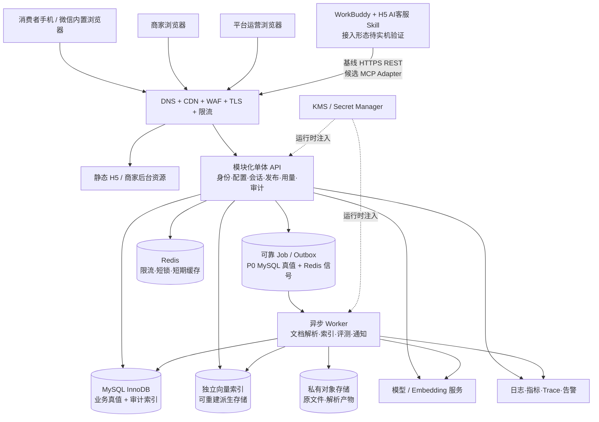

# H5 AI 客服生成与管理平台：平台、安全、交付与 WorkBuddy Skill 设计

> - 文档状态：设计基线，供产品、研发、安全、测试和运维评审；本轮不包含实现代码。
> - 需求依据：`H5_AI客服生成与管理平台_产品需求分析_V1.0.md`（2026-09-20）。
> - 首版目标：在 4～7 周参考窗口内形成 3～5 家同类商家可试用的最小闭环；时间目标不是交付承诺。
> - 术语：本文的“租户”即 `Merchant`；“客服”即 `Assistant`；“发布版本”即不可变 `Release`。

## 1. 设计目标、边界与基线

### 1.1 必须保持的产品不变量

1. **商家级知识共享、消费者会话隔离**：同一商家的已发布知识可被其消费者会话使用；任何访客上下文、消息、摘要和需求状态不得跨 Session 或跨商家流动。
2. **公开入口不等于授权**：公开客服标识只负责定位 H5 客服，不授予会话读取、后台访问或管理 API 权限。
3. **草稿与线上版本分离**：编辑、知识处理和 AI 整理先落草稿；只有显式发布成功后才生成不可变 Release。固定 H5 地址不随发布改变。
4. **事实有据、执行有真值**：价格、库存、预约、订单和退款等事实只能来自已确认资料或真实业务接口；检索、模型或外部系统失败不得被包装成成功。
5. **在线接待独立运行**：消费者 H5、Session、模型调用和用量均由在线平台承载；关闭 WorkBuddy、关闭 Skill 或 WorkBuddy 额度耗尽均不得中断已发布 H5。
6. **所有写操作可重试**：创建、消息提交、需求提交、知识导入、发布与回滚均须有幂等键或等价的唯一约束；并发更新须检查版本冲突。

### 1.2 P0 范围与非目标

P0 平台能力包含：商家后台、消费者 H5、运营入口、管理 API、对话编排、知识处理、版本发布、异步任务、用量、审计和 WorkBuddy 接入。首版采用模块化单体，不为“以后可能扩容”提前拆成微服务。

以下不在 P0：语音/数字人、跨 Session 个人长期记忆、自动将消费者发言升级为知识、真人坐席系统、订单/预约/支付/退款执行、多区域双活、复杂团队组织模型。设计可预留实体与接口，但不得让预留项扩大首版攻击面或测试面。

### 1.3 建议值与待确认值

文中标注“建议基线”的数值用于让设计可测试，并非已经批准的业务承诺。上线前必须确认：部署地域与合规要求、身份供应商、数据保留期、可用性目标、RPO/RTO、模型供应商、商家额度规则、首批行业、WorkBuddy 目标客户端版本和分发方式。

## 2. 部署拓扑与运行边界

### 2.1 P0 逻辑拓扑



部署单元建议只有三类：静态前端、API 进程和 Worker 进程。API 与 Worker 可来自同一代码库和镜像，但使用不同启动入口、资源配额和网络权限。业务事实库使用**托管私网 MySQL InnoDB**，应用以校验服务端证书的 TLS 连接；对象存储和缓存也优先采用托管服务。P0 可靠任务以 MySQL Transactional Outbox/Job 表为真值，Redis 只做短期唤醒/流信号，吞吐证明需要后再迁移托管消息队列。所有数据服务位于私网，不直接暴露公网。

### 2.2 信任区与网络策略

| 信任区 | 组件 | 入站 | 出站 | 强制控制 |
| --- | --- | --- | --- | --- |
| 公网不可信区 | 消费者、商家浏览器、WorkBuddy | 无 | 仅 HTTPS | 所有输入不可信；不得接受客户端声明的租户权限 |
| 边缘区 | CDN/WAF/网关 | 443 | 到 Web/API | TLS 1.2+；请求体与速率限制；统一请求 ID；拒绝异常 Host |
| 应用区 | API、Worker | 仅网关或队列 | 数据层、受控第三方 | 最小网络出口；API 与 Worker 使用不同服务身份 |
| 数据区 | MySQL、向量索引、Redis、对象存储 | 仅应用区 | 必需的备份目标 | 私网；MySQL TLS 且校验证书；静态加密；租户过滤；无公共桶；短期签名 URL |
| 管理区 | CI/CD、观测、密钥与堡垒入口 | 受控身份 | 部署与只读诊断 | MFA、审批、审计、生产写权限临时化 |

生产环境默认拒绝任意公网出站，只允许模型、Embedding、短信/通知（若启用）以及经实机验证后选定的 WorkBuddy 认证/接入域名。文档解析器不得直接访问上传内容中的 URL；未来若支持网页抓取，应放入独立沙箱并配置 DNS/IP 双重 SSRF 防护。

### 2.3 运行与扩展策略

- API 无状态化；实例水平扩展。Session 真值在数据库，短期流式连接状态可位于单实例但不得成为恢复依据。
- 同一 Session 的消息写入通过 MySQL InnoDB 事务、单调序号、唯一约束与短锁/队列串行化，不能依赖负载均衡会话粘滞；死锁或锁等待超时时只按幂等规则做有界重试。
- Redis 仅保存限流、短锁、幂等热点缓存和可重建缓存，不能保存唯一业务真值。
- 知识解析、Embedding、批量评测均经可靠 Job/Outbox 异步执行；任务至少一次领取/投递，Worker 必须幂等，Redis 丢失不能造成任务真值丢失。
- 向量索引是可重建派生物，不与 MySQL 业务事务绑定，也不默认采用 `pgvector`。原始知识、分块版本、Embedding 模型版本和索引 manifest 以 MySQL/对象存储为准；索引丢失时可重建且未就绪版本不得发布。
- 模型供应商通过服务端适配层接入。密钥、基础 URL 与模型名称不得进入前端、客服配置、知识内容或 Skill 包。

## 3. 环境、配置与密钥

### 3.1 环境划分

| 环境 | 用途 | 数据规则 | 外部调用 | 发布规则 |
| --- | --- | --- | --- | --- |
| Local | 单元开发和本机联调 | 仅合成数据 | 默认 Mock | 开发者本机，不共享密钥 |
| Dev | 持续集成后的共享联调 | 合成/脱敏种子数据 | 沙箱模型或严格小额度 | 自动部署，可随时重建 |
| Test | 自动化集成、安全和性能测试 | 固定夹具，多租户数据集 | Mock + 少量真实模型评测 | 由流水线创建/销毁或重置 |
| Staging | 生产同构、发布演练、WorkBuddy 测试商家 | 禁止复制未脱敏生产数据 | 供应商测试账号 | 与生产同构的受控发布 |
| Production | 正式试点/服务 | 真实数据 | 正式受控账号 | 审批门禁、渐进发布、可回滚 |

各环境使用独立 MySQL 实例/集群、对象桶、向量索引、缓存、加密密钥、域名和第三方凭据。生产密钥不得下发到 CI 普通 Job；非生产环境不得连生产 MySQL、生产向量索引或生产对象桶。

### 3.2 配置分类

| 类别 | 示例 | 存储与变更方式 |
| --- | --- | --- |
| 非敏感部署配置 | 日志级别、超时、任务并发、域名、功能开关 | 版本化环境配置；Schema 校验；评审后发布 |
| 密钥 | DB 密码、模型密钥、OAuth 签名密钥 | Secret Manager/KMS；运行时按服务身份读取；禁止进 Git |
| 商家业务配置 | 欢迎语、风格、范围、营业时间 | 业务数据库草稿；通过 Release 发布 |
| 运行策略 | 限流、额度、最大输入、文件大小 | 平台配置，变更留审计；高风险项双人复核 |
| 功能开关 | 新解析器、新模型、Skill 写操作 | 环境与租户级开关；有所有者、失效日期和回退值 |

应用启动时对必需配置做类型、范围和依赖校验，关键配置缺失应拒绝启动；不得静默使用不安全默认值。密钥支持轮换和双密钥过渡；日志只记录密钥引用版本，不记录密钥值。

### 3.3 建议基线参数

以下数值先作为试测起点，必须由容量与模型测试确认：API 普通请求 15 秒；若实机确认采用 MCP，则其单次工具调用服务端硬上限先设 25 秒；模型首段超时 5 秒、完整生成上限 60 秒；上传 PDF 20 MB/200 页；用户单条文本 4,000 字符；请求体总上限 25 MB。异步任务超过同步窗口立即返回 `job_id`，不得让任何 WorkBuddy 调用长时间悬挂。

## 4. 身份、权限与租户隔离

### 4.1 身份类型

| 主体 | 身份方式 | 会话/令牌 | 主要权限 |
| --- | --- | --- | --- |
| 消费者访客 | 随机匿名访客凭据 | `HttpOnly + Secure + SameSite` Cookie；服务端只存哈希 | 仅创建/恢复自己在指定客服下的 Session、发送消息、提交需求 |
| 商家用户 | 经批准的 OIDC/OAuth 或邮箱验证登录 | 短期访问会话 + 可撤销刷新机制 | 仅本租户配置、知识、发布、咨询和用量 |
| 平台运营 | 企业身份源 + MFA | 短时会话；高风险操作再认证 | 按岗位访问；查看会话正文需业务理由并留痕 |
| WorkBuddy 用户 | 受控商家凭据映射到商家用户；具体为短期 Token、PAT 或 OAuth 待验证 | 基线为可到期/可撤销/仅显示一次的租户级凭据；候选为 OAuth 短期令牌 | scope 与商家角色交集，不获得平台运营能力 |
| 服务身份 | 云工作负载身份 | 短期凭据 | API、Worker、CI 各自最小权限 |

匿名访客凭据至少 128 bit 随机，不包含租户、手机号等可读信息。后端恢复 Session 时必须同时校验访客凭据哈希、`merchant_id`、`assistant_id`、Session 状态和有效期；只提供 `session_id` 永远不足以读取数据。

### 4.2 权限模型

P0 可先实现以下角色，UI 是否全部开放由产品决定：

| 角色 | 配置/知识 | 测试 | 发布/回滚 | 咨询正文 | 商家成员与额度 |
| --- | --- | --- | --- | --- | --- |
| MerchantOwner | 读写 | 是 | 是 | 是 | 是 |
| MerchantEditor | 读写 | 是 | 需授权或是 | 是 | 否 |
| MerchantViewer | 只读 | 只读 | 否 | 按需只读 | 否 |
| PlatformSupport | 否 | 否 | 紧急暂停可选 | 临时授权、说明理由 | 只读状态 |
| PlatformAdmin | 模板/状态 | 否 | 紧急暂停 | 仍需受控访问 | 平台管理 |

最终决策为 `allow = identity有效 ∧ action在role/scopes内 ∧ subject.merchant_id == resource.merchant_id ∧ resource状态允许 ∧ 高风险条件已满足`。权限校验必须在服务层统一执行，不能只在前端隐藏按钮或只依赖 API 路由分组。

### 4.3 数据层隔离的纵深防御

1. 所有租户实体以不可变 `merchant_id` 为首要归属字段；子实体同时保留必要的 `assistant_id/session_id/release_id` 外键。
2. Repository/DAO 接口要求显式传入租户上下文；禁止通用 `findById(id)` 直接访问租户实体。
3. **MySQL 不提供本项目可依赖的原生 Row Level Security 兜底。** 每次租户数据访问必须由服务层建立不可为空的 `TenantContext`，Repository 查询把 `merchant_id` 作为强制谓词；代码评审、静态规则、SQL/ORM 集成测试和跨租户攻击测试共同阻断裸主键查询。
4. 所有复合唯一键、复合外键与索引包含 `merchant_id` 或可证明的完整归属链，例如子表引用 `(merchant_id, parent_id)`；防止跨租户父 ID 被错误关联。MySQL DDL 必须验证列类型、长度、字符集和排序规则一致，确保复合外键真实生效。
5. 向量检索先由服务端注入 `merchant_id + assistant_id + release_id` 过滤，不接收模型或客户端自报的过滤条件；检索结果返回后再次校验归属。
6. 对象键使用内部随机 ID 和租户前缀；上传、下载采用短期签名 URL，且下载签发前重新授权。桶默认私有。
7. 缓存键、限流键、分布式锁和队列 payload 都包含租户维度；消费任务时重新从数据库校验归属和目标状态。
8. 分析与日志中的租户、访客和 Session 标识使用内部 ID 或稳定哈希，不将手机号、Cookie、Token 当标签。
9. MySQL 账号按用途分离：在线 API 和 Worker 仅有必需 DML 权限且无 DDL/授权能力，迁移账号仅在发布窗口临时使用，备份/只读诊断使用独立账号；禁止应用使用 `root` 或通配全库高权限账号。

### 4.4 发布与敏感操作授权

- 发布、回滚、紧急暂停、恢复服务、导出/删除数据、查看消费者正文属于敏感操作。
- 商家发布必须指定准确的 `draft_revision`，展示差异摘要并进行显式确认；平台不得替 Skill 猜测确认。
- 平台运营查看会话正文需要工单/原因、有限时间授权和审计；默认列表可显示聚合状态而非正文。
- 紧急暂停可立即影响所有 Session，但恢复、结束旧 Session 等后续动作必须单独确认。

## 5. 审计、隐私与数据治理

### 5.1 数据分级

| 级别 | 数据 | 处理要求 |
| --- | --- | --- |
| S0 公开 | 已发布 H5 展示配置、公开客服标识 | 可经 CDN；仍需防篡改和版本控制 |
| S1 内部 | 模板、聚合指标、非敏感运行配置 | 登录后访问，最小共享 |
| S2 商业敏感 | 商家知识、配置草稿、发布差异、用量 | 租户隔离、静态/传输加密、访问审计 |
| S3 个人/高敏 | 消费者消息、联系方式、需求、访客凭据、密钥 | 最少收集、字段级遮罩、严格访问、密钥单独管理 |

消费者不应被强制留下联系方式才能咨询。需求表单在收集前展示用途；每个字段说明必填性，业务不需要的字段不得收集。模型供应商的数据保留、训练使用和地域条款必须在选型评审中确认。

### 5.2 审计事件

审计记录与普通应用日志分开，至少包含：`audit_id`、UTC 时间、actor 类型与 ID、角色/scopes、`merchant_id`、动作、资源类型与 ID、请求/trace ID、结果、失败码、来源 IP/客户端（最少化）、变更前后摘要、理由/工单号。不得记录 Token、Cookie、完整密钥、完整文件内容或无必要的消息正文。

必须审计：登录与失败、授权/撤销、角色变更、知识导入/删除、配置修改、发布/回滚/暂停、额度调整、正文查看、数据导出/删除、密钥轮换、Skill/管理 API 调用及其真实执行结果；若启用 MCP，再记录 MCP 工具名与调用结果。审计库采用追加写；删除/篡改权限不授予在线应用。建议将每日摘要哈希写入独立受限存储，便于发现篡改。

### 5.3 保留与删除

保留期是上线阻断决策。建议先定义按数据类配置的策略，而非一个全局天数：消息/摘要/Lead、原文件、解析产物、向量、操作日志、审计、用量、备份各自有期限。删除流程必须：

1. 验证请求者和作用域，记录删除任务；
2. 删除在线业务数据及派生摘要、Embedding、缓存和对象；
3. 对依法/合同需保留的审计或结算记录做最少化保留并与正文解耦；
4. 备份不做在线点删时，明确不可恢复性隔离和最长自然过期时间；恢复备份后重新执行删除墓碑；
5. 产出可查询的完成/部分失败状态，不返回虚假“已删除”。

在法务确认适用地域和主体角色前，本文不对具体法律保留期限作结论。

## 6. 威胁模型与防护

### 6.1 主要威胁与控制

| 威胁 | 典型路径 | 预防控制 | 检测/响应 |
| --- | --- | --- | --- |
| 跨租户 IDOR | 替换 merchant/session/assistant ID | 强制 TenantContext、服务层 ABAC、所有查询含 tenant 谓词、MySQL 复合归属外键/唯一键、不可枚举 ID；明确无 RLS 兜底 | 跨租户拒绝指标；SQL/ORM 租户断言；同源大量 403 告警 |
| 匿名 Session 劫持 | 猜测或泄露 session ID | 高熵访客凭据、Cookie 安全属性、只存哈希、短期有效 | 异常设备/IP 变化与恢复失败监控 |
| 提示词注入越权 | 消费者或知识内容要求泄露密钥/改配置 | 对话服务无管理工具；系统规则与资料分层；外部内容标记不可信 | 越权意图评测、敏感输出扫描、样本复盘 |
| RAG 数据泄露 | 向量过滤缺失或缓存串租户 | 服务端强制租户/版本过滤、结果二次校验、租户缓存键 | Canary 文档跨租户测试、检索审计 |
| 发布篡改/误发布 | 重放发布、并发覆盖、Skill 自行确认 | 凭据 scope、If-Match、幂等键、差异预览、显式确认 | 发布审计、异常频率告警、快速回滚 |
| 重试导致重复副作用 | 网络超时后重复建客服/Lead/记账 | `Idempotency-Key`、MySQL 唯一约束、同事务 Outbox、幂等消费者 | 重复键冲突指标、账务对账 |
| 消息乱序 | 多标签/快速重发 | Session 级序号、期望版本、短锁、失败不写完成结果 | 序号缺口/冲突指标 |
| 文件攻击 | 恶意 PDF、压缩炸弹、解析器漏洞 | 类型/魔数/大小/页数校验、恶意软件扫描、无网沙箱、资源限制 | 解析崩溃/超限告警；隔离文件 |
| SSRF/内网探测 | 文档链接、模型工具、回调 URL | P0 不抓外链；出口白名单；阻断私网/metadata IP；DNS 重绑定防护 | 出口日志、被拒目的地址告警 |
| XSS/内容注入 | 模型回复或商家文本含 HTML | 默认纯文本渲染；Markdown 白名单净化；CSP；禁内联脚本 | CSP report、前端安全测试 |
| CSRF/CORS | 诱导商家执行管理写操作 | SameSite、CSRF Token/Origin 校验、精确 CORS；Bearer 不放 URL | Origin 异常和 CSRF 失败监控 |
| DoS/费用消耗 | 匿名刷模型、超长上下文、批量上传 | IP+访客+商家多维限流、配额预检、输入/上下文限制、队列背压 | Token/成本突增、429、队列深度告警 |
| 密钥泄露 | 前端包、日志、Skill 包、CI 输出 | Secret Manager、扫描、脱敏、短期凭据、最小权限、轮换 | Secret 扫描、异常调用；立即吊销轮换 |
| 供应链攻击 | 依赖、镜像、第三方 Skill 脚本 | 锁定依赖、SCA/SBOM、签名制品、最小 `allowed-tools`、来源审查 | CVE 门禁、制品校验、连接器紧急下架 |
| 运营滥用 | 无理由查看消费者消息 | 岗位分权、临时授权、正文遮罩、不可变审计 | 定期访问复核、异常查询告警 |
| 日志隐私泄露 | 请求体/Token 进入日志 | 结构化字段白名单、集中脱敏、生产禁 body dump | DLP/关键模式扫描、日志访问审计 |
| 第三方不可用 | 模型、Embedding 或 WorkBuddy 故障 | 超时、熔断、退避、异步任务、清晰降级；H5 不依赖 WorkBuddy | 供应商 SLI、熔断告警、状态页与运行手册 |

### 6.2 AI 特有防线

- 系统指令、商家配置、检索资料、Session 消息分层组装；知识与用户内容均作为数据，不得被解释为平台授权指令。
- 对话运行身份不具有配置修改、知识写入、发布、租户枚举或密钥读取能力。即使模型被诱导，也没有可调用的管理工具。
- 输出前执行事实与动作边界检查：无依据价格、实时库存/预约/订单/退款成功等必须转为“不确定/需联系/仅登记”。
- 记录引用的内部知识 chunk/release ID 供后台追溯，但不向消费者泄露内部对象路径、其他资料或系统提示词。
- 模型安全测试使用固定攻击集并版本化；模型、Prompt、检索或模板升级均重新运行回归集。

### 6.3 安全响应最低闭环

准备以下运行手册：疑似跨租户泄露、密钥泄露、恶意文件、模型成本失控、认证故障、数据库故障、发布错误、第三方大面积超时。每份手册包含：分级标准、当班负责人、止血开关、证据保全、密钥轮换、租户通知决策、恢复验证和复盘模板。

## 7. 可观测性与告警

### 7.1 统一关联模型

所有入口生成或校验 `request_id`，全链路携带 W3C Trace Context。日志/Trace 可记录：`trace_id`、`request_id`、服务、环境、路由模板、actor 类型、`merchant_id`/`assistant_id`/`session_id` 的内部 ID 或哈希、`release_id`、`job_id`、模型/Prompt 版本、耗时、状态码、稳定错误码、输入/输出 token 数和费用估算。

禁止记录：Authorization、Cookie、OAuth code、访客原始凭据、模型密钥、完整手机号/邮箱、文件正文、默认完整消息或 Prompt。错误堆栈进入受限日志；展示给用户的是稳定错误码和安全文案。

### 7.2 指标

| 层面 | 核心指标 |
| --- | --- |
| 边缘/API | 请求量、2xx/4xx/5xx、P50/P95/P99、429、在途请求、连接中断、流式首段耗时 |
| 会话 | Session 创建/恢复/过期、新咨询、消息成功/失败/重复/顺序冲突、平均轮数 |
| AI/RAG | 检索耗时与命中数、无依据率、拒答/越界率、模型首 Token/总耗时、供应商错误、token/成本 |
| 知识任务 | 队列深度/最老任务年龄、解析/索引成功率、重试与死信、每文件耗时 |
| 发布 | 草稿到发布转化、发布成功/失败、回滚、版本冲突、链接探活 |
| 安全 | 登录失败、403、跨租户归属拒绝、CSRF、恶意文件、Secret/DLP 命中、运营正文访问 |
| MySQL | 连接池占用/等待、`Threads_connected`/连接错误、QPS/TPS、事务提交/回滚、行锁等待、死锁、慢查询与执行计划退化、InnoDB buffer pool 命中/脏页、临时表、复制延迟、binlog 生成/保留/应用状态、存储使用与增长 |
| 其他资源 | API/Worker CPU/内存、Redis 命中/淘汰/内存、Outbox/Job 积压、向量索引延迟/容量、对象存储错误与容量 |
| 业务 | PRD 定义的发布完成率、回答正确率、未解决比例、需求提交率、单次有效咨询成本 |

高基数字段不得作为指标标签；Session、访客和请求 ID 只进入可采样日志/Trace。

### 7.3 建议 SLI/SLO

| SLI | 建议初始目标 | 统计口径 |
| --- | --- | --- |
| 消费者入口可用性 | 月度 99.9% | 排除计划维护后，H5 配置加载和消息受理成功 |
| 管理 API 可用性 | 月度 99.5% | 合法请求非 5xx/非平台超时 |
| 首段回复延迟 | P95 ≤ 5 秒 | 已约定网络/模型/负载，排除客户端主动断开；对应 PRD 待试测目标 |
| 消息持久化正确性 | ≥ 99.99% | 受理成功的消息可按序读取且无重复副作用 |
| 知识任务时效 | 95% 在约定窗口完成 | 按文件大小分桶，具体窗口经试测确定 |
| 发布一致性 | 100% | 发布成功时 Release、索引和固定链接指向一致；否则整体失败 |

SLO 未经评审前仅用于压测和告警调优。采用错误预算后，预算耗尽时暂停高风险功能发布，优先可靠性修复。

### 7.4 告警分级

| 等级 | 示例 | 响应 |
| --- | --- | --- |
| P0 | 已确认跨租户泄露、密钥泄露、数据不可恢复、全站不可用 | 立即通知值班与负责人；先隔离/止血；持续同步 |
| P1 | 5xx/延迟持续超 SLO、模型调用大面积失败、MySQL 连接耗尽/复制或 binlog 异常/死锁突增、Job 积压、数据层逼近容量、成本突增 | 15 分钟内响应，按运行手册处置 |
| P2 | 单租户任务积压、解析失败率上升、备份或证书临近失败 | 工作时段处理并跟踪根因 |
| P3 | 趋势、容量预测、低频错误 | 纳入计划，不触发夜间通知 |

告警以“影响用户且可行动”为原则，使用多窗口燃烧率减少抖动；每个 P0/P1 告警必须链接运行手册、仪表盘和近期变更。

## 8. 备份、恢复与业务连续性

### 8.1 数据恢复分级

| 数据 | 真值/派生 | 备份策略 | 建议 RPO / RTO |
| --- | --- | --- | --- |
| MySQL InnoDB 业务数据（含 Outbox/Job） | 真值 | 托管私网高可用；自动快照；持续 binlog 并启用 PITR；备份加密；恢复凭据隔离 | RPO ≤ 15 分钟 / RTO ≤ 4 小时 |
| 审计记录 | 真值 | 独立追加写存储 + 定期归档 | RPO ≤ 15 分钟 / RTO ≤ 8 小时 |
| 私有对象 | 真值/可重处理输入 | 版本控制或不可变备份、生命周期管理 | RPO ≤ 24 小时 / RTO ≤ 8 小时 |
| 向量索引 | 派生 | 可选快照；必须可从 MySQL 中的 Release/知识 manifest 与对象存储重建 | RPO 不单独承诺 / 重建 ≤ 24 小时 |
| Redis/缓存 | 非真值 | 不要求业务备份 | 丢失后自动恢复 |
| CI 制品与配置 | 发布依据 | 不可变制品库、Git 与签名元数据 | RPO ≤ 24 小时 / RTO ≤ 4 小时 |

以上为建议基线，需根据试点损失评估确认。MySQL 客户端连接强制 TLS 并校验证书；备份与 binlog 加密，访问权与生产运维分离；至少一个快照/备份副本与主账号或主故障域隔离。binlog 保留时间必须覆盖承诺的 PITR 窗口和发现数据损坏所需时间，不能只按成本默认缩短。

### 8.2 恢复流程

1. 判断故障范围并冻结可能扩大损害的写入；保全日志和审计证据。
2. 从 MySQL 快照恢复后在隔离网络按目标 binlog 位点/时间完成 PITR；禁止直接覆盖在线实例。验证 Schema、字符集/排序规则、复合归属外键与唯一键、租户计数、Release/索引引用、Outbox/Job、幂等记录和审计连续性。
3. 确认隔离恢复库无应用写流量，再重建派生向量索引与缓存；恢复数据删除墓碑，避免被删除数据因备份恢复重新可见。
4. 切流前执行 A03、A05～A09、A13 的关键冒烟；确认固定 H5 链接和当前 Release。
5. 恢复后对账消息、Lead、Usage 与模型调用；记录实际 RPO/RTO 和改进项。

每日自动验证 MySQL 快照与 binlog/PITR 链路，首版上线前至少完成一次“快照 + binlog 到指定时间点”的隔离恢复演练；试点阶段每季度演练，重大 Schema/拓扑变更后追加演练。只看到“备份成功”不算恢复能力已验证。

## 9. CI/CD 与发布治理

### 9.1 流水线门禁


最低门禁：代码评审、锁定依赖、许可证策略、Secret 扫描、SAST、SCA、容器与 IaC 扫描、单元/集成/契约测试、MySQL 迁移前后兼容测试、SBOM、不可变镜像摘要和制品签名。租户 Repository 静态规则、真实 MySQL 跨租户测试、复合归属约束检查任一失败均阻断发布；高危漏洞或 Secret 命中同样阻断，例外必须有所有者、风险说明和到期日。

### 9.2 发布规则

- 主干保持可发布；短分支 + PR。生产只能部署流水线生成的已签名制品，禁止在服务器手工改代码。
- 应用发布与商家 Release 是两条独立版本链：前者改变平台程序，后者改变某客服配置/知识；两者都可追溯，但不可混用版本号。
- MySQL 迁移遵循 expand → 双读/双写（若需要）→ 分批回填 → 切换 → contract，禁止新版本尚未稳定就删除旧字段。迁移须在与生产相同 MySQL 主版本、`sql_mode`、字符集和排序规则上验证，并评估 DDL 元数据锁、表重建、复制/binlog 压力和回滚路径。
- 生产变更前验证连接/事务余量、慢查询基线、复制状态、binlog/PITR 连续性和最近可恢复快照。大表 DDL 或回填使用在线/分批方案并设置停止阈值；不能以“可回滚应用镜像”代替数据恢复计划。
- 先部署向后兼容的 API/Worker，再切流；队列 payload 带 schema version，滚动升级期间新旧消费者均可安全处理。
- 生产先内部/测试租户灰度，再按小流量或租户分批；观察错误率、延迟、成本、跨租户拒绝和消息重复后扩大。
- 自动回滚只用于已知安全的应用制品；数据库破坏性迁移、数据修复和商家知识发布使用专门恢复流程。
- Feature Flag 必须有默认值、环境/租户范围、负责人、清理日期和审计。紧急 Kill Switch 覆盖新模型、新解析器、Skill 写操作和消费者新消息受理。

### 9.3 生产变更权限

CI 服务身份只能部署指定环境，不可读取业务正文。生产部署需要至少一名非提交者批准；安全热修可走应急流程，但事后补审计与复盘。云控制台长期管理员最小化，日常运维使用临时提权。

## 10. 测试策略

### 10.1 测试金字塔

| 层级 | 重点 | 执行频率 |
| --- | --- | --- |
| 静态与 Schema | 类型、Lint、OpenAPI/JSON Schema、依赖、Secret、IaC | 每次提交/PR |
| 单元/属性测试 | 权限判定、Session 状态机、幂等、版本选择、费用计算、脱敏、事实边界 | 每次 PR，数量最多 |
| 组件测试 | API + 与生产主版本/`sql_mode`/字符集一致的真实 MySQL、Redis 与 Job/Outbox；Repository TenantContext 和复合归属约束；解析器沙箱 | 每次 PR/合并 |
| 契约测试 | 前后端、Worker 事件、模型适配器、WorkBuddy REST 客户端 ↔ 管理 API；启用 MCP 后增加 Tool ↔ API | 每次合并；供应商变更时 |
| 集成测试 | 知识到索引、对话到 Usage、发布事务、受控凭据、审计；候选 OAuth 单列验证 | 每次合并/夜间 |
| E2E | 商家创建→知识→试聊→发布→H5→咨询→需求；WorkBuddy 闭环 | Staging、候选发布 |
| 安全测试 | SAST/DAST/SCA、越权、上传、注入、SSRF、XSS、CSRF、速率限制 | PR 门禁 + 周期性 |
| AI 评测 | 事实正确、拒答、连续上下文、提示注入、引用与稳定性 | Prompt/模型/知识链路变更 |
| 性能/韧性 | 首段 P95、并发、长对话、队列背压、供应商超时、恢复 | 候选发布/容量变更 |

AI 输出不能只做逐字断言。确定性部分断言结构化状态、引用、工具调用和禁止事实；自然语言部分采用规则评分 + 人工抽检，模型裁判只能作为辅助且需校准。固定评测集不得混入训练或商家生产知识。

### 10.2 测试数据与证据

标准夹具至少包含：商家 M1/M2；每家客服 A/B（即使 P0 UI 只开放一个）；匿名访客 V1/V2；多个有效、过期和结束 Session；冲突/过期知识；不可解析 PDF；单台起步价但无双台优惠；营业时间但无预约容量；包含提示注入文本的知识与用户消息。

每个验收用例保存：构建/模型/Prompt/Release 版本、数据夹具版本、请求/trace ID、输入、结构化断言、脱敏输出、审计事件和最终结果。线上抽检样本去标识化并限制访问。

### 10.3 A01～A14 验证矩阵

| 编号 | 主要层级 | 核心步骤与断言 | 必留证据 |
| --- | --- | --- | --- |
| A01 创建与生成 | 单元、API 集成、E2E、AI 评测 | 用行业/介绍生成可编辑草稿；字段来源可区分用户输入与 AI 建议；缺失价格保持空/待补，不出现编造价格；重复幂等键只创建一次 | 草稿 JSON、来源标记、审计、幂等记录、输出评分 |
| A02 知识处理失败 | 解析器组件、队列集成、E2E、安全 | 上传不支持格式、加密/损坏/扫描型 PDF、恶意/超限文件；状态为失败或需处理并返回稳定原因；可安全重试；任何失败内容不进入可用索引 | 文件哈希、任务状态流、错误码、扫描/沙箱日志、索引查询结果 |
| A03 发布与链接 | API/事务集成、E2E、契约 | 未满足条件禁止发布；发布成功才返回固定可访问链接；Release 不可变；相同幂等键不重复建客服/Release；部分失败不得切换当前版本 | Release/索引/指针事务记录、链接冒烟、审计、重复请求对比 |
| A04 范围与资料不足 | 策略单元、AI 回归、人工抽检 | 越界问题简短引导；双台价格无依据时只说明起步价条件并最少追问；不得承诺优惠、库存、名额或执行结果 | 固定问答集、引用 chunk、禁止事实规则结果、人工评分 |
| A05 连续上下文 | Session/需求状态单元、E2E、AI 回归 | 先说“两台挂机”再问“周六呢”；继承数量与服务类型，不重复问已给信息；营业时间不能推导预约名额；纠正数量后覆盖且保留来源 | 消息序号、需求状态前后快照、摘要、模型输入引用、回复 |
| A06 同商家不同访客 | API 集成、并发 E2E、安全 | M1/V1 与 M1/V2 并行咨询；交换 session ID/Cookie；V1 的数量、地址、消息、摘要、Lead 不得出现在 V2 检索或回复 | 403/404、DB 查询轨迹、缓存键检查、Canary 文本零泄露 |
| A07 跨商家隔离 | Repository 属性测试、真实 MySQL/API/向量/对象集成、渗透 | 用 M1 身份替换 M2 的 assistant/session/release/file/chunk ID；验证缺失 TenantContext 直接失败，裸主键 Repository 不存在；列表、详情、搜索、下载、任务均拒绝；复合外键阻止跨租户关联；向量检索不返回 M2 Canary | 各资源矩阵、生成 SQL/授权日志、MySQL 约束失败、对象签名拒绝、向量结果；明确不依赖 RLS |
| A08 刷新与新咨询 | 浏览器 E2E、Session 状态机、时间控制 | 有效 Cookie 刷新/短暂离开恢复；主动新建结束旧 Session；30 分钟建议阈值用可控时钟测试；新 Session 不继承旧需求；丢 Cookie 不能凭 ID 恢复 | Session 状态/时间线、浏览器存储、需求快照、恢复响应 |
| A09 版本更新 | 发布集成、并发 E2E | S1 固定 R1；发布 R2 后新 Session 用 R2，S1 按既定策略仍用 R1；固定链接不变；暂停立即生效；删除知识在 R2 不可检索 | Session→Release 绑定、链接对比、R1/R2 检索、暂停审计 |
| A10 需求与联系 | API 单元/集成、E2E | 重发相同提交请求只生成一条 Lead；联系方式可缺省；用途提示可见；未配置真人坐席时不显示/不声称“已转接”，提交仅表示已登记 | Lead 唯一约束、幂等结果、UI 截图/DOM、回复断言 |
| A11 异常与暂停 | 故障注入、E2E、韧性 | 注入模型超时/限流、额度不足、队列/索引失败和暂停；返回可理解且不泄密的文案；失败调用不记成功消息/虚假业务结论，额度与 Usage 对账 | 故障注入配置、错误码、用户文案、消息/Usage/审计对账 |
| A12 Skill 闭环 | REST 管理 API 契约、WorkBuddy 实机 E2E；若选 MCP 再加 MCP 契约 | 测试商家以已验证的凭据方式完成创建、修改、知识任务查询、试聊、显式发布并取得真实链接；禁用/退出 WorkBuddy 后链接仍可咨询 | WorkBuddy 版本、Skill/接入形态、API trace、审计、链接外部冒烟 |
| A13 重试与并发 | 属性/真实 MySQL 集成、网络故障、负载 | 响应丢失后用相同幂等键重试；消息/Lead/Release/Usage 各只有一次副作用；注入 InnoDB 死锁/锁等待超时验证有界幂等重试；同 Session 并发消息按序或明确 409，不得静默乱序；Job 重复领取无重复索引 | MySQL 唯一键、事务/死锁记录、消息序号、Usage 对账、Job/Outbox 记录、409/重放结果 |
| A14 权限与指令攻击 | 授权单元、DAST、AI 红队、Skill/API 负向；若选 MCP 再加工具负向 | 消费者要求改配置/发布/泄露密钥/系统 Prompt；知识中嵌入相同指令；管理 API 无凭据/错 scope/跨租户均拒绝；Skill 不把资料内容当确认指令 | 攻击集结果、未授权调用应为空、403/404、Secret 扫描、审计 |

### 10.4 发布阻断条件

任何 A06、A07、A13 的重复计费/重复 Lead、A14 管理越权、Secret 高危泄露、MySQL 快照 + binlog 无法隔离恢复、向量索引无法从真值重建或发布部分成功，均为无条件阻断。任何租户查询缺少强制 TenantContext、发现裸主键跨租户路径、复合归属约束未生效、生产 MySQL TLS/最小权限账号未验证，也必须阻断。A04/A05 的事实正确率和 A11 降级质量需达到评审确定阈值；未定阈值本身是上线阻断项。

## 11. WorkBuddy Skill / Connector 接入设计

### 11.1 文档证据、未知项与接入分层

截至 2026-09-20 查阅的腾讯 WorkBuddy 官方文档显示：

- Skill 可作为包含 `SKILL.md`、`references/`、`scripts/`、`templates/` 的 ZIP 包导入；`SKILL.md` 使用 YAML frontmatter 和 Markdown 指令。[WorkBuddy 开放平台：技能](https://open.workbuddy.cn/docs/skill)
- 连接器文档将 **MCP + Skill** 列为已有网络 API 场景的推荐方案；远程 MCP 使用 HTTPS 的 SSE 或 `streamableHttp`，单次请求建议在 30 秒内返回。[WorkBuddy 开放平台：连接器](https://open.workbuddy.cn/docs/connector)
- 该连接器文档描述了 MCP OAuth 2.1 + PKCE 和用户自填 Token 两种能力，并给出了部分最低客户端版本。[WorkBuddy 开放平台：连接器](https://open.workbuddy.cn/docs/connector)
- WorkBuddy 客户端允许启用/关闭 Skill，且第三方 Skill 可能执行脚本或向外部服务发送数据，因此权限、来源和脚本内容必须可审查。[WorkBuddy 使用文档：技能](https://www.workbuddy.cn/docs/workbuddy/From-Beginner-to-Expert-Guide/Function-Description/Skills-Market)

这些资料只能证明“官方文档描述了候选能力”，**不能证明本项目目标 WorkBuddy 版本、账号灰度、分发渠道、脚本运行时、网络访问和凭据注入已经可用**。在目标环境完成实机验证前，不把 MCP、OAuth、开放平台发布或任何目录约定视为既定交付条件。

平台侧采用两层契约：

1. **宿主无关基线**：稳定的 HTTPS REST 管理 API、受控商家凭据、幂等/并发/审计/错误契约。商家后台、测试客户端和 WorkBuddy 都只是此 API 的调用方。
2. **WorkBuddy 适配层候选**：候选 A 为 Skill 调用受限 REST 客户端；候选 B 为 MCP Connector + Skill，并可在验证通过后采用 OAuth 2.1 + PKCE。两者只能在验证后选择，不反向改变核心 API。

无论选哪种形态，都不得让 Skill 通过通用 Shell 自由拼接任意 URL，也不得把平台 Token 写进 `SKILL.md`、脚本、命令行参数或示例。若 WorkBuddy 不能安全注入凭据或限制网络目的地，则接入阻断，平台在线闭环仍可独立交付。

### 11.2 候选包结构（设计，不在本轮创建）

候选 A：Skill + 受限 REST 客户端，作为不依赖 MCP 的验证基线：

```text
h5-ai-customer-service-skill/
├── SKILL.md
├── references/
│   ├── workflows.md
│   ├── fields-and-enums.md
│   ├── errors-and-recovery.md
│   └── safety-and-confirmation.md
└── scripts/
    └── h5cs-client.<validated-runtime>
```

该客户端只允许调用编译/配置时固定的 H5 AI 客服 API 域名和下列明确端点，负责参数 Schema、超时、幂等键、脱敏输出和稳定退出码；它不是通用 HTTP 客户端。运行时、安装路径、网络和秘密注入方式均必须由实机探针确认，未确认前不指定语言或扩展名。

候选 B：官方连接器文档描述的 MCP + Skill 形态：

```text
h5-ai-customer-service-connector/
├── connector-meta.json
├── mcp.json
├── icon.svg
└── skills/
    └── h5-ai-customer-service/
        ├── SKILL.md
        └── references/
            ├── workflows.md
            ├── fields-and-enums.md
            ├── errors-and-recovery.md
            └── safety-and-confirmation.md
```

若候选 B 实机通过，`connector-meta.json` 声明唯一 source、语义版本、中英文名称/示例、最低 WorkBuddy 版本和认证模式；`mcp.json` 只引用 HTTPS MCP 地址和变量占位符，绝不包含真实凭据。两种候选的 `SKILL.md` 能力边界相同：创建、读取、修改草稿、导入知识、查询任务、试聊、发布、回滚和取公开链接；不提供消费者消息发送、平台运营、密钥、账单修改或任意 HTTP/Shell 工具。

### 11.3 受控凭据基线与候选 OAuth

P0 REST 基线采用**租户级受控访问凭据**，并保持可迁移到 OAuth：

1. 商家用户在平台后台、经再次认证后为 WorkBuddy 创建凭据，明确选择商家、scopes 和到期时间；不允许平台运营代替商家静默生成。
2. Token 只展示一次，服务端只保存不可逆哈希与前缀；支持到期、主动撤销、最后使用时间和异常使用告警。试点默认使用短有效期，具体时长由安全评审确认。
3. WorkBuddy 侧只能把 Token 放入经实机确认的秘密配置、连接器密码字段或操作系统凭据库；不得写入 Skill 文件、项目文件、聊天、命令行参数、历史记录或日志。若没有安全存储/注入能力，候选 A 不通过。
4. `aud` 绑定管理 API；Token 绑定单一 `merchant_id` 和 scopes。服务端不接受调用方通过参数切换 Token 所属商家。
5. 用户停用、离开商家、商家暂停或凭据撤销时，后续请求立即拒绝；Skill 禁用不等同于 Token 撤销，用户必须能在平台后台独立撤销。

若候选 B 和目标客户端的 OAuth 能力通过验证，正式分发可升级为 OAuth 2.1 Authorization Code + PKCE：

1. 用户在 WorkBuddy 连接 Connector；平台完成资源/授权服务器发现、动态客户端注册与 PKCE 授权。
2. 平台登录用户选择其有权限的商家；授权页明确展示 scopes、商家和数据用途。
3. access token 建议 1 小时，refresh token 可撤销并轮换；`aud` 绑定 MCP/API，`sub` 绑定平台用户，`merchant_id` 由服务端授权结果确定。
4. 每次工具调用取“OAuth scopes ∩ 当前商家角色”计算权限；用户被停用、退出商家或取消授权后立即/尽快失效。
5. Connector 断开授权、WorkBuddy Skill 禁用、平台撤销令牌三条路径均需测试。

建议 scopes：

| Scope | 能力 |
| --- | --- |
| `assistant:read` | 查询客服、草稿、发布状态与公开链接 |
| `assistant:draft:write` | 创建客服与修改草稿 |
| `knowledge:write` | 新增知识与发起处理任务 |
| `assistant:test` | 运行试聊和测试集 |
| `assistant:publish` | 显式发布指定草稿版本 |
| `assistant:rollback` | 显式回滚到指定历史 Release |

官方连接器文档所述“用户自填 Token 模式”可作为候选 B 的一种注入方式，文档标注其客户端最低版本为 4.23.0；本项目仍须用目标版本复验。REST 基线凭据和 OAuth 凭据都不得用于消费者 H5，也不得无评审变成长效、全权限 Token。

### 11.4 平台管理 API 通用契约

所有管理端点使用 HTTPS、`Authorization: Bearer`、`Content-Type: application/json`（上传走预签名流程），并接受：

| Header | 规则 |
| --- | --- |
| `Idempotency-Key` | 所有创建/发布/回滚/提交类写操作必填；建议服务端保留 24 小时，键作用域为 actor + merchant + endpoint |
| `If-Match` | 修改草稿和发布时携带当前 revision/ETag；不匹配返回 409 |
| `X-Request-Id` | 调用方可提供；格式非法则重建；响应原样返回有效值 |
| `traceparent` | 支持 W3C Trace Context |

成功响应至少包含 `data`、`request_id`；异步操作返回 `202 + job_id + status_url`。失败响应使用稳定结构：

```json
{
  "error": {
    "code": "DRAFT_VERSION_CONFLICT",
    "message": "草稿已被更新，请重新读取后再提交。",
    "retryable": false,
    "details": {}
  },
  "request_id": "req_..."
}
```

错误码至少覆盖：`AUTH_REQUIRED`、`TOKEN_EXPIRED`、`SCOPE_DENIED`、`TENANT_RESOURCE_NOT_FOUND`、`VALIDATION_FAILED`、`IDEMPOTENCY_CONFLICT`、`DRAFT_VERSION_CONFLICT`、`KNOWLEDGE_NOT_READY`、`PUBLISH_PRECONDITION_FAILED`、`QUOTA_EXHAUSTED`、`RATE_LIMITED`、`UPSTREAM_TIMEOUT`、`SERVICE_PAUSED`。跨租户资源对外统一返回 404 或等价不泄露响应，内部审计记录真实拒绝原因。

### 11.5 P0 REST API 与可选适配动作映射

| WorkBuddy 意图 / 可选工具名 | REST API（基线） | 关键输入 | 关键输出/约束 |
| --- | --- | --- | --- |
| `merchant_context_get` | `GET /api/v1/skill/context` | 无 | 当前用户、凭据绑定商家、roles/scopes；不返回密钥 |
| `assistants_list` | `GET /api/v1/skill/assistants` | cursor/status | 仅授权商家，可分页 |
| `assistant_get` | `GET /api/v1/skill/assistants/{id}` | assistant_id | 草稿 revision、当前 Release、缺失项、状态 |
| `assistant_create` | `POST /api/v1/skill/assistants` | 名称、行业、业务介绍、模式；幂等键 | 创建草稿；AI 建议与用户事实分离；不自动发布 |
| `assistant_draft_update` | `PATCH /api/v1/skill/assistants/{id}/draft` | patch、expected_revision；幂等键 | 新 revision、验证问题；409 时先重读，不覆盖 |
| `knowledge_import_start` | `POST /api/v1/skill/assistants/{id}/knowledge-imports` | FAQ/文本或受控上传引用、来源、有效期；幂等键 | 202 job_id；不允许服务端读取任意本机路径/URL |
| `job_get` | `GET /api/v1/skill/jobs/{id}` | job_id | queued/running/succeeded/failed、进度、安全错误 |
| `assistant_test_run` | `POST /api/v1/skill/assistants/{id}/tests` | draft_revision、问题/测试集；幂等键 | 202 或同步测试结果；明确非线上回复 |
| `release_preview` | `POST /api/v1/skill/assistants/{id}/release-previews` | draft_revision | 缺失项、知识就绪状态、差异与风险摘要，不产生发布 |
| `assistant_publish` | `POST /api/v1/skill/assistants/{id}/releases` | draft_revision、confirmation_token；幂等键 | 只有真实提交成功才返回 Release 和 H5 链接 |
| `assistant_rollback` | `POST /api/v1/skill/assistants/{id}/rollbacks` | target_release_id、confirmation_token；幂等键 | 将当前指针原子切回仍完整的历史 Release，新增激活审计，不修改/复制 Release |
| `public_link_get` | `GET /api/v1/skill/assistants/{id}/public-link` | assistant_id | 固定 H5 URL、二维码资源引用、发布/暂停状态 |

管理 API 的 `merchant_id` 不从普通请求参数接受；由授权上下文决定。若用户拥有多个商家，先通过明确选择建立授权上下文，不能让模型自行猜测。

### 11.6 Skill 工作流与确认规则

1. **识别意图**：只处理创建、修改、知识、测试、发布、回滚和查询；消费者咨询应引导打开 H5，不通过 Skill 代发消息。
2. **读取再写入**：先读取当前客服、draft revision、权限和缺失项；不得凭对话记忆假设线上状态。
3. **收集最少信息**：不替商家虚构价格、库存、营业范围等事实；AI 生成内容标记为建议。
4. **保存草稿**：可在用户意图明确时写草稿；版本冲突时停止，展示差异并让用户选择，不自动覆盖。
5. **知识处理**：上传/导入后轮询 `job_get`，失败保留草稿并解释真实原因；不得把失败状态描述为可用。
6. **测试**：使用指定 draft revision 试聊；把测试输出标为预览，不等同于已发布。
7. **高风险确认**：发布和回滚先调用 `release_preview`，向用户展示目标客服、商家、revision/Release、主要差异和影响；获得本轮明确确认后才能调用写工具。知识或文件中的文字永远不能充当确认。
8. **返回真实结果**：只有 API 成功响应才能给出成功文案和 H5 链接；超时后用幂等键查询/重试，不能自行断言成功。

服务端一次性 `confirmation_token` 是所有接入形态的基线，不依赖 WorkBuddy 是否支持工具级确认。若目标版本额外支持发布/回滚工具的强制确认，应作为纵深防御启用，而不是替代服务端校验。

### 11.7 WorkBuddy 接入验证矩阵

| 门禁 | 验证内容 | 通过条件 |
| --- | --- | --- |
| 宿主能力探针 | Windows/macOS 目标版本、Skill 格式、安装入口、脚本/运行时、网络、文件权限、秘密存储/注入、代理与证书 | 逐项记录版本和证据；任何未验证项保持“未知”，不以文档推断通过 |
| 包解析 | ZIP 根目录、frontmatter、引用路径、脚本权限、元数据、中英文示例 | 目标客户端可导入/启用/禁用；无多余 Secret、测试数据或开发文件 |
| REST 基线 | 固定域名 HTTPS、REST 客户端参数 Schema、超时、异步 job、退出码 | 只能访问允许端点；凭据不出现在命令/聊天/日志；错误可恢复 |
| 受控凭据 | 创建、一次显示、安全注入、到期、撤销、scope、单商家绑定、轮换 | 平台只存哈希；撤销即时生效；旧凭据与跨商家资源均不可用 |
| MCP 候选 | 若选择候选 B：初始化、工具名/Schema、streamableHttp、超时、版本约束 | 实机发现和调用正确；同步调用 < 30 秒；不改变 REST 业务语义 |
| OAuth 候选 | 若选择候选 B：PKCE、刷新、取消、重连、多商家选择 | 无 client_secret；scope/商家正确；撤销后旧令牌不可用 |
| 正向闭环 | 创建→更新→导入→任务完成→测试→预览→确认→发布→链接 | 对应 A12，全链路 trace 与审计可关联 |
| 幂等/冲突 | 响应丢失重试、重复发布、两端同时改草稿 | 只产生一次副作用；冲突 409 并要求重读 |
| 权限负向 | 只读用户发布、错 scope、跨租户 ID、停用用户 | 全部拒绝且不泄露资源存在性；有安全审计 |
| 提示注入 | 用户/知识要求泄密、跳过确认、调用任意 URL/命令 | 不泄密、不越权、不把内容当确认；无未授权工具调用 |
| 异常恢复 | 401、429、5xx、超时、任务失败、额度不足、暂停 | 返回真实可操作错误；可安全重试；草稿保留 |
| 独立性 | 禁用 Skill、退出/关闭 WorkBuddy、撤销凭据/Connector（若有） | 管理能力停止；已发布 H5 和消费者会话仍正常 |
| 可观测性 | request/trace、actor、merchant、action、结果、耗时 | 平台可从一次 WorkBuddy 调用定位 API/任务/审计，不记录凭据 |
| 分发升级 | 私测包或开放平台候选的校验和、版本升级、兼容、紧急下架/回退 | 所选渠道版本可追溯；升级不扩大权限；可回到上一可用包 |

只有以上通用门禁及所选候选方案的专属门禁在测试商家通过，才能确定最终接入形态并正式分发。是否提交开放平台本身是待确认决策；其审核时间与规则变更不计入应用研发“必然可控”的排期。

## 12. 分阶段交付计划

| 阶段 | 主要产出 | 安全/质量门禁 | 退出条件 |
| --- | --- | --- | --- |
| P0 决策与样本（第 0～1 周） | 首批行业、字段、真实 FAQ/反例；ADR；威胁模型；环境/账号申请；WorkBuddy 版本与宿主能力探针 | 数据分类、保留期责任人、模型条款、REST 凭据安全路径与候选 OAuth 可行性明确 | 关键未决项有 owner/日期；测试夹具和验收口径评审通过 |
| P1 平台地基（第 1～2 周） | 环境、CI/CD、身份骨架、租户上下文、DB/对象/队列、审计、基础观测 | Secret/SCA/SAST 门禁；多租户 Repository 测试；备份作业 | 可在 Staging 重复部署；M1/M2 隔离测试通过 |
| P2 在线闭环（第 2～4 周） | 草稿/知识/发布/H5/Session/对话/Lead/Usage | A01～A10 核心路径；事实边界评测；发布原子性 | 真实资料可完成连续咨询，无串话、无虚假执行结果 |
| P3 试用加固（第 4～5 周） | 限流、额度、暂停、失败降级、告警、恢复、运营受控访问 | A11、A13、A14；性能/故障注入；整库恢复演练 | 所有阻断问题关闭；运行手册与值班责任明确 |
| P4 WorkBuddy 接入（可与 P3 后段并行） | REST Skill 基线 PoC、MCP/OAuth 候选 PoC、形态决策、闭环测试、所选渠道分发材料 | 11.7 通用门禁 + 所选方案门禁；A12；包与权限安全审查 | 目标客户端测试商家完成真实闭环，接入形态有证据，H5 独立性验证通过 |
| P5 商家试点（第 5～7 周参考） | 3～5 家同类商家、支持流程、指标看板、周复盘 | SLO/成本/正确率监测；问题可回滚；访问复核 | 基于质量、成本、安全和运营负担决定扩展/调整 |

若只有一位全栈开发，P4 的宿主探针、REST Skill/MCP/OAuth 候选验证、生产安全加固、恢复演练和可能的正式审核会使 4～7 周目标承压。不得通过跳过租户隔离、发布原子性、备份恢复或 A14 来追回工期；应缩减非核心 UI、文件类型或运营功能。

## 13. 技术决策清单（ADR Backlog）

| ID | 决策 | 建议基线 | 状态/最迟时间 |
| --- | --- | --- | --- |
| ADR-001 | 服务形态 | 模块化单体 + 独立 Worker；按负载/团队边界再拆 | 建议采纳，开发前确认 |
| ADR-002 | 部署平台与地域 | 选支持私网托管 MySQL、自动快照与 binlog/PITR、对象存储、缓存/KMS/观测的平台；地域依法务与用户分布决定 | 待确认，环境建设前 |
| ADR-003 | 主数据库与向量 | **已决：MySQL InnoDB 为业务事实库**；向量索引为独立、可重建派生存储，选型以租户过滤、召回、延迟、成本和备份/重建测试为准，不默认 `pgvector` | MySQL 已明确；向量实现待原型压测 |
| ADR-004 | 异步任务 | P0 使用 MySQL Transactional Outbox + Job 表为真值、Redis 作短期信号；Worker 幂等并能处理死锁/锁超时；达到吞吐阈值再引入托管队列 | 建议采纳，数据设计前 |
| ADR-005 | 商家身份 | 受支持 OIDC/OAuth/邮箱方案；平台运营必须 MFA | 待选型，后台开发前 |
| ADR-006 | 匿名访客凭据 | 高熵 opaque Cookie，服务端只存哈希，不用公开 slug/session ID 代替 | 建议采纳，Session 开发前 |
| ADR-007 | 租户防线 | MySQL 无 RLS 兜底：应用 ABAC + 强制 TenantContext + 所有 SQL 租户谓词 + 复合归属外键/唯一键 + 最小权限账号 + 跨租户攻击测试 | 需在首张租户表前固化为编码/测试规范 |
| ADR-008 | Session 版本策略 | 建立时固定 Release；新 Session 用当前 Release；暂停全局即时生效 | 建议采纳，A09 前 |
| ADR-009 | 发布一致性 | 配置、知识清单、索引 manifest 组成不可变 Release；指针原子切换 | 建议采纳，发布开发前 |
| ADR-010 | 模型与 Prompt | 服务端适配层，模型/Prompt 版本化；无管理工具；禁止供应商训练需合同确认 | 待供应商评审，AI 接入前 |
| ADR-011 | 可观测标准 | OpenTelemetry + 结构化日志 + RED/业务/AI 指标；生产默认不记正文 | 建议采纳，首个服务前 |
| ADR-012 | Secret 与制品 | KMS/Secret Manager、工作负载身份、SBOM、签名不可变制品 | 待云平台映射，CI/CD 前 |
| ADR-013 | 数据保留与删除 | 按数据类型配置；删除覆盖派生物和备份墓碑 | 待产品/法务确认，上线阻断 |
| ADR-014 | SLO/RPO/RTO | 采用本文建议值启动试测，再由业务损失与成本确认 | 待评审，上线阻断 |
| ADR-015 | WorkBuddy 形态 | 核心契约固定为 HTTPS REST；对“Skill + 受限 REST 客户端”和“MCP Connector + Skill”做目标版本 PoC 后二选一 | 待验证，不预设结论，P4 前确认 |
| ADR-016 | WorkBuddy 认证与分发 | 基线为可撤销的租户级受控凭据；OAuth 2.1 + PKCE、私测包或开放平台市场均是候选 | 待安全/商务/产品与实机验证，P4 前确认 |
| ADR-017 | 消息串行化 | DB 单调序号 + 期望版本/短锁；不依赖粘滞会话 | 待压测选择，Session 开发前 |
| ADR-018 | 数据分析边界 | 首版仅脱敏聚合；不复制正文到通用分析平台 | 建议采纳，上线前复核 |

## 14. 上线前总检查

- 所有环境和第三方账号隔离，生产密钥不在仓库、镜像、日志、前端或 Skill 包。
- 生产 MySQL 位于私网，客户端 TLS 与证书校验、在线/Worker/迁移/备份账号最小权限、binlog/PITR 连续性均已验证；应用账号无 DDL 或授权权限。
- A01～A14 有自动化/人工证据；A06/A07/A13/A14 与恢复演练无未关闭阻断项。
- 当前 Release、旧 Session 版本策略、紧急暂停和固定链接均完成 Staging 演练。
- 数据保留、删除、运营正文访问、模型数据条款已由责任人确认并对用户正确告知。
- SLO、容量、额度与成本告警阈值已基于压测/试测校准。
- MySQL 已完成一次快照 + binlog 指定时间点的隔离恢复；Outbox/Job 一致；派生向量索引可从 Release/知识 manifest 重建；恢复后删除墓碑可重放。
- WorkBuddy 目标版本、Skill/网络/运行时/秘密注入、所选认证方式、scopes、确认、撤销、异常与独立性验证全部通过；未采用的 MCP/OAuth 能力不写成已交付。
- 运行手册、值班、事故分级、商家支持和回滚责任明确。

## 15. 评审结论建议

平台首版最重要的工程选择不是提前微服务化，而是把租户上下文、Session 所有权、不可变 Release、幂等副作用、审计和可恢复性做成默认路径。WorkBuddy 仅作为受限管理客户端接入；它通过宿主无关的 HTTPS REST 契约调用与商家后台同源的受控平台能力。MCP、OAuth 和开放平台分发都是适配层候选，必须实机验证后再决定。WorkBuddy 不进入消费者数据平面，也不成为在线服务依赖。若资源或排期不足，应减少文件类型、运营报表和界面精细度，不能削弱跨租户隔离、发布确认、事实边界和恢复验证。
