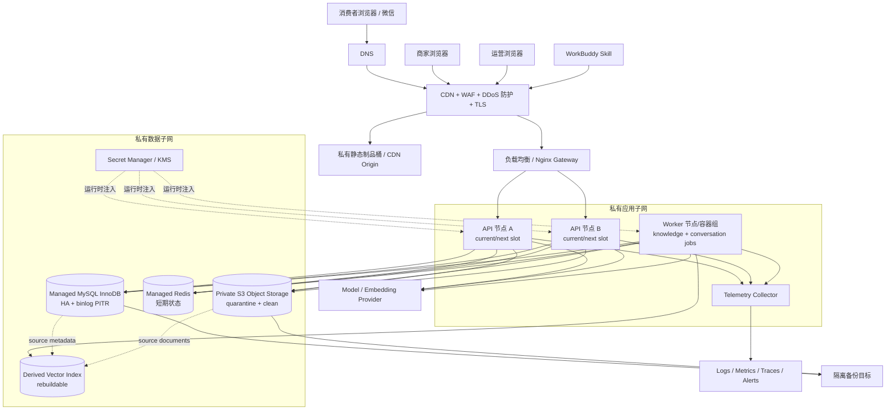
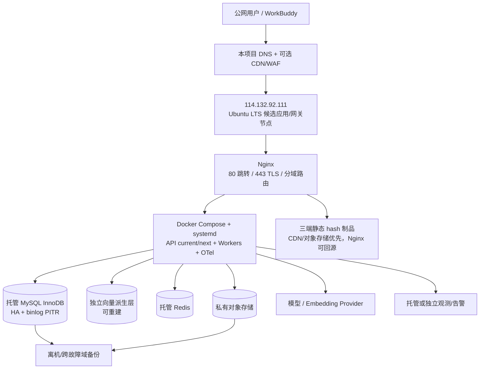

# H5 AI 客服生成与管理平台：服务器部署与发布设计

> - 文档状态：V1.2，包含部署设计、MySQL ADR，以及 2026-09-21 已执行的 S0～S2 云网络、SSH、主机基线和域名 HTTP 收敛记录；尚未部署业务、数据库或 TLS。
> - 设计日期：2026-09-20；最近实施更新：2026-09-21。
> - 输入依据：`README.md`、`10-overall-system-architecture.md`、`02-backend-data-ai.md`、`03-frontend-systems.md`、`04-platform-security-delivery-skill.md`。
> - 适用范围：服务器与网络、Linux 基线、容器和进程、Nginx/边缘网关、域名与 TLS、数据服务、Secret、环境配置、迁移、CI/CD、灰度、回滚、备份恢复、监控告警、容量成本、部署验证与运维 Runbook。

## 1. 标记约定与设计结论

本文使用三类显式标记：

- **[建议基线]**：适合 P0 小规模试点的默认方案，评审通过后才能进入实施。
- **[待确认]**：依赖业务目标、实际云平台、容量、成本或技术尖峰，不能当作已批准结论。
- **[用户需提供]**：实施前必须由资源所有者提供或授权的信息；缺失时不得猜测、购买或变更外部资源。

### 1.1 首版部署结论

1. **[建议基线]** 保持 TypeScript 单仓库、三个独立 Web 产物、模块化单体 API 和独立 Worker；不为首版引入 Kubernetes 或微服务。
2. **[建议基线]** 三个前端优先生成静态产物并经对象存储/CDN 或 Nginx 发布；API 与 Worker 构建为不同启动入口的容器镜像，可来自同一代码库和基础镜像。
3. **[用户决策/建议基线]** 生产数据使用托管私网 MySQL InnoDB、托管 Redis、私有 S3 兼容对象存储和云 Secret Manager；应用节点不保存业务真值，MySQL TCP 3306 永不公网开放。
4. **[建议基线]** 可靠异步任务的真值是 MySQL InnoDB Transactional Outbox + Job 表；Redis 只承载短期唤醒、SSE 临时事件、缓存、限流和短锁。
5. **[建议基线]** 生产至少两个无状态 API 故障单元；Worker 独立部署和伸缩。若预算只能支持单机，只能作为开发、预发布或明确接受风险的封闭试点，不宣称高可用。
6. **[建议基线]** 域名按消费者、商家、运营、Skill API 分面；每个 Web 面优先同源代理自己的 API，降低 Cookie、CORS 和 CSRF 复杂度。
7. **[建议基线]** 制品一次构建、按不可变 digest 晋级；数据库迁移采用 expand/contract；发布先预发布验证，再灰度生产；应用回滚与数据库恢复分开处理。
8. **[待确认]** 腾讯云广州和正式域名 `h5cs.1rying.com` 已确定；TLS 仍待证书账户邮箱与 CA 条款确认，托管 MySQL/Redis/对象存储产品、SLO/RPO/RTO、真实负载、预算和合规要求仍待冻结。

### 1.2 不可破坏的架构约束

- 任何部署简化都不得绕过 `merchant_id` 租户上下文、Session 所有权、不可变 Release、幂等写入和审计。
- `public_slug`、二维码和固定 H5 链接只能定位公开客服，不能成为会话或管理凭据。
- 在线 H5 不依赖 WorkBuddy 存活；Skill、MCP、OAuth 或 WorkBuddy 分发失败不能拖垮消费者数据平面。
- API/Worker 的运行身份不持有云控制台管理员权限；模型、数据库和对象存储密钥不进入前端、镜像、Git 或 Skill 包。
- Redis、容器本地磁盘和单台主机都不是业务真值；数据库、对象存储和审计必须可独立恢复。

## 2. 实施前必须取得的用户输入

### 2.1 资源与权限清单

| 类别 | [用户需提供] 内容 | 缺失影响 |
| --- | --- | --- |
| 云与地域 | 云厂商/账号/项目、目标地域和可用区、预算归属、资源配额、是否允许开通托管服务 | 无法冻结网络、服务规格、价格和数据驻留方案 |
| 服务器 | 已有主机清单、用途、CPU/内存/磁盘、操作系统与架构、公私网 IP、到期时间、是否允许重装 | 无法选择 VM、容器平台或单机降级方案 |
| 网络 | VPC/CIDR、子网、安全组、防火墙、NAT/公网出口、固定出口 IP、VPN/堡垒机、IPv6 要求 | 无法设计精确路由、白名单和运维入口 |
| 访问授权 | SSH 公钥、允许的运维身份、sudo 边界、云 IAM 角色、是否允许 CI 部署 | 不得连接或改变服务器；无法设计自动发布凭据 |
| 域名与 DNS | 当前正式域名 `h5cs.1rying.com`；后续是否拆分 H5、商家、运营、Skill API 子域；备案/合规审批 | 当前 HTTP Host 已收敛；缺少后续分域结论会阻塞 Cookie/CORS 和正式路由 |
| TLS | 证书账户邮箱、CA 条款确认、续期责任人；当前计划 ACME/等价自动签发 | 未确认前不申请证书、不启用 443 |
| 数据服务 | 托管私网 MySQL InnoDB、Redis、对象存储、备份库的产品/版本、网络端点、容量、HA 和付费限制 | 无法确定部署方式、迁移窗口和恢复能力 |
| 外部 Provider | 模型/Embedding/Reranker 服务、区域、Endpoint、凭据获取方式、配额、数据使用条款 | 无法做出口白名单、延迟/成本和降级设计 |
| 代码与制品 | Git 托管平台、主分支策略、CI 执行器、容器镜像仓库、制品保留与签名服务 | 无法实现可信构建与自动部署 |
| Secret/KMS | 可用的 Secret Manager/KMS/Vault、密钥管理员、轮换要求 | 无法决定密钥注入和加密方式 |
| 监控与通知 | 现有 APM/日志/指标平台、告警渠道、值班联系人和升级链路 | 告警无法送达，不能宣称可运营 |
| 业务目标 | 试点商家数、峰值并发 Session、每日消息、文档量、单文件上限、可接受停机和维护窗口 | 无法完成容量、限流和成本估算 |
| 恢复目标 | 确认的 SLO、RPO、RTO、备份保留期、异地/跨账号要求、恢复审批人 | 无法验收备份与灾难恢复 |
| 合规与隐私 | 数据驻留、保留/删除、日志和备份要求、是否允许第三方监控或模型处理正文 | 无法冻结地域、供应商和日志方案 |
| 变更治理 | 生产发布审批人、紧急变更联系人、冻结期、事故负责人 | 无法建立生产发布和回滚授权链 |

这些输入可以分批提供，但在进入生产资源创建前，云账号/地域、网络、域名、数据服务、Secret、监控、恢复目标和变更责任人必须全部有明确结论。

当前已确认腾讯云实例 `ins-oo7je11q`（`ap-guangzhou-7`）、公网 `114.132.92.111`、内网 `10.8.11.111`、Ubuntu 22.04、2 vCPU/8 GiB/50 GiB，以及正式域名 `h5cs.1rying.com`。S2 主机基线与 HTTP Host 收敛已经完成；云账号归属、固定 EIP 状态、托管 MySQL/Redis/对象/向量产品、Secret、镜像制品和 TLS 证书信息仍需补齐。

### 2.2 当前不应替用户做出的决定

- 不代替用户购买云资源、域名、证书或第三方模型额度。
- 不猜测服务器 IP、SSH 用户、DNS 托管商、云区域或数据库密码。
- 不把建议的 99.9% 可用性、15 分钟 RPO、4 小时 RTO 当作用户已接受的承诺。
- 不默认中国大陆、境外或特定行业的备案/合规结论；由用户和法务确认适用要求。
- 不因为存在一台服务器就把 MySQL、Redis、对象存储和生产应用全部永久放在同一故障域；当前 2 vCPU/8 GiB 应用/网关机不安装 MySQL。

## 3. 环境与部署拓扑

### 3.1 环境隔离

| 环境 | 目标 | 资源隔离 | 数据 | 发布权限 |
| --- | --- | --- | --- | --- |
| Local | 开发与单元测试 | 本机容器/Mock | 合成数据 | 开发者本机 |
| Dev | 持续联调 | 独立命名空间和凭据；允许低规格共享基础设施但禁止连生产 | 合成/脱敏夹具 | CI 自动部署 |
| Test | 集成、安全、容量自动化 | 可临时创建；独立数据库/Schema 和对象前缀 | 固定多租户夹具 | CI 自动创建/销毁 |
| Staging | 生产同构演练、真机和 WorkBuddy 验证 | 独立网络逻辑、数据库、Redis、对象桶、密钥和 Provider 沙箱账号 | 禁止复制未脱敏生产数据 | 受控自动部署 |
| Production | 正式试点 | 独立账号/项目优先，至少独立网络与所有数据资源 | 真实数据 | 审批后渐进发布 |

**[建议基线]** Staging 与 Production 使用相同镜像、启动方式、迁移流程、网关规则和可观测性，只降低规格。配置值可以不同，配置 Schema 不得不同。

### 3.2 三种实施档位

| 档位 | 架构 | 适用 | 结论 |
| --- | --- | --- | --- |
| A 托管优先 | CDN/WAF/LB + 托管容器或两台应用 VM + 托管 MySQL/Redis/对象存储/Secret | 正式试点和生产 | **[建议基线]** |
| B 便携 Ubuntu | CDN/LB + 两台 Ubuntu LTS；Docker Compose + systemd；数据仍尽量托管 | 没有容器平台但能管理 VM | **[建议基线的可移植实现]** |
| C 单机封闭试点 | 一台 Ubuntu 同时运行 Nginx、API、Worker；数据最好仍外置托管 | 开发、演示、极小封闭试点 | **[待确认风险接受]**，无节点高可用；不得宣传生产 HA |

P0 不自建 Kubernetes。只有用户已有受管集群、团队具备持续运维能力并能复用安全/观测/发布体系时，才把同一容器和配置模型映射到 Kubernetes。

### 3.3 推荐生产拓扑



**[建议基线]** API 节点跨两个故障单元；Worker 至少一个实例，Job 表租约使其可以安全扩为多个。应用节点只缓存可重建数据，不保存上传原件、业务数据库或唯一日志。

### 3.4 网络分区与端口

| 来源 | 目标 | 端口/协议 | 策略 |
| --- | --- | --- | --- |
| Internet | Edge/LB | TCP 443 | 唯一公网业务入口；80 仅做 HTTPS 跳转 |
| 运维人员 | Bastion/VPN | TCP 22 或企业远程管理协议 | 仅批准身份和来源；应用节点不直接暴露 SSH |
| Edge/LB | Nginx/API 节点 | 私网 HTTPS 或受控 HTTP | 安全组只允许边缘来源；保留真实源 IP 的受信代理链 |
| Nginx | API 容器 | 内部容器网络/loopback | 不发布到公网；按路由白名单转发 |
| API/Worker | MySQL InnoDB | TCP 3306 + TLS | 仅私网应用安全组；分角色账号；永不公网开放 |
| API/Worker | Redis | TCP 6379 或托管 TLS 端口 | 仅应用安全组；ACL/TLS |
| API/Worker | 对象存储 | HTTPS 443 | 私网 Endpoint 优先；最小桶权限 |
| API/Worker | 模型服务 | HTTPS 443 | 出口域名/IP 白名单；超时、熔断和成本限制 |
| 节点/容器 | Telemetry Collector | 私网 OTLP | 只允许观测出口；正文和 Secret 脱敏 |
| 监控系统 | `/metrics`/节点采集端口 | 私网 | 不向公网开放 |

**[建议基线]** 安全组和主机防火墙均默认拒绝。数据库、Redis、容器运行端口、Docker API、指标端点和管理面板永不直接暴露公网。

## 4. 域名、同源策略与 TLS

### 4.1 建议域名矩阵

| 用途 | 建议形式 | 路由范围 | Cookie/缓存 |
| --- | --- | --- | --- |
| 消费者 H5 | `chat.<root-domain>` | 静态 H5 + `/api/v1/public/*` 同源反代 | 匿名凭据使用 Host-only Cookie；HTML 短缓存，API 不缓存 |
| 商家后台 | `console.<root-domain>` | 商家静态产物 + `/api/v1/merchant/*` 同源反代 | 商家会话 Host-only；静态 hash 资源长缓存 |
| 运营后台 | `ops.<root-domain>` | 运营静态产物 + `/api/v1/ops/*` 同源反代 | 更短会话；禁止搜索引擎收录；不得与商家共享 Cookie |
| Skill API | `skill-api.<root-domain>` | 仅 `/api/v1/skill/*` | Bearer/候选 OAuth；所有业务响应不缓存 |
| 静态资源（可选） | `assets.<root-domain>` | 只读 hash 资源 | 长缓存、无凭据 |

**[当前事实]** P0 已确定并配置单一正式 Host `h5cs.1rying.com`，解析到 `114.132.92.111`。在多子域和业务制品尚未冻结前，Nginx 仅对该 Host 提供 HTTP 维护态入口；直接 IP 和未知 Host 不提供业务响应。上表是后续分面目标，不代表这些子域已创建。

**[建议基线]** 每个 Web 域名通过边缘或 Nginx 将对应 API 前缀代理到同一 API 应用，避免浏览器跨域。API 应用仍按 `/public`、`/merchant`、`/ops`、`/skill` 使用独立鉴权中间件。不得设置覆盖 `.root-domain` 的广域 Cookie。

**[待确认]** 若必须使用统一 `api.<root-domain>`，需逐域配置精确 CORS allowlist、`credentials`、CSRF/Origin 校验和 Cookie SameSite；严禁 `Access-Control-Allow-Origin: *` 与凭据并用。

### 4.2 DNS 和证书

- **[建议基线]** DNS 使用低但非极端的变更 TTL；切换前至少一个 TTL 周期降低，稳定后恢复。生产和 Staging 使用不同主机名。
- **[建议基线]** TLS 在 CDN/LB 或 Nginx 终止，边缘到源站继续使用受信 TLS 或私网受控链路；TLS 最低 1.2，优先 1.3。
- **[建议基线]** 自动续期证书，并对 30/14/7 天到期设置告警；私钥进入证书服务或 Secret Manager，禁止进仓库和镜像。
- **[建议基线]** 全站 HTTP 跳转 HTTPS；确认所有子域稳定后再启用 HSTS，先短 `max-age` 试运行，再评估是否包含子域。
- **[待确认]** 是否使用通配符证书、企业证书或 ACME 取决于 DNS 权限和组织安全规范。运营域优先单独证书/入口，降低误配影响。
- **[用户需提供]** `h5cs.1rying.com` 的证书账户邮箱、CA 条款确认、续期责任人以及适用的备案/合规状态；缺失时保持 HTTP 维护态且不监听 443。

## 5. Linux 服务器基线加固

适用于档位 B/C；托管容器平台应映射到等价控制。

### 5.1 操作系统与账号

- **[建议基线]** 使用仍在厂商安全支持期的最小化 Ubuntu LTS 镜像；最终版本、内核和 CPU 架构在创建服务器时锁定。
- 使用 UTC 系统时区、可靠 NTP、统一主机命名和资产标签；业务显示时区在应用层处理。
- 禁止 SSH root 登录和密码登录；只允许个人公钥/企业身份，禁止多人共享私钥。
- 运维账号、部署账号和应用运行身份分离。部署账号的 Docker 权限等同主机 root，必须最小化并审计。
- sudo 使用命令/角色边界；日常诊断默认只读，临时提权有到期时间。
- 删除默认无用账号、服务和软件包；禁止在生产主机安装编辑器、编译器和无关调试服务，紧急诊断工具使用审批后的临时容器或受控包。

### 5.2 补丁、防火墙与内核

- 启用安全更新自动下载/安装；需要重启的内核更新进入约定维护窗口。补丁失败、待重启时间过长要告警。
- 主机防火墙默认拒绝入站；22 仅来自 VPN/堡垒机/固定运维网段；80/443 只按拓扑开放。
- 公网 SSH 不是建议方案；若短期无法避免，再增加速率限制、Fail2ban/等价防护和严格来源白名单。
- 保持 AppArmor/等价强制访问控制开启；容器使用默认或加固 seccomp，不以关闭安全模块解决兼容问题。
- 关闭 IP 转发等非必要能力；Docker 网络所需转发由受控规则明确开启。禁止 Docker 自动规则意外绕过云安全组/主机防火墙。
- 配置文件句柄、进程数和 TCP keepalive 以 SSE 压测结果为准；不在未测试时盲目提高内核参数。

### 5.3 磁盘与主机日志

- 系统盘、容器数据盘和临时处理空间设独立容量告警；应用不得把上传文件永久留在 `/tmp` 或容器 writable layer。
- Docker 日志采用大小与文件数双重轮转；主机 `journald` 设置上限并转发到集中日志。
- 临时 PDF 解析目录使用专用目录或 `tmpfs`，任务结束清理；挂载 `nodev/nosuid`，条件允许时 `noexec`。
- 根盘达到 70% 预警、85% 高警、95% 紧急只是建议起点，需结合云盘扩容耗时确认。
- 主机镜像和初始化脚本版本化；禁止靠人工历史命令维持“雪花服务器”。

## 6. 容器与进程编排

### 6.1 P0 运行单元

| 单元 | 职责 | 扩缩容依据 | 本地持久化 |
| --- | --- | --- | --- |
| `api` | 四个 API 面、认证、事务、SSE 协调 | 请求率、P95、在途请求、SSE 连接、CPU/内存 | 无 |
| `worker-conversation` | Turn、模型/RAG、Usage 收敛 | 活跃 Turn、最老 Job、Provider 配额 | 无 |
| `worker-knowledge` | PDF 扫描/解析、切片、Embedding、索引 | Job 队列、CPU/内存、Provider 配额 | 仅受限临时空间 |
| `web-*` 或静态制品 | 三端静态资源；若后续启用 SSR 才变为运行容器 | 流量/构建产物 | 无 |
| `nginx` | TLS/路由/SSE/安全头；使用托管 LB 时可由边缘代替部分职责 | 连接数、5xx、带宽 | 仅配置和短日志 |
| `otel-collector` | 收集、过滤、批量发送遥测 | 遥测吞吐和队列 | 有界缓冲，不是业务真值 |
| `migrator` | 单次数据库迁移 Job | 每次发布一次 | 无 |

Worker 逻辑可以来自同一镜像，但使用不同 Job 类型白名单、资源限制和并发参数，避免 PDF 解析耗尽对话资源。

### 6.2 Docker/容器安全

- 镜像以非 root 用户运行，固定 UID/GID；`read_only` 根文件系统，临时写入使用受限 `tmpfs`/volume。
- 默认 `cap_drop: ALL`、`no-new-privileges`、默认 seccomp/AppArmor；禁止 privileged、host network、host PID、宿主根目录和 Docker socket 挂载。
- 镜像用 digest 部署；基础镜像保持小型且有安全支持，生产镜像不包含源码、测试夹具、包管理缓存或调试密钥。
- 每个服务设置 CPU、内存、PIDs 和临时磁盘上限。OOM 需产生明确告警，不能无限自动重启掩盖泄漏。
- 容器网络按 `edge`、`app`、`telemetry` 分段；只有 Nginx 可达 API 监听端口，Worker 不接受公网入站。
- PDF/文件处理容器禁公网出站，使用最小只读输入和临时输出；模型/Embedding 步骤由另一个有受控出口的 Worker 完成更安全。

### 6.3 进程生命周期与健康检查

| 探针 | 含义 | 不应检查 |
| --- | --- | --- |
| `/livez` | 进程事件循环和基本自检正常 | 不访问外部模型/Redis/对象存储 |
| `/readyz` | 可接受新流量；数据库可用、Schema 兼容、应用未排空 | 不因非关键 Provider 短暂故障踢出全部实例 |
| `/startupz` | 启动和配置校验完成 | 不成为长期健康检查 |
| Worker heartbeat | 进程活跃、可领取允许版本的 Job、租约续期正常 | 不把单个业务 Job 失败视为进程死亡 |

进程接收终止信号后先从负载均衡摘除，停止接收新请求/Job，给 SSE 和当前任务有限排空时间；到期后安全终止并由状态机恢复。具体 grace period 由最长普通请求、SSE 总时长和 Job 分段能力试测确定。

### 6.4 编排选择

- **[建议基线]** 有现成托管容器平台则使用其 Deployment/Service/Secret/Auto Scaling 能力。
- **[建议基线]** 便携 Ubuntu 使用 Docker Compose 描述服务，由 systemd unit 管理每个环境/发布槽；禁止用交互 Shell 长期运行 `docker compose up`。
- **[建议基线]** Compose 生产发布使用 `current`/`next` 两套 project/端口或跨节点滚动；Nginx upstream 原子切换，不原地覆盖运行容器。
- **[待确认]** 若三端启用 Next.js SSR，需要独立 `merchant-web`、`consumer-h5`、`ops-web` 容器与缓存设计；P0 静态外壳不先承担这项复杂度。

## 7. Nginx、边缘网关与 SSE

### 7.1 路由原则

- 主机名与允许路径双重白名单：`chat` 只能访问 Public API，`console` 只能访问 Merchant API，`ops` 只能访问 Ops API，`skill-api` 只能访问 Skill API。
- 未匹配 Host、内部路由、`/metrics`、调试端点和管理端口直接拒绝，不转给通用 API。
- 统一生成/透传 `X-Request-Id` 和 W3C `traceparent`；仅信任已知 CDN/LB 的真实源 IP 头，防止伪造。
- 普通 API 和 HTML 设置合理 body/头大小；PDF 优先走对象存储预签名直传，不经过 Nginx。若必须代理上传，只对上传路由放宽上限。
- API、带 Cookie 的 HTML、Session 历史、Skill 响应和 SSE 禁止 CDN/代理缓存；hash 静态资源使用不可变长缓存。

### 7.2 SSE/流式代理基线

仅在流式路由启用以下语义：HTTP/1.1 或受支持的 HTTP/2 流式传输、关闭代理缓冲和响应缓存、关闭可能聚合数据的压缩/转换、读取超时大于应用总生成上限、及时 flush。应用发送心跳的周期需小于 CDN/LB/Nginx 最短空闲超时。

**[待确认]** 选择 CDN/LB 后必须实测：首字节、持续流、空闲超时、客户端中断、Nginx reload、单节点摘除、移动网络切换和微信 WebView。任何中间层偷偷缓冲都会直接破坏“首段 P95”口径。

### 7.3 安全头和浏览器策略

- 全站设置 `X-Content-Type-Options: nosniff`、合适的 `Referrer-Policy` 和 `Permissions-Policy`。
- CSP 按三端分别生成：生产禁 `unsafe-eval`，脚本使用自身 hash/nonce 或静态来源；`connect-src` 只允许对应 API、遥测和必要对象存储域名。
- 使用 CSP `frame-ancestors` 控制嵌入；运营端默认禁止被嵌入。是否允许商家把 H5 嵌入第三方页面必须产品与安全单独确认。
- 受限 Markdown 不由 Nginx 信任或清洗，仍由前端 sanitizer 处理。
- 只有 HTTPS 设置 `Secure` Cookie；管理 Cookie 使用 HttpOnly、Host-only 和明确 SameSite；CSRF Token/Origin 校验由 API 承担。

### 7.4 边缘限流

边缘只做粗粒度 IP/路径/请求体保护，应用再按 Merchant、VisitorCredential、Session、Assistant 和配额做精确限流。微信/运营商 NAT 会共享 IP，不得仅因单 IP 流量高永久封禁所有用户。SSE 建连、消息发送、登录、上传、需求提交和 Skill 调用使用不同规则。

## 8. MySQL InnoDB 与向量派生层

### 8.1 部署基线

- **[用户决策/建议基线]** 使用托管私网 MySQL InnoDB，启用高可用、静态/传输加密、自动备份、binlog 连续归档/PITR 和维护窗口；具体产品与版本由腾讯云支持矩阵、预算和压测冻结。
- MySQL 仅私网可达，TCP 3306 永不加入公网安全组或 UFW。应用经私网 Endpoint/安全组访问，运维通过堡垒/VPN 或云数据库代理。
- 当前 2 vCPU/8 GiB 的 `114.132.92.111` 只作为应用/网关节点，不安装 MySQL。只有用户另行明确选择临时单机、完成扩容/数据盘/备份设计并书面接受单故障域风险时，才重新评审本机 MySQL。
- 时区统一 UTC，字符集 `utf8mb4`、排序规则随产品兼容性冻结，启用严格 SQL mode、Performance Schema、`sys` Schema 和慢查询能力。在线应用不拥有创建用户、授权、数据库或 DDL 权限。

### 8.2 角色与连接

| 角色 | 权限 |
| --- | --- |
| `db_admin` | 仅平台 DBA/受控自动化持有；管理数据库对象和账号，不供应用运行 |
| `migrator` | 执行审核过的迁移并持有迁移锁；无云平台管理员和业务导出权限 |
| `app_api` | API 所需表/视图/存储过程最小权限；无 DDL、授权和跨环境权限 |
| `app_worker` | Worker 所需 Job、知识、Turn、Outbox 权限；与 API 分开 |
| `readonly_ops` | 经批准的脱敏诊断/报表权限；默认无正文和批量导出 |
| `backup_restore` | 备份与隔离恢复，不供日常查询 |

连接池总预算必须小于 MySQL `max_connections` 的安全比例，并为迁移、监控、故障处理和故障转移保留余量。建议从小池开始：`API 实例数 × 每实例池 + Worker 并发池 + 运维保留`，通过连接等待、`Threads_running`、事务吞吐和故障转移压测调优；不把提高 `max_connections` 当作首选修复。

### 8.3 租户约束、索引与向量派生

- 每张租户业务表显式带 `merchant_id`，复合主键/唯一键/外键尽量把租户键纳入约束；Repository/DAO 必须从受信请求上下文注入租户条件，并对所有查询、更新和删除做跨租户负向测试。
- MySQL 不提供本文旧 PostgreSQL 方案中的原生 RLS 防线，因此不得在验收记录中声称“RLS 已启用”。第二道防线改为复合数据库约束、API/Worker 分角色最小权限、禁止无租户条件的通用查询接口、审计和 A06/A07/A14 负向测试。
- 向量检索不默认依赖 MySQL 插件或 pgvector。Embedding/向量索引部署为独立、可重建的派生层；MySQL 保存 Source/Revision/Chunk、租户归属、Embedding 模型/版本和索引状态，对象存储保存原件/解析产物。
- 向量层的每条记录必须携带并强制过滤 `merchant_id + assistant_id + release/revision` 闭包。向量服务可在 PoC 后选择托管向量检索、OpenSearch 或专用服务，但不得成为业务真值；丢失时从 MySQL 与对象存储重建。
- 大表 DDL/索引优先使用云产品支持的 Online DDL、`ALGORITHM=INSTANT/INPLACE` 等受控能力；在 Production 前用接近真实体量数据验证 metadata lock、binlog/复制延迟、临时空间、回滚和旧应用兼容性。
- 对 Session/Message/Usage/Audit 的增长建立容量和归档阈值；是否分区待真实写入量、MySQL 产品限制和保留期确认，不在 P0 预先复杂化。

### 8.4 数据库运维指标

监控：可用性、连接使用率/等待、`Threads_running`、事务时长、慢查询、行锁/metadata lock/死锁、Buffer Pool 命中与脏页、redo、binlog/复制延迟、InnoDB purge 与 history list length、undo/临时空间、表/索引容量、磁盘/IOPS，以及备份/PITR 可恢复时间窗。长事务、空闲事务、迁移锁等待和复制落后需单独告警；`OPTIMIZE TABLE` 不是 PostgreSQL vacuum 的机械替代，必须按表、空间和锁影响单独评审。

## 9. Redis

- **[建议基线]** 使用私网托管 Redis，TLS/ACL、自动故障转移；在线应用与运维使用不同 ACL。
- Redis 只存有 TTL 的缓存、限流计数、短锁、SSE 临时事件和可重建信号，不保存唯一消息、Job、Usage 或发布状态。
- Key 必须包含环境与租户边界：`env:module:merchant_id:assistant_id:resource:id`；禁止只用 `session_id` 或 `public_slug`。
- **[建议基线]** 初始采用 `noeviction` 或等价显式失败策略，避免锁/限流在内存压力下静默消失；所有 key 要有合理 TTL，Stream/事件设置最大长度。
- Redis 故障时不得跨租户读取旧缓存。API 可清缓存后回源数据库；消息受理和限流采用经评审的保守降级，不能无限放开昂贵模型调用。
- 不为业务恢复依赖 Redis 备份；若开启 AOF/快照，仅用于缩短缓存恢复，不改变其“非真值”定位。

监控：内存、碎片率、连接、命令延迟、阻塞客户端、拒绝连接、故障转移、Key 数、过期速率、Stream 长度和任何 eviction。出现 eviction 应视为容量或 TTL 缺陷。

## 10. 对象存储与文件处理

### 10.1 桶与前缀

**[建议基线]** 至少区分：上传隔离区 `quarantine`、扫描/解析后私有区 `clean`、派生产物/临时区、备份/归档区。可使用独立桶或同桶严格前缀与 IAM，但生产和非生产必须分开。

对象键遵循 `merchants/{merchant_id}/knowledge/{source_id}/revisions/{revision_id}/...`，不使用原始文件名作为授权依据。桶关闭公共访问，启用服务端加密、版本控制、访问日志和生命周期。

### 10.2 上传与访问

- API 签发短期、单对象、限定方法/大小/类型/前缀的预签名 URL；CORS 只允许商家后台域名和必要方法。
- 客户端上传完成后以幂等请求提交对象 key、大小和哈希；服务端 HEAD/校验后才创建 KnowledgeRevision 和 Job。
- 扩展名、MIME、魔数、大小、页数和恶意软件扫描都在服务端重新验证。扫描失败或超时不进入 clean/ready。
- 解析容器无网络、只读输入、资源/PID/时间限制；输出写临时区，成功后原子登记到数据库。
- 下载前重新做租户授权再签发短期 URL；日志不记录完整预签名 URL。

### 10.3 生命周期

原件、解析文本、Chunk/Embedding 派生物、失败隔离文件和历史 Release 引用的保留策略不同。删除任务必须覆盖对象、数据库引用、向量、缓存和恢复墓碑；备份中的删除以最长自然过期时间和恢复后重放墓碑保证。

## 11. Secret 与环境配置

### 11.1 Secret 分类

| Secret | 建议所有者 | 注入目标 | 轮换触发 |
| --- | --- | --- | --- |
| 数据库账号 | 平台/DBA | API、Worker、Migrator 各自独立 | 定期、人员/权限变化、疑似泄漏 |
| Redis ACL | 平台 | API、Worker | 同上 |
| 对象存储凭据 | 云 IAM/工作负载身份 | API、Worker | 优先短期凭据，不保留长期 Key |
| Cookie/Token 签名密钥 | 安全/平台 | API | 定期双密钥轮换，保留验证窗口 |
| 模型/Embedding Key | Provider 管理员 | API/Worker 的 Provider Adapter | 配额/人员变化、疑似泄漏 |
| 监控上报 Token | 平台 | OTel/前端构建的公开 DSN 需单独区分 | 权限或 Endpoint 变化 |
| WorkBuddy 凭据/客户端配置 | 商家或平台授权系统 | Skill API/OAuth 服务 | 到期、撤销、账号变化 |

### 11.2 注入与存储

- 首选工作负载身份读取 Secret Manager；次选由部署系统在启动时挂载只读临时文件。环境变量仅在平台安全边界可接受且不会进入诊断/进程转储时使用。
- Docker Compose 文件、systemd unit、镜像、前端 bundle、CI 日志和仓库中只出现 Secret 引用，不出现值。
- CI 生产 Job 使用短期 OIDC/工作负载身份，不保存长期云管理员 Key。CI 能部署不代表能读取业务正文或数据库。
- 独立记录 Secret 版本而非值；支持新旧两版并存的无中断轮换，轮换完成后验证旧值失效。
- 若无 Secret Manager，**[待确认]** 可用 SOPS/等价加密文件 + KMS 和 root-only 临时解密作为过渡；纯文本 `.env` 不是生产方案。

### 11.3 配置契约

配置分为：非敏感部署配置、Secret 引用、业务运行策略、Feature Flag。应用启动时以 Schema 验证类型、枚举、URL、范围和依赖，关键项缺失拒绝启动。

关键配置域包括：环境/服务名、构建版本、Public/Merchant/Ops/Skill Origins、Cookie 策略、数据库/Redis/对象引用、模型 Provider、超时、Job 并发、上传限制、上下文限制、限流/额度、观测 Endpoint 和 Feature Flag。任何默认值都必须在配置文档中可见，不能在代码中悄悄形成生产策略。

## 12. 数据库迁移设计

### 12.1 迁移原则

- 迁移文件随代码版本化且不可修改历史；每次发布输出目标 Schema 版本和兼容范围。
- Migrator 使用独立账号和一次性 Job；全环境同一套迁移制品。API 启动只检查兼容性，不自行竞争执行迁移。
- Migrator 使用专用连接取得 MySQL 命名迁移锁（例如 `GET_LOCK`）或迁移工具自带锁表，保证单实例执行；记录 `IS_USED_LOCK`/锁表状态并在 finally 中释放。命名锁是连接级而非事务级，断线和连接池复用必须演练。为 metadata/行锁设置受控的 `lock_wait_timeout`、`innodb_lock_wait_timeout` 与客户端执行超时，超时即失败退出，不无限等待阻塞生产流量。
- 所有变更遵循 expand → backfill → switch → contract。先加可空字段/新表/兼容索引，部署兼容代码，异步回填并校验，最后在后续发布删除旧结构。
- 大表回填分批、可暂停、可重跑并带进度；不在一个长事务中更新全表。
- 破坏性 DDL、列类型重写、租户约束/授权路径变更、向量重建和大索引必须在 Staging 用近似数据量演练并由人工批准。

### 12.2 发布顺序

1. 校验全量备份 + binlog PITR 可用、数据库容量、复制延迟和无长事务/metadata lock。
2. 执行兼容性 expand 迁移；记录迁移 ID、耗时、锁和校验结果。
3. 启动 `next` API/Worker，验证其同时兼容当前和目标 Schema。
4. 灰度切流并观察；启动可暂停的 backfill/索引 Job。
5. 全量稳定至少一个发布周期后，单独批准 contract 迁移。

数据库迁移失败不会自动用“向下迁移”恢复生产。首选停止切流、回滚应用到仍兼容的旧 digest 或执行经过评审的 forward fix；只有灾难场景才做时间点恢复。

## 13. CI/CD 与制品供应链

### 13.1 流水线


### 13.2 不可变制品

每个候选发布生成一份 Release Manifest，至少包含：Git commit、构建 ID、API/Worker/Web 镜像 digest、静态制品哈希、迁移集合与目标 Schema、OpenAPI/事件 Schema 版本、基础镜像、SBOM、签名/来源证明、配置 Schema 版本和构建时间。

生产只接受已签名、已在 Staging 运行过的 digest。禁止生产服务器 `git pull`、现场 `npm install`、手工编辑构建文件或使用浮动 `latest` 标签。

### 13.3 前端制品发布

- 先上传带内容哈希的静态资源并保留旧资源，再最后切换 HTML/运行时配置；避免旧 HTML 引用已删除资源。
- HTML、运行时配置和 Service Worker（若未来启用）短缓存或不缓存；hash 资源长缓存 `immutable`。
- 三端独立构建/发布和 CSP。消费者 H5 制品检查不得包含商家/运营代码、内部 API、Secret 或公开 source map。
- Source map 只上传到受控监控平台，不作为公开静态文件部署。
- API 需在 P0 发布周期内向后兼容至少当前和上一版前端，避免 CDN/浏览器旧页面瞬时失效。

### 13.4 生产权限

构建、签名、部署和审批身份分离。生产 Job 只能部署允许的服务和环境，不能读取业务数据库；人工紧急发布必须使用同一签名制品并留下审批、执行者、原因和结果。

## 14. 灰度发布与切流

### 14.1 发布前门禁

- 变更说明、风险、回滚条件、数据库兼容性、Feature Flag 和负责人齐全。
- Staging 使用同一 digest 通过核心 E2E、A06/A07 隔离、A13 幂等并发、A14 权限，以及 SSE/微信真机冒烟。
- MySQL 全量备份/binlog PITR 健康，目标数据库容量、节点资源、证书和 Provider 配额足够。
- 当前 P0/P1 事故已处理或有明确风险接受；错误预算允许发布。
- 旧镜像、旧静态资源、旧配置和切流命令可用；回滚负责人在线。

### 14.2 建议顺序

1. 构建并签名一次，部署 Staging 验证。
2. 生产执行 expand 迁移。
3. 启动 `next` API 实例，不接公开流量；运行 `/startupz`、`/readyz`、数据库/Redis/对象/模型受控冒烟。
4. 先用内部测试商家或受信测试请求验证；不得信任用户可伪造的 Canary Header 绕过授权。
5. 将少量真实流量切到 `next`，观察至少一个覆盖正常消息、SSE、Job 和发布操作的窗口。
6. 逐步提升权重；每一步检查 5xx、P95、SSE 中断、数据库锁/连接、Redis、Job 年龄、模型错误/成本、跨租户拒绝和重复副作用。
7. 部署兼容 Worker。旧 Worker 停止领取新 Job 后排空；Job payload 带 schema version，新旧版本均只能处理声明兼容的任务。
8. 发布静态 hash 资源，再切换 HTML/运行时配置。
9. 全量后继续观察，记录 Manifest、切流时间、指标和最终结论。

**[待确认]** 灰度比例和观察时长由真实流量决定。流量过低时，“5%”没有统计意义，应使用内部测试租户 + 固定用例 + 更长观察窗口。

### 14.3 Feature Flag

模型、Prompt、解析器、检索策略、WorkBuddy 写操作和消费者新消息受理均应有可审计 Kill Switch。Flag 必须有默认值、环境/租户范围、负责人、创建和失效日期；Flag 不能绕过身份授权或数据库约束。

## 15. 回滚设计

### 15.1 回滚矩阵

| 变更 | 回滚方式 | 关键限制 |
| --- | --- | --- |
| API/Worker 镜像 | Nginx/LB 切回上一签名 digest | 旧版本必须兼容当前 Schema 和事件；先停止坏版本领取新 Job |
| 前端 | HTML/运行时配置指回上一版本；保留所有旧 hash 资源 | 不强制打断正在流式回复的用户 |
| 非敏感配置 | 恢复上一版本化配置并滚动重启 | Secret 引用与 Schema 必须仍兼容 |
| Secret | 双版本切换或紧急轮换 | 泄漏时不能简单切回旧 Secret；必须吊销并调查 |
| Feature Flag | 关闭新功能/Provider/解析器 | 不替代数据修复和授权检查 |
| 数据库 expand 迁移 | 保留新增结构，应用回滚 | 不自动删除新列/表/索引 |
| 数据库破坏性变更 | Forward fix 或经批准的 MySQL binlog PITR | 会丢失目标时间点后的写入，属于灾难恢复 |
| 商家 Release | 重新激活完整历史 Release 并新增审计 | 与平台程序回滚是两条版本链，不能混淆 |

### 15.2 自动与人工边界

可自动回滚的条件只限于已知安全、无破坏性迁移的应用/前端制品，例如健康检查失败、5xx 或 P95 明显越界。跨租户风险、重复计费/Lead、数据损坏、迁移异常、Secret 泄漏必须立即止血并由事故负责人决定恢复动作，不能由简单自动脚本继续反复切换。

### 15.3 回滚验证

切回后必须验证：H5 固定链接、Session 恢复、SSE、消息幂等、当前 Release、发布/回滚、知识 Job、Usage 对账、数据库连接/锁、前端 buildId 和审计记录。只看到容器“running”不代表回滚成功。

## 16. 备份、恢复与灾难恢复

### 16.1 建议目标

| 数据 | [建议基线] RPO/RTO | 方案 |
| --- | --- | --- |
| MySQL InnoDB 业务数据 | RPO ≤ 15 分钟，RTO ≤ 4 小时 | 多故障单元托管 HA、全量备份 + binlog PITR、隔离恢复实例 |
| 审计记录 | RPO ≤ 15 分钟，RTO ≤ 8 小时 | 追加写、独立归档/对象锁（若合规需要） |
| 对象原件 | RPO ≤ 24 小时，RTO ≤ 8 小时 | 版本控制、生命周期、跨故障域/账号副本按风险决定 |
| 向量/全文索引 | 不单独承诺，24 小时内可重建 | 从 Release 绑定的 Revision 和对象重建 |
| Redis | 无业务 RPO；故障后可重建 | 不作为真值 |
| Git/IaC/制品/配置 | RPO ≤ 24 小时，RTO ≤ 4 小时 | Git + 不可变制品库 + Release Manifest |

**[待确认]** 以上值沿用 A4 建议，必须由用户根据业务损失和预算批准。备份保留天数、异地/跨账号、对象锁和加密密钥托管也需确认。

### 16.2 备份规则

- 备份加密，备份管理员与在线应用身份分离；至少一份副本不能被生产应用账号删除。
- MySQL 启用自动全量备份与 binlog 连续归档/PITR；每日校验任务状态、binlog 连续性、保留期和可恢复时间窗。
- 对象存储启用版本控制和生命周期；删除标记、历史 Release 引用和法定/合同保留必须协调。
- Redis 不承担业务恢复。容器卷只备份必要配置引用，不备份可重建镜像和临时文件。
- KMS/Secret 恢复流程单独演练；有数据备份但丢失加密密钥等同不可恢复。

### 16.3 恢复演练

1. 在与生产隔离的网络/账号恢复数据库到指定时间点。
2. 用签名制品和版本化配置创建临时应用，不覆盖生产 DNS。
3. 校验 Schema、租户/客服/Session 计数、Release 指针、幂等记录、Usage、审计连续性和对象引用。
4. 从 MySQL Source/Revision/Chunk 元数据与对象原件重建独立向量/全文派生层和缓存，重放删除墓碑，防止已删除数据重新可见。
5. 执行 A03、A05～A09、A13 冒烟和链接验证，记录实际 RPO/RTO。
6. 销毁隔离恢复环境前确认其中不残留可公开访问的数据。

上线前至少完成一次端到端恢复；试点阶段建议每季度以及重大迁移后演练。恢复报告包括时间线、失败点、数据差异和改进负责人。

## 17. 可观测性与告警

### 17.1 收集架构

应用使用 OpenTelemetry 或等价标准发送结构化日志、指标和 Trace 到本地/托管 Collector，再由 Collector 批量发送到观测平台。节点、容器、Nginx、MySQL、独立向量派生层、Redis、对象存储、CI/CD 和外部 Provider 指标统一关联环境、服务、buildId、trace/request ID；高基数 Session/Visitor ID 不作为指标标签。

普通日志禁止 Authorization、Cookie、预签名 URL、完整联系方式、消息正文、文件内容、Prompt 和模型密钥。需要质量回放时通过受控业务查询并记录审计。

### 17.2 最小仪表盘

| 仪表盘 | 指标 |
| --- | --- |
| Edge/Nginx | QPS、状态码、请求/响应字节、TLS、连接、SSE 在途/中断、upstream 时间 |
| API | RED 指标、事件循环延迟、内存/GC、连接池、各 API 面和错误码 |
| Worker/Job | Job 数量、最老年龄、领取/完成/重试/死信、租约超时、各 Job 类型耗时 |
| MySQL InnoDB | 可用性、连接/`Threads_running`、事务、行锁/metadata lock/死锁、慢查询、Buffer Pool、redo、binlog/复制、purge/history list、存储/IOPS |
| 向量派生层 | 索引版本/落后量、构建队列、Recall/P95、租户过滤失败、重建进度与容量 |
| Redis | 内存、延迟、连接、故障转移、拒绝、eviction、Key/Stream 增长 |
| Object/文件 | 上传/下载/签名失败、扫描/解析失败、容量、生命周期和拒绝访问 |
| AI/成本 | Provider 成功/超时/限流、首 Token、总时长、Token/费用、额度预占/结算差异 |
| 业务/SLO | H5 可用、Session 创建/恢复、消息、发布、Lead、未解决、A4 定义的 SLI |
| Release | 当前 buildId/digest、迁移版本、配置版本、灰度权重和最近变更 |

### 17.3 告警

- P0：跨租户泄漏、密钥泄漏、数据不可恢复、全站不可用。
- P1：持续 SLO 燃烧、数据库不可用/空间危急、SSE 大面积中断、Job 严重积压、模型大面积失败或成本异常。
- P2：单类型任务失败上升、证书/备份/磁盘/配额临近阈值、Redis 内存或连接异常。
- P3：容量趋势和低频错误。

每个 P0/P1 告警必须有 Runbook、仪表盘、服务负责人、告警渠道和升级联系人。**[用户需提供]** 值班人员、电话/IM/邮件渠道及夜间通知规则；没有接收人时不得称为“已完成告警体系”。

## 18. 容量与成本基线

### 18.1 初始规格建议

仅用于 3～5 家小规模试点的压测起点，不是生产承诺：

| 组件 | 起始规格建议 | 调整信号 |
| --- | --- | --- |
| API | 2 个故障单元，每实例约 2 vCPU / 4 GiB | CPU、事件循环、内存、SSE 连接、P95、连接池等待 |
| Conversation Worker | 1～2 实例，约 2 vCPU / 4 GiB | 活跃 Turn、最老 Job、Provider 并发/限流 |
| Knowledge Worker | 1 实例，约 4 vCPU / 8 GiB，严格并发 | PDF 峰值、解析内存、Embedding 吞吐和成本 |
| MySQL InnoDB | 约 2～4 vCPU / 8 GiB，100 GiB 可扩容磁盘，HA | 连接、`Threads_running`、IOPS、Buffer Pool、redo/binlog、复制延迟、增长率 |
| 向量派生层 | PoC 后按文档量和 Recall/P95 选托管/独立规格 | 索引大小、Embedding 吞吐、查询 P95、重建时长与成本 |
| Redis | 约 1～2 GiB 托管实例，生产 HA | 峰值内存、Stream/Key、命令延迟、故障转移 |
| 对象存储 | 按上传原件 + 版本 + 派生物 + 备份估算 | 月增长、历史版本、生命周期节省 |

最终规格必须用真实行业文档、目标模型、SSE 持续时间和并发脚本验证。单机档位若把 Nginx/API/Worker 放在一起，建议至少 8 vCPU / 16 GiB 起测，但仍无法解决节点故障和资源争抢。

### 18.2 容量模型

- 峰值 API 并发 = 非流式请求 + 活跃 SSE 连接；分别测内存、文件句柄和带宽。
- 模型并发受 Provider 配额、单 Turn 成本和数据库 UsageReservation 共同限制，不以 CPU 空闲为唯一扩容依据。
- Worker 并发 = `min(CPU/内存安全并发, 数据库连接预算, Provider 配额, 成本预算)`。
- MySQL 连接预算 = API 实例池 + Worker 池 + Migrator/监控/运维保留；故障转移后仍应可承受。
- 存储月增量 = 消息/Trace 元数据 + 知识原件及历史版本 + Chunk/向量 + 审计 + 日志 + 备份放大。
- 日志成本以采样、字段白名单和保留分层控制；不能靠记录全部 Prompt/正文提高“可观测性”。

### 18.3 成本控制

模型调用通常比应用 CPU 更敏感，必须按 Merchant、用途、模型、输入/输出 Token、知识处理和失败重试归集。设置 50%/80%/100% 预算提醒只是建议起点；额度策略由产品确认。P0 不引入 Kubernetes 或独立消息队列；向量检索必须是独立可重建派生层，其具体产品只在 PoC 证明文档量、Recall/P95 和成本后选择，不默认把向量塞入 MySQL。

## 19. 部署验证与上线门禁

### 19.1 基础设施验证

- DNS 解析、证书链、自动续期、HTTPS 跳转、HSTS/CSP/安全头符合分域设计。
- 未知 Host、内部路由、管理端口、Docker API、数据库、Redis 和指标端点无法从公网访问。
- 安全组、主机防火墙、容器网络和云 IAM 的实际规则与拓扑一致。
- API/Worker 以非 root 运行，镜像 digest/签名/SBOM 可追溯，无 Secret 和高危未豁免漏洞。
- `/livez`、`/readyz`、排空、重启、节点摘除、Nginx reload 和故障转移行为符合预期。

### 19.2 应用与流式验证

- 四个 API 面的 Host/路径/身份不能互换；Cookie 为 Host-only，CORS/CSRF/Origin 负向测试通过。
- SSE 在 CDN/LB/Nginx/双 API 节点下不缓冲；首段、心跳、总超时、断线恢复、节点摘除和微信真机通过。
- 静态资源缓存正确，旧 HTML/旧 buildId 在兼容窗内仍可运行；前端制品不含后台代码、Secret 或公开 source map。
- 对象预签名上传不能越前缀、改大小/类型、重复确认或读取其他租户文件；恶意/失败文件不进入 clean/ready。
- MySQL 复合租户约束/应用层租户强制、命名迁移锁、全量备份 + binlog PITR、独立向量层租户过滤/重建，以及 Redis 失效降级通过；不得声称存在 MySQL 原生 RLS。

### 19.3 发布与恢复验证

- 同一 digest 从 Staging 晋级；Release Manifest、审批、迁移、灰度和指标证据齐全。
- 在有活跃 SSE 和 Job 时完成一次 `next` 部署、切流、旧实例排空和应用回滚。
- 验证 API、Worker、前端和配置各自回滚；确认数据库 expand 迁移不会阻止旧应用。
- 完成真实隔离恢复，重建向量/缓存并重放删除墓碑；记录实际 RPO/RTO。
- A01～A14 在真实部署环境保留证据，其中 A06/A07/A13/A14、备份不可恢复、发布部分成功和 Secret 泄漏为无条件阻断。

### 19.4 上线后首日检查

检查证书、DNS、buildId、错误率/P95、SSE 中断、连接池、锁/慢查询、Redis 内存、Job 年龄、对象失败、Provider 错误/成本、消息/Lead/Usage 去重、备份作业和告警送达。观察窗口结束后才关闭发布变更单。

## 20. 运维 Runbook 目录

每份 Runbook 使用统一模板：触发条件、用户影响、前置权限、立即止血、诊断查询、恢复步骤、验证清单、升级联系人、证据保全、复盘项和禁止操作。

| Runbook | 触发 | 首要动作 |
| --- | --- | --- |
| 标准部署 | 候选版本获批 | 核验 Manifest/备份/迁移，按灰度顺序执行并持续观测 |
| 应用回滚 | 新版本 5xx/P95/业务错误显著异常 | 停止扩大流量，保留证据，切回兼容旧 digest，跑核心冒烟 |
| 迁移卡住/失败 | 锁等待、超时、迁移失败 | 停止切流；确认是否持锁；不要直接 kill/重跑或执行破坏性 down migration |
| MySQL 不可用 | 连接失败、主库故障、存储危急 | 停止非必要写入/任务，确认托管故障转移、复制状态和连接池，保护数据一致性 |
| MySQL binlog PITR | 数据损坏/误操作 | 冻结写入和证据，获业务批准后在隔离环境恢复并对账，不直接覆盖生产 |
| Redis 不可用 | 限流/缓存/SSE 信号失败 | 启用保守降级，防止无限模型调用；数据库仍为真值，恢复后清理陈旧缓存 |
| Worker/Job 积压 | 最老 Job 或死信超阈值 | 区分 Provider/数据库/毒任务；暂停问题 Job 类型，避免无界重试 |
| SSE 大面积中断 | 首段/中断告警 | 检查 CDN/Nginx buffering、idle timeout、节点切流和 Provider；不重复生成消息 |
| 模型 Provider 故障 | 超时/限流/错误突增 | 熔断/降级或暂停新调用，保留已受理 Turn 状态，不伪造成功 |
| 对象上传/解析故障 | 上传、扫描、PDF 失败率突增 | 隔离新文件处理，检查权限/容量/扫描器；失败内容不得发布 |
| 磁盘/日志暴涨 | 节点/日志平台临界 | 停止非必要日志和新 Job；按已知路径释放可重建缓存，禁止盲删未知目录 |
| 证书续期失败 | 到期告警/握手失败 | 保护现有证书，修复 DNS/ACME 权限，验证新链后原子 reload |
| Secret 泄漏 | 扫描或异常调用命中 | 立即吊销轮换、限制出口/权限、保全审计，不能只删除日志或文件 |
| 跨租户疑似泄漏 | Canary/用户报告/异常授权 | 最高级事故；暂停相关入口/查询路径，保全证据，禁止先清日志 |
| 成本/额度失控 | Token/费用异常 | 租户/模型/用途级 Kill Switch 和限额，核查重试/攻击/配置，不直接全站停机 |
| 备份失败 | 全量备份/binlog/对象副本失败 | 当日处理，确认仍有可恢复点；连续失败升级 P1 并限制高风险发布 |

Runbook 不应包含硬编码密码、完整 Token、生产个人信息或不可审计的“直接 SSH 后手改”步骤。

## 21. 分阶段落地计划

| 阶段 | 产出 | 退出条件 |
| --- | --- | --- |
| D0 输入与 ADR | 用户输入清单、云/地域/域名/档位、SLO/RPO/RTO、网络图、成本上限 | 所有生产阻断输入有 owner 和日期 |
| D1 基础设施 | IaC、网络/安全组、服务器/容器平台、MySQL/Redis/对象/Secret、DNS/TLS | Staging 可重建；公网暴露面验证通过 |
| D2 发布地基 | CI、Registry、签名/SBOM、配置 Schema、Migrator、Compose/平台模板、健康检查 | 同一 digest 可重复部署和回滚 |
| D3 预发布闭环 | 三端静态制品、API/Worker、Nginx/SSE、观测/告警、备份 | Staging 通过核心 E2E、流式和恢复演练 |
| D4 生产试点 | 灰度、容量/成本阈值、值班与 Runbook、真实告警送达 | 上线门禁通过，用户批准风险和维护窗口 |
| D5 稳定化 | 复盘、规格调整、慢查询/Job/成本优化、删除与恢复演练 | 指标稳定后再决定扩容或拆分服务 |

## 22. 待确认技术决策

| ID | 决策 | 当前建议 | 必须依据 |
| --- | --- | --- | --- |
| DEP-001 | 云厂商与地域 | 托管能力完整、靠近主要用户且满足数据要求 | 用户账号、预算、数据驻留、Provider 网络 |
| DEP-002 | 部署档位 | A 托管优先；无平台时 B 双 Ubuntu | 现有资源与运维能力 |
| DEP-003 | 容器编排 | P0 托管容器或 Docker Compose + systemd，不上 K8s | 是否已有集群和平台团队 |
| DEP-004 | 域名路由 | P0 当前使用 `h5cs.1rying.com` 单一 Host；后续按 chat/console/ops/skill-api 分面评审 | 证书账户邮箱、CA 条款、备案/证书和 Cookie/CORS 方案 |
| DEP-005 | MySQL HA | 托管私网 MySQL InnoDB、全量备份 + binlog PITR；3306 永不公网开放 | 云服务可用性、版本支持矩阵、预算、性能/恢复 PoC |
| DEP-006 | Redis | 私网托管 HA，非真值，初始 noeviction | 预算、流式/限流压测 |
| DEP-007 | 对象存储 | 私有 S3 兼容、quarantine/clean、预签名直传 | 云产品、地域、生命周期/成本 |
| DEP-008 | Secret | 工作负载身份 + Secret Manager/KMS | 用户已有系统和 IAM 能力 |
| DEP-009 | CI/Registry | OIDC 短期部署身份、不可变 digest、签名/SBOM | Git/CI/Registry 平台 |
| DEP-010 | 发布模式 | `current/next` 蓝绿 + 逐步切流；低流量用测试租户补足 | LB/CDN 能力和真实流量 |
| DEP-011 | SLO/RPO/RTO | A4 初始建议，试点前业务确认 | 损失评估与成本 |
| DEP-012 | 观测平台 | OpenTelemetry 接入用户现有托管或自建平台 | 现有许可、合规、值班渠道 |
| DEP-013 | 初始规格 | 使用第 18 节起点，压测后调整 | 商家/文档/并发/模型数据 |
| DEP-014 | SSR | P0 静态外壳；仅分享元数据/SEO 确有需求再启用 | 产品需求和缓存/运维成本 |
| DEP-015 | IPv6 | 在 CDN/LB 层按用户群与安全能力决定 | 云网络、DNS、监控和合规 |
| DEP-016 | 向量检索 | 独立可重建派生层，不默认 pgvector/MySQL 插件 | 文档量、Recall/P95、重建时长、成本和托管产品能力 |

## 23. 进入真实部署前的交接门槛

开始任何真实服务器或云资源变更前，必须同时满足：

1. 用户明确指定云账号/主机、地域、域名、目标环境和允许的变更范围。
2. 访问方式和权限已通过受控渠道提供；聊天和仓库中没有明文私钥/Token。
3. DEP-001～DEP-012 至少有临时批准结论，SLO/RPO/RTO 和预算有责任人。
4. IaC/配置/迁移/发布和回滚方案已经评审，Staging 先行。
5. 备份、告警接收人、维护窗口、事故联系人和停止条件明确。
6. 用户再次确认本次是“创建/配置/部署”而非仅设计评审。

在满足这些门槛前，本线程只维护设计、清单、验证计划和 Runbook，不连接或改变真实服务器。

## 24. 跨项目生产复制手册的可复用结论

### 24.1 参考边界

已完整阅读外部参考 `F:\BaiduNetdiskWorkspace\projects\OPC-YRY-lite\docs\operations\production-server-replication-guide.md`。该文件记录的是另一个项目的生产实施事实和复制方法，按本任务要求仅作为**不可信跨项目参考资料**：

- 其中的命令、账号、服务名、路径、端口、域名、IP、数据库、模型、密钥、版本、证书和操作次序均不构成本项目授权。
- 本文只复用经过本项目架构重新解释的方法论，不复制旧配置值、文件、脚本、Secret、`known_hosts`、安全组规则索引或构建产物。
- 参考手册基于另一项目的单机 Node.js + MySQL + systemd 具体事实；本项目虽已决策使用 MySQL，但统一为容器化 API/Worker、托管私网 MySQL InnoDB、独立可重建向量层、Redis、S3 对象存储和三个 Web 面。旧项目的本机数据库、账号、Schema、脚本和备份参数仍不得复用。
- 已执行的 S0～S2 和域名 HTTP 操作只使用本项目单独审查的脚本/命令并记录在第 27～32 节；从未直接执行或复制参考手册中的旧项目命令、凭据和固定参数。

### 24.2 可复用的工程做法

| 参考手册做法 | 本项目如何复用 |
| --- | --- |
| 先登记目标实例、用途和允许范围 | 为 `114.132.92.111` 建立唯一资产记录、变更单、执行者和停止条件；不凭 IP 直接开工 |
| SSH 密钥按项目/人员隔离 | 新建本项目密钥或企业身份；私钥不进同步目录、聊天、仓库；旧项目密钥不复用 |
| 从云控制台取得主机指纹并严格比对 | 首次连接前由控制台/VNC/串口读取新机 ED25519 指纹，建立本项目专用 `known_hosts`；指纹不一致立即停止 |
| SSH 只放行实际来源 `/32`，登录后用 `SSH_CONNECTION` 复核 | 作为无 VPN/堡垒机时的最低临时控制；优先仍是 VPN/堡垒机，不开放 `0.0.0.0/0` |
| 空机先做只读盘点，发现已有业务立即停止空机路线 | 检查系统、资源、端口、用户、挂载、包、Docker、systemd、定时器、数据库目录和云代理；有现有项目就改做共存/迁移评审 |
| 供应链包校验签名/摘要，安装前评估依赖差异 | Docker/Nginx/OS 包、镜像和工具均固定来源与 digest；不照抄旧版本，不在生产现场构建 |
| 运行、迁移、备份账号分离 | 映射为 `app_api`、`app_worker`、`migrator`、`backup_restore` 和只读诊断角色；在线账号无 DDL/跨租户能力 |
| 不可变 release + 原子 `current` 切换 | 映射为签名镜像 digest、静态制品版本和 `current/next` 发布槽；禁止覆盖运行制品 |
| 候选先安装但保持停用，在回环/隔离环境验收 | 新容器先不接公网 upstream，只在 loopback/内部网运行 startup/readiness、Schema、依赖和合成数据验证 |
| 配置只合并被批准的差异 | 配置和 Secret 引用都版本化；发布前后比较摘要；禁止把 Dev/Test `.env` 整体复制到 Production |
| 网关切换前先验证配置 | Nginx/边缘配置先做语法和路由测试，再原子 reload/切 upstream；未知 Host 和私有路径负向验证 |
| 激活前后都备份并做随机隔离恢复 | MySQL 使用全量备份 + binlog PITR 恢复到隔离实例；对象、删除墓碑、Release 指针、Usage 和审计一并校验 |
| “日志事件”不等于“有人收到告警” | 每个 P0/P1 告警必须实测电话/IM/邮件送达和升级联系人，而不是只看本机日志 |
| 先回环、再网关、再公网的故障定位顺序 | 保留分层诊断：进程 → 本机/容器 → 数据依赖 → Nginx/LB → 安全组/DNS → 公网客户端 |
| 每阶段记录前态、实际改动、验证和回滚点 | 使用第 26.4 节实施记录模板；“active/HTTP 200”不能替代上线验收 |

### 24.3 必须替换或重新确认的项目特定配置

| 参考项目内容 | 本项目要求 |
| --- | --- |
| 旧项目 IP、内网地址、实例 ID、地域和安全组 | 只保留用户声明的候选公网 IP `114.132.92.111`；其余全部从本项目云账号重新读取和批准 |
| 旧域名、证书、微信校验文件和精确 Nginx 路由 | 使用本项目 `chat/console/ops/skill-api` 候选分域；域名、DNS、证书和微信需求由用户重新提供 |
| Ubuntu 22.04、旧主机名和 amd64 假设 | 新机只读盘点后选择仍受支持的 Ubuntu LTS；架构、内核、镜像来源重新确认 |
| 主机直装 Node.js 和两个 Node systemd 服务 | P0 默认只在主机安装受控容器运行时、Nginx/观测代理；API/Worker 运行于非 root 容器，由 Compose + systemd 或托管平台编排 |
| MySQL 8.4、本机回环数据库和旧项目账号/备份 | 只复用 InnoDB 方法论，不复用旧实例/账号/Schema/脚本；本项目优先托管私网 MySQL、复合租户约束、应用层租户强制、独立向量派生层和全量备份 + binlog PITR |
| 旧项目没有 Redis | 本项目需要私网 Redis 承载短期信号、缓存、限流、锁和 SSE 临时事件，但仍不是业务真值 |
| 本机私有图片目录 | 本项目知识 PDF/对象优先进入私有 S3 兼容对象存储的 quarantine/clean 流程，不把应用主机磁盘作为唯一文件库 |
| 旧 frontend/backend 用户、目录、端口和服务名 | 重新创建 H5/merchant/ops 静态产物、API、conversation worker、knowledge worker、OTel 的命名、目录、容器网络和内部端口 |
| 旧环境变量、身份 API、费率、模型名和图片策略 | 仅依据本项目配置 Schema、认证选择、Provider PoC 和产品决策生成；所有 Secret 新建或受控注入 |
| 旧 buildSha、知识/Prompt/Toolset 版本 | 从本项目当前源码和锁文件生成新的 Release Manifest、镜像 digest、SBOM、OpenAPI/事件版本 |
| MySQL dump + 本机加密归档 | 替换为托管 MySQL 自动全量备份 + binlog PITR、必要的受控逻辑导出、对象版本、离机/跨账号副本和 Secret/KMS 恢复演练 |
| 单域名单机健康入口 | 使用 `/livez`、`/readyz`、Worker heartbeat 和四个 API 面的内部/外部探针；公网只暴露安全的最小健康信息 |
| 旧项目的停机、开关、后台和业务验证项 | 使用本项目 A01～A14、SSE、Session、Release、租户隔离、幂等、Usage 和 WorkBuddy 独立性门禁 |

## 25. 候选服务器 `114.132.92.111` 部署准备

### 25.1 已知事实与未知项

| 项目 | 当前状态 | 结论 |
| --- | --- | --- |
| 计划用途 | H5 AI 客服首个应用/网关节点 | S1 只读盘点已确认初始空机；S2 主机基线已完成，不在本机部署 MySQL/Redis |
| 公网 IPv4 | `114.132.92.111` | API 只读确认当前映射到目标实例；是否固定 EIP 和账号归属仍待补齐 |
| 云厂商/账号/实例 ID/地域 | 腾讯云；`ins-oo7je11q`；`ap-guangzhou` / `ap-guangzhou-7`；账号归属未补齐 | 实例和地域已由只读 API 核对，不能据此推断账号授权范围 |
| 内网 IP/VPC/子网/安全组 | 内网 `10.8.11.111`；VPC `10.0.0.0/12`；子网 `opc-guangzhou-7`；安全组顺序 `[sg-g1zx69r5, sg-rrlvv6jx]` | 专属组关联数 1；不得复用其他项目凭据或修改共享组 |
| OS/架构/CPU/内存/磁盘/带宽 | Ubuntu Server 22.04 LTS 64 位；2 vCPU、8 GiB RAM、50 GiB 通用型 SSD、50 Mbps 公网带宽 | 可作为单个应用/网关节点的候选起点；容量与磁盘不足以直接接受本文 All-in-one 建议，必须压测 |
| 是否空机/现有业务 | S1 盘点确认初始无 Docker、Nginx、MySQL、Redis、Node.js 或项目服务 | S2 后已有 Docker/Nginx/主机基线，但仍无业务容器、镜像或数据服务 |
| SSH 客户端身份 | 独立 ED25519 密钥 `h5_ai_customer_service_prod_114_132_92_111_ed25519` 已成功认证 `ubuntu` 用户 | 与 `ai_customer_service_ops` 和 OPC 项目完全隔离；私钥仅本机保存 |
| SSH 用户/端口/服务器 Host Key | `ubuntu`、TCP 22；ED25519 `SHA256:yQ+SCaFFTHzcaT3a3fTGFjQfB7/Z6ipYtNFYIOJgTJw` | 已由腾讯云 VNC 独立核对并写入项目专用 `known_hosts`；严格 SSH 重连及重启后验收通过 |
| 控制台/VNC/串口救援 | 腾讯云 VNC 可用并已用于 Host Key 独立核对 | 保留为 SSH/防火墙变更时的带外救援路径 |
| 域名、DNS、TLS | `h5cs.1rying.com` 已解析并收敛 HTTP Host；443 尚未监听 | 等用户确认 ACME/证书账户邮箱和 CA 条款后再申请证书、启用 TLS |
| MySQL/Redis/对象存储 | 用户已决策 MySQL；具体托管产品和端点未提供 | 优先托管私网 MySQL InnoDB；当前 2c8g 主机不安装 MySQL/Redis |
| CI/Registry/Secret/监控 | 未提供 | 无法实施可信发布和告警闭环 |

### 25.2 针对单台候选机的建议拓扑

在用户只提供一台新机器的前提下，建议把 `114.132.92.111` 定位为**首个应用/网关节点**，而不是所有数据的唯一故障域：



**[建议基线]** 目标生产阶段主机只公开 80/443，SSH 仅经堡垒/VPN或经批准的运维来源；原始 S0/S1 基线只开放确认后的 SSH 实际端口和运维来源 `/32`，80/443 保持关闭。实际执行中，用户已批准在未关联的专属组提前写入 80/443；该偏差及未来绑定门禁见第 30 节。API/Worker 容器端口只在 loopback/内部网络；MySQL 3306、Redis、向量服务、Docker API、OTel 和指标端口不对公网。

该拓扑仍有网关/应用单节点故障。稳定后增加第二个应用节点和负载均衡即可沿用容器、Manifest、数据库和对象存储，不需要迁移业务真值。

### 25.3 All-in-one 降级方案

若用户以后另行明确要求 MySQL、Redis、向量派生层和对象文件也临时放在 `114.132.92.111`，必须重新立项评审；当前决策是不安装：

- 当前截图规格为 2 vCPU/8 GiB/50 GiB，明显低于本文 All-in-one 约 8 vCPU/16 GiB + 独立持久数据盘的起测建议；**当前不建议在该规格上启用 All-in-one**。若坚持使用，须先扩容/增加独立数据盘并完成资源与故障压测。
- MySQL/Redis/向量服务仅监听内部容器网络或 loopback，3306/6379/向量端口不开放云安全组；各组件使用独立 volume/目录和运行身份。
- MySQL InnoDB 仍是 Job/业务真值；Redis 和向量层可清空重建；对象原件必须有离机副本，不能只在同一根盘。
- 每日备份必须传到另一故障域/账号，并完成隔离恢复；仅在本机加密归档不能覆盖整机/磁盘损坏风险。
- CPU/内存/IO 为 API、对话 Worker、知识 Worker、MySQL 和 Redis 设置硬上限；知识 Worker 高峰不得挤死消费者会话。
- 此方案不能满足双节点可用性，维护/重启会中断服务，RPO/RTO 和成本需用户书面接受。

### 25.4 云安全组和主机入口计划

| 规则 | 建议 |
| --- | --- |
| TCP 443 | 面向公网或仅允许 CDN/WAF 回源地址；优先正式业务入口 |
| TCP 80 | 只用于 HTTPS 跳转和经选择的 ACME HTTP-01；若用 DNS/托管证书可进一步收紧 |
| SSH 实际端口 | 只允许堡垒/VPN/当前批准来源；新增前保存完整安全组规则、优先级、关联实例和版本 |
| MySQL 3306/Redis/向量/应用端口 | 永不开放公网；托管数据服务只允许应用安全组/私网地址 |
| 出站 HTTPS | 仅 Registry、对象存储、模型/Embedding、观测、OS/证书源等批准目标；逐步收敛白名单 |
| DNS/NTP | 使用批准的解析与时间源；记录云元数据访问策略，容器不得任意访问 metadata endpoint |

**停止条件：** 安全组同时关联未知实例、规则优先级不清、控制台显示的实例/IP 不一致、没有带外救援、主机指纹无法独立取得，或用户要求直接开放数据库/Redis 到公网。

### 25.5 部署前检查清单

#### P0：无需连接服务器即可完成

- [ ] 用户确认 `114.132.92.111` 的云账号、实例 ID、地域/可用区、固定 EIP 状态和资源所有者（公网/内网/VPC/子网与规格已由截图确认，其余仍缺）。
- [x] 用户确认该实例是本项目全新空机，且不得复用 `ai_customer_service_ops`、OPC 密钥或旧项目配置；首次登录仍做只读复核。
- [ ] 明确允许的环境：Dev、Staging、封闭试点或 Production；不能只写“服务器”。
- [ ] 提供云控制台/VNC/串口救援方式和当前完整安全组/云防火墙导出。
- [ ] 确认 SSH 用户、实际端口、认证方式和运维来源；独立 ED25519 密钥已创建，用户称公钥已加载但尚待控制台/目标用户绑定证据，私钥不得发送到聊天。
- [ ] 从控制台取得主机 ED25519 指纹，供首次连接逐字核对。
- [ ] 确认根域和四个候选子域、DNS 管理方式、证书方式和适用备案/合规状态。
- [ ] 选择托管私网 MySQL/Redis/对象存储和独立向量派生产品，确认全量备份 + binlog PITR 与对象备份目标；默认禁止在当前 2c8g 主机安装 MySQL。
- [ ] 提供模型/Embedding Endpoint、区域、网络白名单方式和配额；Secret 值走受控注入。
- [ ] 确认 Git/CI/Registry、Secret Manager/KMS、监控平台、告警渠道和值班人。
- [ ] 确认维护窗口、回滚负责人、SLO/RPO/RTO、保留期、预算和预期流量。

#### P1：用户另行明确授权首次连接后，仅做只读盘点

- [ ] 用新项目身份和独立 `known_hosts` 严格核对控制台主机指纹；不使用跳过校验选项。
- [ ] 保持两个独立会话/带外入口；登录后用会话事实复核真实源 IP、目标 IP、主机名和账号。
- [ ] 记录 OS/内核/架构、CPU、内存、磁盘/挂载、时区/NTP、虚拟化/云代理和待重启状态。
- [ ] 记录所有用户、sudo、SSH 配置、`authorized_keys`、监听端口、防火墙、路由和 DNS，不打印私钥/Token。
- [ ] 盘点 Docker/containerd、Nginx、Node、MySQL、Redis、向量服务、定时器、cron、systemd 服务、进程和已有发布目录。
- [ ] 检查磁盘/数据库目录、对象文件、日志、备份和其他项目标识，确认是否真空机。
- [ ] 保存前态摘要与云安全组/实例关系；只读盘点完成前不更新包、不重启、不安装、不删文件。

**只读盘点停止条件：** 主机身份/指纹不一致；发现未知生产服务或用户数据；磁盘/LVM/RAID/挂载关系不清；资源明显不足；OS 已停止安全支持；sudo/带外救援不可用；安全组和主机监听无法解释。

## 26. `114.132.92.111` 后续实施步骤与交接

### 26.1 分阶段实施计划（S0～S2 已完成并重启验收；下一步进入发布前置决策）

| 阶段 | 计划动作 | 验收 | 回滚/停止 |
| --- | --- | --- | --- |
| S0 目标与授权 | **已完成：**资产记录、前态、安全组与访问边界 | 目标实例、专属身份、安全组和带外入口已有记录 | 剩余账号/EIP/绑定审计缺口继续补录 |
| S1 严格首次连接 | **已完成：**VNC 独立指纹、专用 known_hosts、严格 SSH、只读空机盘点 | 实际来源/目标一致；空机结论有证据 | 后续 Host Key 变化仍立即停止 |
| S2 主机基线 | **已完成：**安全更新、SSH/UFW、时间、swap、Docker/containerd、Fail2ban、维护态 Nginx | 重启与严格登录回归、0 待更新、0 failed units；详见第 32 节 | 保留脚本与回读证据；后续变更另行审批 |
| S3 数据与 Secret | 创建/连接托管 MySQL InnoDB、Redis、对象存储、独立向量派生层、Secret/KMS、备份；分离角色 | TLS、最小权限、错凭据/跨库/公网均失败；binlog PITR/对象版本和向量重建可验证 | 不把临时明文 Secret 留盘；数据服务失败不继续应用激活 |
| S4 停用候选 | 上传签名镜像和静态制品，创建 current/next Compose/systemd，配置 Schema 校验 | digest/Manifest、非 root、资源限制、health/readiness、合成数据通过 | 不接公网 upstream；候选失败只移除本候选引用 |
| S5 网关与 TLS | 先维护站点/精确路由，申请/绑定证书，SSE 与安全头测试 | Nginx 配置测试、未知 Host、私有路径、TLS/续期和流式验证 | 恢复旧 vhost/upstream；不删除全局 Nginx/其他站点 |
| S6 迁移与恢复 | 执行 expand 迁移、生产前备份、隔离恢复和一致性校验 | MySQL Schema/复合租户约束、向量重建、Release/Job/删除墓碑、实际 RPO/RTO | 迁移失败停止切流；优先 forward fix/兼容旧应用 |
| S7 激活与灰度 | 内部测试租户、next slot、少量流量、Worker 排空、静态 HTML 最后切换 | A01～A14 核心、SSE、Usage、告警、内外探针和成本正常 | 触发阈值立即停止扩大并切回兼容 digest |
| S8 上线收口 | 生产后备份/恢复抽验、证据、首日观测、Runbook 和值班交接 | 发布记录、Manifest、告警送达、备份和所有未执行项明确 | 未完成项不能写“已上线” |

### 26.2 与参考手册相比新增的本项目验证

- MySQL InnoDB 复合租户约束、应用层租户强制、命名迁移锁、binlog PITR，以及独立向量层的 `merchant + assistant + release/revision` 强制过滤/重建。
- Redis 故障/清空/故障转移时，Session、Job、Usage、发布和消息仍以 MySQL 收敛；限流采取保守降级。
- 四个 API 面的 Host + Path + 身份交叉负向测试；`chat` 不能调用 ops/skill，`ops` 不能依赖前端隐藏菜单隔离。
- SSE 经 CDN/Nginx/current-next 切流的无缓冲、心跳、超时、断线恢复、节点排空和微信真机测试。
- 三个 Web 制品独立，消费者产物不包含商家/运营代码；旧 HTML 与上一 API 兼容；source map 不公开。
- PDF 预签名上传、quarantine/clean、恶意文件、解析沙箱无网络、对象跨租户和生命周期删除测试。
- API/Worker 多容器资源隔离、Worker Job schema 兼容、模型 Provider 限流/成本和 UsageReservation 对账。
- WorkBuddy 只调用 `/api/v1/skill/*`，关闭/撤销后在线 H5 仍正常；具体凭据和接入形态继续实机验证。

### 26.3 当前最优先需要用户补充的信息

1. `h5cs.1rying.com` 的证书账户邮箱、CA 条款确认、TLS 获取/续期责任人，以及微信域名校验和适用备案/合规状态。
2. 容器镜像仓库、CI 身份、镜像签名与 digest 固定策略，以及 API/Worker/H5 的实际构建产物和 Release Manifest。
3. 托管 MySQL InnoDB、Redis、对象存储和独立向量派生层的选型、地域/私网、全量备份 + binlog PITR、RPO/RTO 与访问身份；本机不部署这些数据服务。
4. Secret Manager/KMS 或等价 Secret 注入方式、轮换责任人和最小权限策略；不得把正式 Secret 写入镜像、仓库或服务器脚本。
5. 应用运行时配置、内部端口、health/readiness、迁移版本和最小合成数据；业务容器只绑定 loopback/内部容器网络。
6. 模型/Embedding/Reranker Provider、区域、Endpoint、配额、出口白名单、数据条款和成本限制。
7. 监控/日志平台、实际告警接收人、试点规模、峰值并发、预算、维护窗口和数据保留期。
8. 继续补录云账号归属、固定 EIP 状态、共享组 `sg-rrlvv6jx` 完整策略，以及专属组绑定的 RequestId/执行者/回滚证据；这些审计缺口不阻止已验收 S2，但必须在后续安全组变更前闭环。

### 26.4 实施记录模板

```text
阶段 / 变更单：
目标云账号 / 实例 ID / 公网与内网 IP / 环境：
执行者 / 审批人 / 窗口 / 值班人：
批准的写入范围：
写前安全组 / DNS / 服务 / 端口 / 挂载 / 配置摘要：
候选 Release Manifest / 镜像 digest / Schema 版本：
实际改动：
明确未执行项：
验证结果与 trace / 仪表盘证据：
备份 / 隔离恢复 / 回滚点：
异常、停止或恢复记录：
Go / No-Go 结论：
运行交接与下一次复核时间：
```

“已安装”“容器 running”“服务 active”“HTTP 200”均不能单独写成上线成功。只有目标身份、权限、数据、内外健康、租户隔离、SSE、备份恢复、告警送达、灰度和回滚全部达到本项目门禁，才可记录“已上线”。

## 27. S0/S1 工作站与首次连接记录（2026-09-21，当前主机状态见第 32 节）

> **历史记录边界：** 第 27～32 节保留当时的执行事实和原始措辞。其中出现的 PostgreSQL/pgvector 仅代表当时尚未更新的候选方案，已被第 33 节 MySQL ADR 取代，不得用于后续资源创建、端口开放、迁移或验收。

### 27.1 事实记录与证据边界

以下是用户提供的 2026-09-21 当前工作站侧观测，本线程将其登记为 S0 证据，但未在本线程重复探测或独立验证：

| 检查项 | 用户提供结果 | 当前结论 |
| --- | --- | --- |
| 候选目标 | 公网 `114.132.92.111`、内网 `10.8.11.111`；API 只读确认实例 `ins-oo7je11q`、`ap-guangzhou` / `ap-guangzhou-7` | 实例、地域/可用区及当前 IP 映射已登记；云账号归属和固定 EIP 状态仍待确认 |
| 网络归属 | VPC `10.0.0.0/12`，子网 `opc-guangzhou-7` | 仅用于本项目新安全组和私网规划；不得据子网名推断全部云属性 |
| 主机规格 | Ubuntu Server 22.04 LTS 64 位，2 vCPU、8 GiB、50 GiB 通用型 SSD、50 Mbps | 用户截图确认；适合作为应用/网关候选起点，不满足当前 All-in-one 起测建议 |
| 空机状态 | S1 只读盘点确认初始无业务服务、数据服务或容器资产 | 空机路线已验证；S2 后仅新增经批准的主机基线和维护态网关 |
| ICMP | 可响应，约 32～33 ms | 表明当时从该工作站到目标存在某种 ICMP 可达路径；不能证明 SSH/Web 服务、实例归属或主机安全状态 |
| TCP 22 | 后续测试已可达 | 两处直连出口均为 `114.92.10.197`，与专属组 TCP 22 的 `/32` 匹配；传输路径已验证 |
| TCP 80 | S2 后 `/gateway-health` 公网返回 200 JSON，其他路径返回 503 | 仅表示维护态 Nginx 网关健康，不表示业务上线 |
| TCP 443 | 云安全组/UFW 已预留，但主机不监听 | 域名和证书未确定，HTTPS 尚未上线 |
| 工作站对照 | `www.baidu.com:443` 可达 | 仅证明当时工作站具备一般 HTTPS 出网能力；不证明 TCP 22/80 出网策略或目标侧配置正确 |
| 本机 `known_hosts` | 项目专用记录已建立 | Host Key 已由腾讯云 VNC 独立核对；严格校验和重启后重连通过 |
| 本机 SSH config | 别名 `h5-ai-customer-service-prod` | 使用专用私钥、`IdentitiesOnly=yes`、严格 Host Key，并禁用 Agent 转发 |
| 已排除的旧候选公钥 | `~/.ssh/ai_customer_service_ops.pub`，指纹 `SHA256:uT35dLgSINUcraiozd8lmYDJDZ15GcMvk60w3aUMNZ4` | 只保留为历史预检事实；不得用于本机，不得与 OPC 或其他项目复用 |
| 本项目专用 SSH 密钥 | `h5_ai_customer_service_prod_114_132_92_111_ed25519`（ED25519） | `ubuntu` 用户公钥认证成功；私钥仅本机保存，未使用旧项目密钥 |
| 本项目公钥指纹 | `SHA256:wqV7J4nHg5OO/phlZkdVm7yjbS1NN4hgFJcD63P4VJs` | 后续云控制台密钥绑定/目标用户 `authorized_keys` 的唯一核对值；不是服务器 Host Key |
| 本项目安全组 | `sg-g1zx69r5`；Final Version 2；关联资源 1 | 已关联唯一目标实例并位于安全组顺序首位；完整规则见第 30.5 节 |
| 目标当前安全组 | `[sg-g1zx69r5, sg-rrlvv6jx]` | 完整有序列表已只读确认；共享组完整策略和绑定变更审计仍待补齐 |
| SSH 会话 | 严格 SSH 别名登录及重启后回归均成功 | S1 盘点和获批 S2 基线已完成；后续写入仍按阶段授权 |
| 服务器 Host Key | ED25519 `SHA256:yQ+SCaFFTHzcaT3a3fTGFjQfB7/Z6ipYtNFYIOJgTJw` | SSH 握手与腾讯云 VNC 独立指纹一致，信任闭环完成 |
| 远程/外部变更 | 已执行受限云写、安全组关联和 S2 主机基线 | 具体主机改动、异常处置与验收见第 32 节；DNS、证书、数据库和业务仍未部署 |

候选**用户公钥指纹**与服务器 **SSH Host Key 指纹**是两类不同证据：前者验证“允许哪个客户端身份登录”，后者验证“正在连接哪台服务器”。首次连接前两者都必须分别从可信渠道核对，不能相互替代。

### 27.2 当前判定

- **S0/S1/S2：已完成并通过重启验收。** Host Key 已由 VNC 独立核对，项目专用 `known_hosts` 和严格 SSH 可用；空机前态、系统更新、SSH/UFW、Fail2ban、Docker/containerd、Nginx、swap、NTP 和失败单元均已核验，权威现状见第 32 节。
- TCP 22 继续只允许工作站当前精确 `/32`；80 的唯一成功路径为 `/gateway-health`，其他路径保持 503；443 不监听。禁止把维护态网关描述为业务或 HTTPS 已上线。
- 下一阶段不是继续主机加固或在本机安装数据库，而是先确定域名/TLS、镜像仓库、托管数据服务、Secret 与实际应用制品。
- 公钥可以公开核对，私钥不得通过聊天、仓库、共享网盘或远程命令输出；首次连接前需在本机确认专用 ED25519 私钥文件存在、ACL 合理并与 `SHA256:wqV7J4nHg5OO/phlZkdVm7yjbS1NN4hgFJcD63P4VJs` 匹配，但不记录私钥内容。

### 27.3 SSH 首次连接核对模板（已完成，保留作审计模板）

本节复选框保留原始门禁模板，不代表当前未完成；实际完成证据和 S2 验收以第 32 节为准。

#### A. 云端与授权（连接前必须全部完成）

- [ ] 用户确认 `114.132.92.111` 当前确实绑定到本项目目标实例，并提供云厂商、账号/项目、实例 ID、地域/可用区、内网 IP 和固定 EIP 状态。
- [ ] 用户明确授权范围是“首次 SSH + 只读盘点”，还是同时包含安全组写入；若只授权连接，不得修改任何云规则。
- [ ] 从云控制台保存当前实例状态、镜像/OS、CPU/内存/磁盘、关联安全组/云防火墙和其他绑定资源的前态。
- [ ] 确认带外控制台/VNC/串口可用，并指定锁死 SSH 时的恢复责任人；无带外救援时不做 SSH/防火墙加固写入。
- [ ] 确认实际 SSH 用户和端口，不能默认 `root` 或 22；TCP 22 不可达时优先查询控制台配置，不扫描其他端口。
- [ ] 从云控制台或受信本机控制台读取服务器 SSH ED25519 Host Key 公钥/指纹，记录获取时间和渠道；不得用未验证的网络扫描结果建立信任。
- [ ] 云控制台密钥绑定或目标用户 `authorized_keys` 明确包含与 `SHA256:wqV7J4nHg5OO/phlZkdVm7yjbS1NN4hgFJcD63P4VJs` 对应的本项目公钥；用户称已加载但尚无绑定证据。旧 `ai_customer_service_ops` 公钥不得安装。
- [ ] 若需新增 SSH 安全组规则，先确认工作站当前真实公网出口、规则优先级、关联实例和完整回滚；只加批准来源的精确 CIDR，不开放全网。
- [ ] 安全组变更与 SSH 首次连接分开留痕；规则生效后只测试已确认端口，不扩大探测范围。

#### B. 工作站本地准备

- [ ] 记录候选公钥文件、上述 SHA-256 指纹、对应私钥的本地路径和 ACL 检查结果；记录中不包含私钥内容或口令。
- [ ] 在本机验证公钥确由对应私钥派生，避免公私钥不配；只记录“匹配/不匹配”和指纹。
- [ ] 创建本项目专用 `known_hosts` 文件或等价隔离记录，不复用其他项目条目；先写入经控制台验证的服务器 Host Key。
- [ ] 为目标准备显式连接参数：SSH 用户、确认后的端口、指定私钥、`IdentitiesOnly`、禁用 agent/端口/X11 转发、严格 Host Key 校验和项目专用 `known_hosts`。
- [ ] 不在首次连接中启用 `StrictHostKeyChecking=no`、清空全局 `known_hosts`、接受指纹变化或允许密码回退。
- [ ] 保存工作站当前公网出口和测试时间；若 `/32` 出口变化，按第 30.6 节先交叉核对，再向专属组 TCP 22 追加当前精确 `/32` 并回读。不得开放全网；旧来源的删除/替换需另行授权，并纳入定期清理。

#### C. 首次连接握手核对

- [ ] 连接界面显示的目标 IP 和端口与审批一致，没有经过未知 ProxyJump/SSH config/代理。
- [ ] 服务端 Host Key 算法和指纹与云控制台记录逐字一致；任何不一致立即取消，不选择“继续连接”。
- [ ] 认证只使用明确指定的项目私钥，不向目标提交其他 agent 密钥，不尝试密码或其他用户名。
- [ ] 首次成功后立即记录远端实际登录用户、主机名、目标/来源地址和会话时间，核对云控制台实例；不先执行安装或更改。
- [ ] 保持带外入口或首个会话，使用同一 Host Key 记录建立第二个独立会话，验证重连能力后才开始只读盘点。

#### D. 首次登录后的只读身份核验

- [ ] 核对当前用户、主机名、OS/内核/架构、云实例元数据的安全可见部分、CPU/内存、磁盘和挂载。
- [ ] 核对 `SSH_CONNECTION` 等会话事实中的来源/目标地址是否与安全组和工作站记录一致。
- [ ] 核对 sudo 是否存在以及是否需要交互；不使用 sudo 修改任何内容。
- [ ] 只读记录监听端口、主机防火墙、用户/组、SSH 配置摘要、运行服务、Docker/containerd、Nginx、数据库、Redis、cron/timer 和现有项目目录。
- [ ] 检查是否存在业务数据、额外数据盘、备份、未知容器或其他项目；发现任一项即停止“空机部署”路线。
- [ ] 保存脱敏前态和停止/继续结论；只读阶段不更新包、不重启、不安装、不写 `authorized_keys`、不改防火墙/安全组、不创建目录。

### 27.4 首次连接停止条件（持续适用）

出现以下任一情况立即停止并保持现场：

- 云控制台实例/IP/账号归属不清，或公网 IP 已重新绑定。
- 服务器 Host Key 缺少独立来源、与控制台不符或发生未解释变化。
- 候选用户公钥未绑定、对应私钥不匹配、私钥 ACL 不安全，或服务端要求密码/未知 MFA 流程。
- SSH 实际用户/端口/来源与审批不一致，连接经过未声明代理或跳板。
- 只有一个易失会话且无带外控制台，继续操作可能锁死访问。
- 登录后发现非空业务、现有生产服务、未知数据盘/数据库/容器、异常监听或资源归属不明。
- 有人要求通过开放全网 SSH、禁用 Host Key 校验、清空历史信任或扫描端口来“先连上再说”。

S2 已在用户明确授权后完成。该授权不自动延伸到 DNS/TLS、数据库、业务发布或新的主机变更；后续仍需按范围审批。

### 27.5 本项目独立安全组当前状态（规则已写入并绑定）

#### 隔离原则

- 已创建只属于 H5 AI 客服 Production 候选机的独立安全组 `sg-g1zx69r5`（`h5-ai-customer-service-prod-sg`）；当前策略 Version 为 2、关联资源为 1，唯一已知关联目标为 `ins-oo7je11q`。不得复用、克隆或修改 OPC 与其他项目安全组。
- 安全组标签至少包含项目、环境、资产负责人、变更单和创建日期。关联前保存目标实例全部现有安全组、规则、优先级、关联实例和版本。
- 新安全组只关联 `114.132.92.111 / 10.8.11.111` 对应的已确认实例。若控制台显示同组还会影响其他实例，立即停止。
- 云安全组与主机防火墙是两层控制；首次连接阶段不同时修改两层，避免无法判断阻断位置或把自己锁在门外。
- 腾讯云同一实例的多安全组按有序列表共同参与匹配，不能假设“置顶组未命中就自动回退到后续组”。只含 80/443 的 Web 组若顺序或出站不完整，可能意外影响 SSH 或出站。因此本项目优先形成一份**完整、可审查的有效入站/出站策略**，而不是叠加一个不完整的 Web-only 组。

#### 当前入站规则与首次连接控制

| 方向 | 协议/端口 | 来源 | 动作 | 状态 |
| --- | --- | --- | --- | --- |
| 入站 | TCP 22 | `114.92.10.197/32` | ACCEPT | 已生效并从两处相同直连出口验证 TCP 可达、`ubuntu` 密钥认证成功 |
| 入站 | TCP 80,443 | `0.0.0.0/0` | ACCEPT | 已随专属组绑定进入云网络有效组合；尚不证明主机有服务监听 |
| 入站 | PostgreSQL/Redis/API/Worker/OTel/指标端口 | 无 | 永不公网开放 | 通过私网安全组或内部容器网络访问 |
| 入站 | ICMP | 无显式新规则 | 不因当前可 ping 就复制旧规则 | 是否保留由云基线和诊断策略另行确认 |
| 其他入站 | 任意 | 任意 | 不新增 Allow | 不建立临时全开放兜底 |

当前 TCP 22 来源 `114.92.10.197/32` 是 2026-09-21 的工作站出口快照。工作站出口经常变化；SSH 超时或失败时，先按第 30.6 节交叉核对实时出口，再检查专属组完整规则。若新出口 `/32` 缺失，按用户已明确的运维策略优先追加该精确 `/32`、立即回读后再重试；绝不把 TCP 22 放宽到 `0.0.0.0/0` 或大网段。旧来源默认保留以便回滚，删除或替换须另行授权，并应定期复核以避免无限累积。

#### 出站策略

当前专属组已写入 Egress ALL/ALL、目标 `0.0.0.0/0`、ACCEPT，并已随绑定进入有效组合，作为兼容云镜像 DNS、NTP、实例管理/监控代理和软件源的初始策略。完成 S1/S2 盘点后，应按批准目标逐步收敛 HTTPS 出站到 OS 软件源、Registry、对象存储、模型/Embedding、观测和证书服务。容器访问云 metadata endpoint 必须显式阻断或通过工作负载身份的最小路径控制。

#### 推荐实施次序

1. 用户从控制台确认实例、带外入口、SSH 用户/实际端口和服务器 Host Key。
2. 用户在云端确认已加载的本项目 ED25519 公钥指纹为 `SHA256:wqV7J4nHg5OO/phlZkdVm7yjbS1NN4hgFJcD63P4VJs`，并提供绑定目标用户/实例和时间的证据；不上传 `ai_customer_service_ops` 或 OPC 公钥。
3. 以目标实例真实 region 为显式参数，只读导出实例 ID、公私网 IP、当前全部安全组及有序关联、每组完整入/出站、Version、关联实例统计和云防火墙前态；不使用旧 tccli profile、region、sg ID、IP 或脚本固定值。
4. 原始设计基线是初始入站仅含“实际 SSH 端口 + 当前批准运维来源 `/32`”，80/443 延后。实际执行中，用户另行授权了包含公网 80/443 和兼容性全量出站的完整候选策略；该偏差已在第 30 节留痕，绑定审批必须显式接受提前启用 Web 规则的影响。
5. 创建本项目空专属组后立即只读回查组 ID、Version 和空策略状态，但暂不关联实例。新组初始实测为 `Version=0`、入站 0、出站 0、关联资源 0；没有直接绑定。规则写入经过失败不落地、入站中间态和完整覆盖后，最终回读为 Version 2，详见第 30.4–30.5 节。
6. 只有完整策略非空、顺序明确、版本前置条件正确时才可提交受控写入；写入后立即回读并逐项比较入站、出站、顺序、Version 和规范化摘要。当前规则内容已回读，绑定后 TCP 22 已验证；规则优先级、规范化摘要和共享组组合仍须补齐审计。RequestId 只证明 API 接受请求，不等于策略正确。
7. 绑定前重新读取实例当前完整有序安全组列表。`ModifyInstancesAttribute` 按**完整有序列表替换**理解，而非“追加一个组”；请求必须包含所有最终要保留的组及顺序，并有精确旧列表回滚载荷。
8. 先保持云控制台/VNC/串口可用，再提交绑定；立即回读实例关联列表、顺序和各组统计，确认只影响唯一目标实例，不批量删除或修改旧项目组。
9. 仅测试已批准 SSH 端口，完成严格 Host Key 与用户公钥认证；建立两个独立会话并完成只读盘点。失败即使用已保存的完整旧安全组列表回滚，不扩大来源或端口。
10. SSH 验证稳定后，评审目标实例是否还需保留默认组；任何解绑仍用完整有序列表、前态和带外救援单独审批。
11. 专属组当前已绑定且包含 80/443 公网规则，因此云网络层的 Web 入口已提前启用。S5 前不据此部署或暴露未经批准的服务；若不接受该偏差，须另行授权修改规则并回读，而不是另建或置顶不完整的 Web-only 组。

#### 回滚与停止条件

- 新规则导致异常时只回滚本项目新规则或解除本项目新安全组关联，不修改旧项目安全组。
- 若关联后 SSH 不通，使用云控制台核对规则、实际端口和公钥绑定；不得改成 `0.0.0.0/0`、扫描端口或禁用 Host Key 校验。
- 若当前 ICMP 来源于默认/共享组，不为了保持 ping 而复制；先确认该组是否还提供云管理代理等必要能力。
- 任何时候发现目标安全组关联多台未知实例、规则优先级行为不确定、控制台实例与 IP 不一致、或无法取得带外救援，停止关联/移除操作。
- 新组 Version 为 0 且写接口语义未确认、完整策略为空/缺少出站、回读与期望不一致、无法构造完整有序关联列表或没有旧列表回滚载荷时，禁止继续。

独立安全组已写入候选规则、回读为 Version 2，并置于实例安全组有序列表首位；关联资源为 1。TCP 22、`ubuntu` 专用密钥认证和服务器 ED25519 Host Key 的 VNC 独立核对均已完成；后续 S2 主机实施和当前状态见第 32 节。

## 28. S1 SSH 传输层历史 No-Go 记录（2026-09-21，已由第 31 节更新）

本节保留安全组关联前 TCP 22 超时的历史证据。后续传输层和用户密钥认证已经成功，当前状态以第 31 节为准；以下“不可达”“未认证”和“关联资源 0”不得再作为现状引用。

### 28.1 早期测试事实

| 检查项 | 结果 | 证据边界 |
| --- | --- | --- |
| 云端操作陈述 | 用户称密钥加载和实例重启已完成 | 尚无控制台绑定详情、重启完成状态或服务器侧证据，本线程不将其视为已验证 |
| TCP 目标 | `114.132.92.111:22` | 仍需确认 22 是否为该实例实际 SSH 端口 |
| TCP 连接 | 当前工作站等待 5 秒超时，不可达 | TCP 握手未建立，问题仍位于实例状态、路由/ACL、安全组、防火墙、端口或 sshd 监听等传输路径 |
| `ssh-keyscan` | 未返回 ED25519 服务器 Host Key | 没有取得服务器身份材料；不得生成或写入 `known_hosts` |
| SSH 用户认证 | 未发生 | 无法据此判断新 ED25519 用户公钥是否安装正确，也没有密码/密钥认证失败证据 |
| 本机信任记录 | 未写入 | `known_hosts` 保持无该目标记录，符合停止条件 |
| 服务器修改 | 未执行 | 本线程未建立 SSH 会话，未远程运行命令或修改服务器 |

`ssh-keyscan` 没有返回结果不是“Host Key 不匹配”，而是尚未获得 SSH 服务响应。此时重复换密钥、改用户名或删除 `known_hosts` 都不会解决传输层不可达，也会混淆证据。

### 28.2 当时的 No-Go 判定

**当时判定：No-Go，停止在 S1 传输层。** 在以下条件全部核实前，当时不应再次发起正式 SSH 登录、不进入只读盘点，更不进入 S2 主机写入：

1. 云控制台显示目标实例处于 Running/运行中，系统检查和网络检查正常，`114.132.92.111` 仍绑定该实例。
2. 新建的本项目独立安全组确已关联到唯一目标实例；若还有默认/共享组，完整列出其优先级和有效规则。
3. 入站规则使用**确认后的实际 SSH 端口**，来源精确等于当前工作站真实公网 IPv4 `/32` 或批准的 VPN/堡垒机网段；规则已生效且未被更高优先级拒绝规则覆盖。
4. 子网路由、网络 ACL、云防火墙和实例公网能力允许该返回路径；不能只看一条安全组规则。
5. 通过云控制台/VNC/串口只读确认 sshd/`ssh.socket` 实际监听地址与端口；如果不是 22，先更新资产记录和审批，禁止端口扫描。
6. 从同一带外控制台取得服务器 ED25519 Host Key 指纹，作为后续严格连接的独立信任依据。
7. 明确 SSH 登录用户，并确认新项目公钥指纹 `SHA256:wqV7J4nHg5OO/phlZkdVm7yjbS1NN4hgFJcD63P4VJs` 已绑定到该用户；不安装旧 `ai_customer_service_ops` 或 OPC 公钥。
8. 若通过腾讯云 API/tccli 新建或调整安全组，必须先满足第 29.3 节全部云写门禁；安全组 Version、完整入/出站策略、实例完整有序关联列表或精确回滚载荷任一缺失，继续保持 No-Go。

### 28.3 当时建议的云控制台核对顺序

这些是用户/云资源管理员应在控制台或带外终端核对并回传的证据，不授权本线程代为修改：

1. 实例详情：实例 ID、账号/项目、地域/可用区、运行状态、最近启动时间、公网/内网 IP 和 EIP 绑定状态。
2. 网络关系：VPC `10.0.0.0/12`、子网 `opc-guangzhou-7`、路由表、网络 ACL、云防火墙及全部关联安全组。
3. 独立安全组：核对 `sg-g1zx69r5` 的 Version 2、完整规则、优先级和关联资源 0；明确若以后绑定，当前 80/443 公网规则会与 SSH 规则同时进入有效组合。
4. 当前运维出口：重新确认工作站测试时的公网 IPv4 与 TCP 22 来源 `/32` 逐字一致；若出口变化，按第 30.6 节追加精确 `/32` 并留痕，不放宽到全网。
5. 带外 SSH 服务：只读查看 sshd 服务状态、实际监听端口/地址和 Host Key 指纹；不要先重装、改端口或关闭防火墙。
6. 用户密钥：云平台密钥绑定记录或目标用户授权公钥指纹与本项目公钥一致；记录绑定时间，不输出私钥。

核对顺序遵循“实例/EIP → 安全组关联 → 规则来源/端口 → 路由/ACL → sshd 监听 → Host Key → 用户公钥”。只有前一层成立才检查后一层，避免用扩大公网暴露掩盖真实故障。

### 28.4 当时继续测试的准入条件

下一次只允许先做单一目标、单一已确认端口的 TCP 连通性测试。TCP 建立后，再用从控制台取得的 Host Key 做严格 SSH 握手；先验证服务器身份，后验证用户密钥。仍然禁止：

- 将 SSH 来源改为 `0.0.0.0/0` 或大网段；
- 扫描其他端口、枚举用户名或尝试密码；
- 使用 `StrictHostKeyChecking=no`、自动接受 `ssh-keyscan` 未经独立验证的结果；
- 因连接失败重新使用旧项目私钥、公钥、安全组或 SSH config；
- 在传输层尚不可达时重复重启、重装 sshd 或同时改安全组和主机防火墙。

这次历史 No-Go 没有触发回滚：当时没有成功连接、没有写入 `known_hosts`，也没有修改服务器。后续安全组关联与 SSH 认证结果另见第 31 节；服务器身份独立核对仍未完成。

## 29. 腾讯云安全组 API 变更证据与写前门禁（2026-09-21）

### 29.1 来源与适用边界

本节依据用户对“四方项目”A4 实际安全组记录的只读核对结果整理。旧项目当时不是在控制台套用模板，而是使用腾讯云 API/tccli 在广州地域分阶段完成。该记录可作为**流程风险证据**，但本线程未独立复核旧项目调用日志，也没有验证腾讯云当前 API 的参数和语义；它不是 H5 项目的云写授权、可执行脚本或资源基线。

旧 A4 记录中的实际顺序为：

1. `CreateSecurityGroup` 创建空的项目专属安全组。
2. 只读获取实例当前全部有效规则、全部安全组关联及其顺序。
3. 构造完整等价的入站/出站策略，并在当时获批阶段加入 Web 规则。
4. 调用 `ModifySecurityGroupPolicies` 写入完整策略，随后立即回读比对。
5. 调用 `ModifyInstancesAttribute` 提交实例最终的**完整有序安全组列表**，而不是只传新增组。
6. 核对 RequestId、回读后的关联列表和关联统计，再执行新的 SSH 连通性与身份验证。

其中可迁移到本项目的是“先读全量前态 → 离线形成完整目标状态 → 写入 → 立即回读 → 绑定 → 再回读 → 独立验证”的控制方法。不可迁移的是旧项目的 tccli profile、地域、账号/项目、实例 ID、安全组 ID、IP、规则优先级、脚本固定值和当时的 Web 开放范围。

### 29.2 已知高风险语义

- 按已核对的旧 A4 记录，新建空组处于 `Version=0` 时，直接调用 `ModifySecurityGroupPolicies` 曾存在被解释为清空策略的风险。本项目在重新核对当前官方 API、实际读回值和空数组语义之前，一律将 `Version=0` 视为硬 No-Go，不凭旧脚本或经验推断请求格式。
- `ModifyInstancesAttribute` 在旧记录中提交的是完整、有序安全组列表。本项目必须按“目标状态替换”而非“追加”来设计请求和回滚；只传新组、遗漏原有组或改变顺序均可能改变 SSH、Web 或出站的有效行为。
- 多安全组的匹配行为不能简化为“前一个组未命中就回退后一个组”。只有 80/443 的置顶组、缺少必要出站的组或顺序变化都可能使 SSH、云代理、DNS/NTP 或软件源访问失效。
- RequestId 只说明云 API 接受了请求，不证明资源最终状态、规则顺序或实际网络行为正确。每个写步骤都必须通过独立读回和实际最小验证闭环。

以上是旧项目记录揭示的风险边界。在 H5 项目实际变更前，仍须以目标账号、目标地域和当时腾讯云官方文档/只读 API 返回为准。

### 29.3 H5 项目云写准入清单

以下项目必须全部满足并留存脱敏证据，才能申请一次具体的安全组写变更；满足清单也不等于自动授权，仍需用户对本次写操作明确批准：

- [ ] 用户明确批准本次云写的动作、唯一目标实例、规则范围、时间窗和回滚执行者；“继续排查”或提供旧记录不视为写授权。
- [ ] 已确认目标云账号/项目、权威 region/可用区、实例 ID，以及公网 `114.132.92.111`、内网 `10.8.11.111` 与该实例的当前绑定关系。
- [ ] 使用 H5 项目独立、最小权限、可审计的 API/tccli 身份；旧项目 profile、凭据和固定参数均未复用。
- [ ] 只读导出实例当前全部安全组的完整有序关联列表、各组完整入站/出站、Version、规则优先级、关联实例统计，以及路由/ACL/云防火墙前态；记录查询时间、region 和 RequestId。
- [ ] 对只读快照和待提交目标状态生成可复核的规范化摘要；敏感值脱敏，但资源身份、顺序和差异不得丢失。
- [ ] 目标策略完整且非空：SSH 仅含已确认实际端口与批准来源 `/32`（或批准的 VPN/堡垒机网段），出站覆盖经确认的必要能力。若保留当前已获批的 80/443 公网规则，绑定审批须显式接受在 S5 前提前启用 Web 网络入口；否则先经授权删除并回读。
- [ ] `CreateSecurityGroup` 后已立即回读新组 ID、Version 和空策略状态；若为 `Version=0`，已依据当前官方说明和只读结果确认正确的首次写入方法，不盲调 `ModifySecurityGroupPolicies`。
- [ ] `ModifySecurityGroupPolicies` 的请求包含经复核的完整入站/出站策略和正确版本前置条件；已准备写后逐项回读与摘要比对，而不是只检查 RequestId。
- [ ] 绑定前再次读取实例安全组列表；`ModifyInstancesAttribute` 请求明确包含最终要保留的**完整有序列表**，并经过第二人/独立步骤复核。
- [ ] 已保存变更前完整有序列表，并准备可直接执行的精确回滚载荷；回滚不依赖临时回忆、旧项目脚本或现场重新拼接参数。
- [ ] 云控制台/VNC/串口等带外救援可用；变更期间不同时修改 UFW/nftables、sshd 端口或其他网络层。
- [ ] 每次写入后的立即回读、关联统计核对、严格 Host Key SSH 验证和失败判定均已有执行人、超时和停止条件。

### 29.4 写入、验证与回滚边界

获批后也只能按单步事务推进：一次写入后立即回读；只有读回状态与目标摘要一致，才允许进入下一步。安全组关联完成后，先验证唯一批准 SSH 端口及服务器身份，再验证用户公钥；不得用端口扫描、密码尝试、扩大来源或禁用 Host Key 校验代替验证。

出现以下任一情况立即停止，不继续绑定、换序、解绑或开放 Web：

- region、实例/EIP 关系、当前全部安全组或顺序仍不明确；
- 新组为 `Version=0` 且首次写入语义尚未确认；
- 目标策略为空、只有入站没有完整出站，或策略差异无法解释；
- 写后读回与目标规则、顺序、Version 或关联统计不一致；
- 无法构造实例最终完整有序列表，或精确旧列表回滚载荷未通过复核；
- 带外救援不可用，或有人计划同时修改主机防火墙/sshd；
- 任何参数仍来自旧 sg/profile/region/IP 或带固定值的旧脚本。

失败时只恢复该实例变更前的完整有序安全组列表，并回读确认；不修改、清空或删除旧项目安全组。若新专属组尚未关联且策略写入失败，保留现场和调用证据，待原因明确后再决定是否删除，禁止在故障窗口连续试写。

### 29.5 当前结论

**规则写入和实例绑定已成为观测事实，绑定审计仍未闭环。** 当前实例有序列表为 `[sg-g1zx69r5, sg-rrlvv6jx]`，专属组 Version 2、关联资源 1，TCP 22 已验证可达。当前交接没有包含实际绑定调用的 RequestId、执行者、时间、变更前完整列表或精确回滚载荷；共享组完整策略和规则优先级也仍待补齐。不得因连接成功而推定这些审计门禁已满足，也不得继续换序、解绑或修改共享组。

## 30. S1 腾讯云独立安全组创建与规则写入记录（2026-09-21）

### 30.1 授权和证据边界

用户先明确授权“直接创建安全组，规则由用户配置”，随后另行授权“直接创建规则”。两次授权分别覆盖创建 H5 项目独立安全组，以及向该专属组写入本节所列规则；均不包含关联实例、调整实例安全组顺序、解绑共享组或修改其他云资源。

用户同时明确：工作站公网出口经常变化；SSH 超时或失败时，先核对当前实时出口是否已被 TCP 22 的精确 `/32` 规则覆盖，若未覆盖则优先追加当前 `/32` 并回读，之后才排查其他原因。该指令不授权 TCP 22 使用 `0.0.0.0/0` 或大网段，也不授权删除旧来源规则。项目根 `AGENTS.md` 已登记同一排障顺序、专属安全组/专属身份和禁止 22 全网开放的约束。

以下结果由上游执行线程回传并登记到本文档；本文档维护线程没有重复调用腾讯云 API。使用的腾讯云 API/tccli profile 为 `ssh-security-group`，显式 region 为 `ap-guangzhou`。profile 名称仅用于审计定位，不代表本文档已验证其权限范围或凭据内容。

### 30.2 API 调用结果

| 阶段 | 结果 | RequestId / 证据 | 影响 |
| --- | --- | --- | --- |
| 首次 `CreateSecurityGroup` | API 明确拒绝：Description 超过 100 字符 | `5f7723ad-4c28-4ee0-95e6-734088dc48b8` | 未创建资源；未绑定、未写规则 |
| 失败后核对 | 确认同名安全组仍不存在 | 只读核对 | 排除重复创建后才允许安全重试 |
| 缩短描述后重试 | 创建成功 | `4cfc7141-4c46-42d7-b7f4-ae5a56a9da1f` | 只产生一个未关联的空安全组 |
| 创建后回读 | `Version=0`、Ingress 0、Egress 0、关联资源 0 | API 只读回读 | 不具备绑定条件，现网未改变 |

成功创建的资源信息：

| 字段 | 值 |
| --- | --- |
| SecurityGroupId | `sg-g1zx69r5` |
| SecurityGroupName | `h5-ai-customer-service-prod-sg` |
| Description | `H5 AI customer service prod 114.132.92.111` |
| ProjectId | `0` |
| Region | `ap-guangzhou` |
| 创建后初始策略 | `Version=0`；入站 0；出站 0 |
| 创建后关联 | 0 个资源 |

首次请求失败后没有直接盲目重试，而是先确认同名资源不存在，再修正唯一已知错误字段 Description。这避免了在响应不确定时产生重复安全组。本次失败和成功 RequestId 均应随变更记录保留。

### 30.3 目标实例只读状态及后续关联变化

创建后对目标实例进行了只读核对：

| 字段 | 当前值 |
| --- | --- |
| InstanceId | `ins-oo7je11q` |
| Region / Zone | `ap-guangzhou` / `ap-guangzhou-7` |
| 公网 / 内网 IP | `114.132.92.111` / `10.8.11.111` |
| 创建后安全组 | 当时仅关联共享组 `sg-rrlvv6jx` |
| 创建后新组状态 | 当时 `sg-g1zx69r5` 未关联 |

规则写入完成时新组关联资源仍为 0，目标实例的网络路径未立即改变。此后专属组已被关联并置于首位，当前有序列表为 `[sg-g1zx69r5, sg-rrlvv6jx]`、关联资源 1；这一后续状态及 SSH 验证见第 31 节。

### 30.4 规则写入调用链

规则写入遵循失败即回读、确认无意外落地后再修正请求的顺序：

| 阶段 | API 结果 | Version / 状态 | 审计结论 |
| --- | --- | --- | --- |
| 首次同时 Create Ingress + Egress | API 以 `Coexist` 明确拒绝 | 无规则写入，保持 Version 0 | 不能假设同一 Create 请求可同时写两个方向；先确认无落地 |
| 单独 Create 入站 | 成功 | Version 0 → 1 | 形成仅有入站的中间态；新组仍未关联实例 |
| 第一次 Modify 完整策略 | 因空 `Ipv6CidrBlock` 字段被明确拒绝 | 保持 Version 1，仅保留入站中间态 | 空字符串不是“未提供”；失败后不连续盲试 |
| 删除空字段后再次 Modify | 完整规则写入成功 | Version 1 → 2 | RequestId `3463f548-f089-4e1e-97e1-088f327dee6f` |
| 最终只读回读 | Version 2，完整入站/出站与目标一致 | 关联资源仍为 0 | 规则已创建，但尚未影响任何实例 |

上游记录未在本次交接中提供前三次规则 API 调用的 RequestId，因此本文档不虚构这些值；若调用日志仍可取得，应补充到变更附件。`Coexist` 和空 `Ipv6CidrBlock` 均属于明确失败响应，且分别通过 Version/规则回读确认没有额外写入。

### 30.5 Final Version 2 策略回读

| 方向 | 协议 / 端口 | 来源或目标 | 动作 | 描述 |
| --- | --- | --- | --- | --- |
| Ingress | TCP 80,443 | `0.0.0.0/0` | ACCEPT | `H5 AI public HTTP and HTTPS` |
| Ingress | TCP 22 | `114.92.10.197/32` | ACCEPT | `H5 AI SSH current workstation 20260921` |
| Egress | ALL / ALL | `0.0.0.0/0` | ACCEPT | 完整允许出站 |

规则写入步骤的最终回读为 Policy Version 2、当时关联资源 0；后续只读状态已更新为关联资源 1。云策略本身不能证明主机服务或身份，但这些主机侧事实后来已通过 VNC、严格 SSH 和 S2 回读分别验证，当前结果见第 32 节。交接记录未包含规则优先级的具体数值，仍需从完整 API 回读中补齐。

80/443 规则已获用户授权，并随专属组关联进入实例的云网络有效组合；它与原“到 S5 再开放 Web”的阶段基线不同。S2 后主机仅监听 80，`/gateway-health` 返回 200、其他路径返回 503；443 不监听且无域名/证书，不能把该状态写成业务或 HTTPS 已上线。

### 30.6 动态工作站出口的 SSH 排障顺序

每次 SSH 连接超时或失败时，按以下固定顺序处理：

1. 从当前工作站使用至少两个不经过 HTTP 代理的公网 IPv4 回显来源交叉核对实时出口，并记录时间和结果；不能沿用历史 IP 或只看本地网卡地址。
2. 以 `ssh-security-group` 专属身份和显式 `ap-guangzhou` 只读查询 `sg-g1zx69r5` 的当前 Version、完整入/出站及关联资源。
3. 将实时出口转换为精确 `/32`，逐字比对 TCP 22 Allow 来源。若已经存在，不重复添加，继续检查实例关联和传输路径。
4. 若缺失，按用户已明确的运维指令只向 TCP 22 追加当前出口 `/32`；不得修改为 `0.0.0.0/0`、大网段或复用其他项目规则。提交后立即回读规则、Version 和关联资源，并记录 RequestId。
5. 只有回读确认后才重试单一目标、单一端口的 TCP/严格 Host Key SSH；若仍失败，再依次检查实例安全组关联、路由/ACL/云防火墙、sshd 监听、Host Key 和用户公钥，不扫描端口、不尝试密码。
6. 默认保留旧 `/32` 便于回滚；删除、替换或批量清理旧来源需用户另行明确授权。运维评审应定期清理过期来源，避免长期累积。

这项动态 IP 规则维护授权仅限 `sg-g1zx69r5`、TCP 22 和当前工作站实时公网 IPv4 `/32`，不扩大到 Web、出站、实例绑定或其他安全组。

### 30.7 实例绑定后的审计缺口与后续变更门禁

实例当前已关联专属组，因此原绑定前门禁转为待补齐的审计缺口。任何后续换序、解绑、规则收敛或共享组修改前，必须同时满足：

1. 保存当前 `[sg-g1zx69r5, sg-rrlvv6jx]` 有序列表、专属组 Version 2/关联资源 1、完整规则、规则优先级和查询 RequestId；不得根据控制台截图中的局部规则推断完整策略。
2. 将当前策略与第 27.5、29.3 和 30.5 节逐项比对，保存规范化摘要；明确接受或修正 80/443 已进入有效组合以及 ALL Egress 的风险。
3. 读取共享组 `sg-rrlvv6jx` 的完整策略，评估组合后的 SSH、Web 与出站行为；不得假定首组未命中会自动回退。
4. 补录导致当前绑定状态的调用 RequestId、执行者、时间、变更前完整有序列表和回滚载荷；在此之前不宣称绑定审计完成。
5. 为任何未来 `ModifyInstancesAttribute` 准备新的“最终完整有序列表”和当前“原完整有序列表”精确回滚载荷，并完成独立复核。
6. 重新核对工作站实时出口；若与 `114.92.10.197/32` 不同，先按第 30.6 节追加当前精确 `/32` 并回读，不通过放宽 TCP 22 解决。
7. 用户对每次后续安全组写操作另行明确授权；此前创建、规则写入、绑定事实和动态 `/32` 维护授权不得扩展到换序、解绑或共享组修改。
8. 保持云控制台/VNC/串口救援可用，并确保同一窗口不修改主机防火墙或 sshd。

在上述缺口补齐前，保持当前有序列表不变。不得仅凭 SSH 成功就解绑共享组、调整顺序或扩大端口，也不得忽略共享组组合语义或跳过精确回滚准备。

## 31. S1 SSH 连通、用户认证与服务器身份门禁阶段记录（2026-09-21，当前见第 32 节）

本节保留进入 S2 前的阶段性信任门禁。VNC 指纹核对、项目 `known_hosts`、严格 SSH、只读盘点和获批 S2 基线后来均已完成；当前事实及发布门禁以第 32 节为准。

### 31.1 证据来源与操作边界

本节依据上游执行线程回传的只读云查询和受限 SSH 探针结果登记；本文档维护线程未重复连接服务器或调用腾讯云 API。SSH 会话仅完成握手、`ubuntu` 用户专用密钥认证并随即执行 `exit`，没有运行盘点命令、没有写远程文件，也没有修改服务器配置。

本次结果把 S1 从“传输层不可达”推进到“网络与用户认证已验证、服务器身份仍待独立确认”。通过同一 SSH 通道看到的 Host Key 只能作为候选指纹，不能自证服务器身份。

### 31.2 云端、网络与 SSH 探针结果

| 检查项 | 结果 | 当时结论 |
| --- | --- | --- |
| 工作站实时出口 | 两处不经 HTTP 代理的直连查询均返回 `114.92.10.197` | 与专属组 TCP 22 的 `114.92.10.197/32` 精确匹配 |
| 实例状态 | `ins-oo7je11q` 为 RUNNING | 实例控制面状态正常；不替代主机内盘点 |
| 安全组有序列表 | `[sg-g1zx69r5, sg-rrlvv6jx]` | 专属组在首位，共享组仍保留 |
| 专属组状态 | Version 2、关联资源 1 | 规则已经作用于唯一已知目标实例 |
| TCP 22 | 可达 | 传输层门禁已通过 |
| SSH 服务标识 | `OpenSSH_8.9p1 Ubuntu-3ubuntu0.15` | 与 Ubuntu 22.04 系列相符，但不是完整 OS/补丁证明 |
| SSH 用户认证 | `ubuntu` 使用本项目专用 ED25519 私钥认证成功 | 用户、端口和本项目公钥实际生效已验证 |
| 远端动作 | 认证后仅执行 `exit` | 无主机盘点、配置写入、重启或服务操作 |
| 候选服务器 Host Key | ED25519 `SHA256:yQ+SCaFFTHzcaT3a3fTGFjQfB7/Z6ipYtNFYIOJgTJw` | 来自网络握手，尚未获得独立控制台确认 |
| 项目 `known_hosts` | 未写入 | 保持信任门禁，等待独立指纹比对 |

TCP 22 和用户密钥认证成功，不代表远端身份已经可信。若连接被错误目标或中间人终止，同一通道仍可能同时提供服务标识和候选指纹，因此必须使用云控制台/VNC/串口作为第二信任来源。

### 31.3 Windows `ssh-keyscan` 兼容性记录

Windows 工作站的 `ssh-keyscan` 因服务器广告 `sntrup761x25519` 相关算法时出现兼容问题，未能取回 ED25519 Host Key；正常 `ssh` 客户端协商 `curve25519` 后可以完成握手和认证。

这说明当前 `ssh-keyscan` 失败不能再解释为 TCP 22 不可达，也不是 Host Key 不匹配证据。不得为绕过该工具问题而关闭 Host Key 校验、启用未知弱算法或把未经独立验证的网络结果直接写入 `known_hosts`。独立信任来源仍是实例 VNC/控制台。

### 31.4 TAT 只读查询结果

为尝试从腾讯云控制面取得独立代理状态，使用当前专属 profile 发起了只读 `tat:DescribeAutomationAgentStatus` 查询。调用因无该权限被拒绝，RequestId 为 `4a265855-9766-4629-b259-920c9838c294`；没有产生云端或主机写入。

该拒绝只证明当前 profile 不具备此 TAT 查询权限，不能据此判断 TAT Agent 是否安装或运行。当前已有 VNC/控制台核验路径，不为便利临时扩大 `ssh-security-group` 身份权限，也不改用旧项目高权限凭据。

### 31.5 当时的服务器 Host Key 独立核对步骤（现已完成）

当时要求用户在腾讯云 VNC/控制台中直接针对 `ins-oo7je11q` 执行：

```text
ssh-keygen -lf /etc/ssh/ssh_host_ed25519_key.pub
```

该步骤后来已执行，输出与网络候选指纹完全一致，随后项目 `known_hosts` 和严格 SSH 验证成功。以下判定规则保留作 Host Key 变更时的审计模板：

1. 若控制台输出的 SHA-256 指纹不等于 `SHA256:yQ+SCaFFTHzcaT3a3fTGFjQfB7/Z6ipYtNFYIOJgTJw`，立即停止；不接受网络候选、不写 `known_hosts`、不继续 SSH，并核对实例/IP/Host Key 是否发生重建或错连。
2. 若完全一致，从工作站使用正常 `ssh`、项目专用 `known_hosts` 和 `StrictHostKeyChecking=ask` 再次连接；只在客户端显示同一指纹时接受并写入该专用文件，不写全局信任文件。
3. 随后以 `StrictHostKeyChecking=yes` 重新连接验证持久信任，并建立两个独立会话或保持 VNC 救援；只有这些步骤成功，才允许开始第 27.3 节的只读主机盘点。
4. Host Key 核对和只读盘点不授权 S2 写入。包更新、用户/SSH/UFW、Docker、Nginx、磁盘或服务修改仍需另行批准。

### 31.6 历史 Go / No-Go（已由第 32 节取代）

| 门禁 | 当时状态 | 说明 |
| --- | --- | --- |
| 云实例运行与安全组关联 | Go（需补审计） | RUNNING，有序列表和专属组关联已回读；绑定调用元数据/回滚证据仍待补齐 |
| 工作站出口与 TCP 22 | Go | 两处直连出口一致，`/32` 匹配，TCP 可达 |
| `ubuntu` 专用密钥认证 | Go | 认证成功且未使用旧项目身份 |
| 服务器 Host Key 独立信任 | **No-Go** | 只有 SSH 握手候选指纹，缺少 VNC/控制台独立比对 |
| 项目 `known_hosts` 写入 | **No-Go** | 必须等独立指纹一致后按第 31.5 节写入 |
| S1 只读主机盘点 | **No-Go** | 等待服务器身份信任闭环 |
| S2 及后续主机写入 | **No-Go** | 尚无盘点结论和单独变更授权 |

本节记录当时应停在服务器 Host Key 独立核对门槛；该门槛后来已通过，当前结论以第 32 节为准。禁止重复探测端口、扩大 TCP 22 来源、调整安全组顺序或给 TAT/profile 临时扩权的约束继续有效。

## 32. S2 主机基线实际执行记录（2026-09-21，取代第 31.6 节状态）

### 32.1 信任闭环与执行授权

用户在腾讯云 VNC 中执行 `ssh-keygen -lf /etc/ssh/ssh_host_ed25519_key.pub`，独立取得 ED25519 指纹 `SHA256:yQ+SCaFFTHzcaT3a3fTGFjQfB7/Z6ipYtNFYIOJgTJw`，与网络握手候选逐字一致。随后建立项目独立 `known_hosts`，以 `StrictHostKeyChecking=yes`、专用私钥、`IdentitiesOnly=yes` 和禁用 Agent 转发的配置成功登录。用户之后明确要求开始配置服务器，因此第 31.6 节的 Host Key/S2 No-Go 已被本节取代；安全组换序、解绑共享组、DNS、证书、数据库和业务发布仍不在这次授权内。

本机 SSH 别名为 `h5-ai-customer-service-prod`。私钥内容从未写入项目、脚本或记录。

### 32.2 只读前态与实施结论

只读盘点确认该机为 Ubuntu Server 22.04.5 LTS、2 vCPU、约 8 GiB 内存、50 GiB ext4 系统盘；初始仅 SSH 监听公网，无 Docker、Nginx、PostgreSQL、Redis、Node.js 或项目服务。`ubuntu` 具备免交互 sudo，云初始化完成，带外 VNC 可用。依据该规格，本机继续定位为首个应用/网关节点，不作为 PostgreSQL、Redis 和对象数据的唯一生产故障域。

实施后状态：

| 项目 | 已验证结果 |
| --- | --- |
| 主机身份 | 静态主机名 `h5-ai-customer-service-prod`；Ubuntu 22.04；内核 `5.15.0-191-generic` |
| 更新 | 官方 Ubuntu/Tencent 镜像源包已完成安全更新；模拟升级结果为 0 个待更新；重启门槛已清除 |
| SSH | 仅允许 `ubuntu` 公钥；`PermitRootLogin no`、密码与交互认证关闭、Agent/X11 转发关闭、`MaxAuthTries 4`；新连接和重启后连接均验证成功 |
| 主机防火墙 | UFW active；默认拒绝入站、允许出站；仅允许 22/80/443；云端 22 仍受工作站 `/32` 限制 |
| 防爆破 | Fail2ban active/enabled；`sshd` jail 正常，5 次/10 分钟、封禁 1 小时，动作经 UFW |
| 容器运行时 | Docker `29.1.3`、Compose `2.40.3`、containerd active/enabled；0 容器、0 镜像；日志轮转 10 MiB × 3；未把 `ubuntu` 加入 root 等价的 `docker` 组 |
| 网关 | Nginx `1.18.0` active/enabled；TCP 80 的 `/gateway-health` 公网返回 200 JSON；其他路径返回 503 维护态 |
| TLS | 云安全组/UFW 已预留 TCP 443，但尚无域名/证书且主机不监听 443；不得把该状态描述为 HTTPS 已上线 |
| 资源保护 | `/swapfile` 2 GiB 已启用并写入 `fstab`；系统盘约 17% 使用；自动安全更新开启且禁止自动重启 |
| 时间 | `Asia/Shanghai`；NTP 已选中腾讯云内网源，最终 `NTPSynchronized=yes` |
| 失败单元 | 0；SSH、Nginx、Docker、containerd、Fail2ban、Snap AppArmor 均 active |
| 公网监听 | 仅 TCP 22 和 80；containerd 仅 loopback；没有数据库、Redis、Docker API、应用内部端口或监控端口公网监听 |

### 32.3 配置路径与可审计脚本

本次执行脚本保存在：

- `scripts/operations/bootstrap-phase1-packages.sh`：更新系统并安装基线包；安装期间阻止新网络服务自动启动。
- `scripts/operations/bootstrap-phase2-configure.sh`：主机名、`h5ai` 系统账户和目录、SSH、Docker、Fail2ban、维护态 Nginx；所有配置先做语法校验。
- `scripts/operations/bootstrap-phase3-enable.sh`：UFW 与服务启用、健康验证。
- `scripts/operations/bootstrap-phase4-finalize.sh`：完整安全更新、2 GiB swap、sysctl 和自动安全更新。

远端主要配置为 `/etc/ssh/sshd_config.d/60-h5-ai-hardening.conf`、`/etc/docker/daemon.json`、`/etc/fail2ban/jail.d/h5-ai-sshd.local`、`/etc/nginx/sites-available/h5-ai-customer-service`、`/etc/sysctl.d/60-h5-ai-customer-service.conf`。应用预留目录为 `/opt/h5-ai-customer-service`、`/etc/h5-ai-customer-service`、`/var/lib/h5-ai-customer-service` 和 `/var/log/h5-ai-customer-service`；专用运行账户 `h5ai` 使用 `nologin`。

### 32.4 异常与处置留痕

- 安装/配置脚本通过 Windows PowerShell 标准输入传送时在末尾产生单个 CR 字符，导致脚本完成后报告 `$'\\r': command not found`；关键步骤此前均已完成且逐项回读，无未清理临时策略。后续应使用 SCP/二进制方式传送 LF 脚本。
- Fail2ban 第一次状态检查发生启动后 socket 尚未就绪的短暂竞态；10 秒后 `ping` 和 `sshd` jail 均正常，应在脚本中加入有界就绪重试。
- 升级后的 Netplan 对 `/etc/netplan/50-cloud-init.yaml` 0644 权限告警；已收紧为 root:root 0600，`netplan generate` 通过。
- 系统镜像预装的 LXD Snap 为空，但其生成的 AppArmor 规则与当前解析器不兼容，导致 `snapd.apparmor.service` 失败。确认容器、虚拟机、存储池和 Snap 快照均为空后，精确执行 `snap remove lxd --purge`；未删除 Docker 或项目数据。处置后 Snap AppArmor active，失败单元为 0。

### 32.5 当前发布门禁与下一步

主机基线和 HTTP 维护网关已经就绪，但业务仍未部署。下一步必须先确定：生产域名和 DNS 权限、正式 TLS 获取方式、容器镜像仓库与签名/摘要策略、托管 PostgreSQL/Redis/对象存储、Secret 注入方式、备份恢复目标，以及实际 API/Worker/H5 构建产物。业务容器只允许绑定 `127.0.0.1` 或内部容器网络，由 Nginx 反向代理；Docker 发布端口不得使用 `0.0.0.0` 绕过 UFW。

当前正式域名已确定为 `h5cs.1rying.com`，A 记录经系统解析器、腾讯公共 DNS 和 Cloudflare DNS 一致回读为 `114.132.92.111`，TTL 600，且没有 AAAA 记录。Nginx 已收敛为仅对该 Host 提供 HTTP：`http://h5cs.1rying.com/gateway-health` 返回 200，其他业务路径返回 503，直接 IP 和未知 Host 返回空响应；ACME HTTP-01 临时文件已从公网验证可达并完成清理。对应脚本为 `scripts/operations/configure-domain-http.sh`。

TCP 443 仍只在安全组和 UFW 中预留，主机尚未监听。在证书账户邮箱和 CA 条款确认前不申请证书、不启用 443，也不把 PostgreSQL/Redis/内部应用端口加入安全组。

## 33. ADR：生产数据层采用 MySQL InnoDB（2026-09-21）

### 33.1 决策与优先级

**状态：Accepted / 当前权威方案。** 用户已明确生产存储使用 MySQL。本 ADR 取代本文此前所有 PostgreSQL 16+、pgvector、TCP 5432、WAL、vacuum/autovacuum、PostgreSQL RLS、PostgreSQL advisory lock 和 PostgreSQL PITR 目标设计。

第 27～32 节是不可重写的执行审计记录，其中旧数据库字样保留为“当时认知”，不表示当前仍计划部署 PostgreSQL。发生冲突时，以本节和本文第 1～26 节已更新的 MySQL 设计为准。

### 33.2 技术语义映射

| 旧候选语义 | 当前 MySQL 语义 |
| --- | --- |
| PostgreSQL 16+ | 托管私网 MySQL InnoDB；具体版本按云厂商支持矩阵、驱动/ORM兼容和压测冻结 |
| TCP 5432 | TCP 3306，仅私网应用安全组；永不公网开放 |
| WAL + PITR | 自动全量备份 + binlog 连续归档/PITR；校验 binlog 连续性、保留期和可恢复时间窗 |
| `pg_stat_statements` | Performance Schema、`sys` Schema、慢查询日志和云数据库诊断 |
| vacuum/autovacuum、膨胀 | InnoDB purge、history list length、undo、Buffer Pool、redo、表/索引容量；`OPTIMIZE TABLE` 逐表评审而非机械定时执行 |
| PostgreSQL RLS | MySQL 不声明原生 RLS；使用应用层强制租户上下文、含 `merchant_id` 的复合主/唯一/外键、API/Worker 分角色最小权限、审计和跨租户负向测试 |
| PostgreSQL advisory lock | Migrator 专用连接上的 `GET_LOCK`/`IS_USED_LOCK`/`RELEASE_LOCK`，或迁移工具锁表；连接级语义、断线释放和连接池隔离必须演练 |
| pgvector | 独立、可重建的向量派生层；MySQL/对象存储是真值，向量产品经 Recall/P95、容量、重建时间和成本 PoC 后选择 |
| 并发索引/WAL 增长检查 | MySQL Online DDL 能力、metadata lock、binlog/复制延迟、临时空间和旧应用兼容性检查 |

### 33.3 生产部署硬约束

- 生产优先使用托管私网 MySQL InnoDB，启用 HA、TLS、静态加密、自动全量备份、binlog PITR、监控和维护窗口。
- 当前 2 vCPU/8 GiB/50 GiB 的 `114.132.92.111` 继续只承担应用/网关职责，不安装 MySQL、Redis 或向量数据库。
- 只有用户另行明确选择“临时单机数据层”，并完成主机扩容、独立数据盘、资源隔离、离机备份/恢复压测和单故障域风险接受后，才允许重新设计；该例外不能沿用当前 S2 授权。
- TCP 3306 不加入云安全组公网入站或 UFW 公网规则。应用通过私网 Endpoint/安全组访问；运维经批准的堡垒/VPN/数据库代理。
- MySQL 是业务、Job、Outbox、Usage、Release 和审计真值；Redis、向量索引、缓存和应用节点本地文件均可重建，不能反向覆盖 MySQL 真值。
- MySQL 账号至少分为 `db_admin`、`migrator`、`app_api`、`app_worker`、`readonly_ops`、`backup_restore`，禁止在线账号持有 DDL、授权或跨环境能力。
- 每次发布先验证全量备份 + binlog PITR、复制状态、长事务/metadata lock、迁移命名锁和旧/新应用 Schema 兼容，再执行 expand → backfill → switch → contract。

### 33.4 向量派生层边界

MySQL 保存 Source、Revision、Chunk、租户/客服/Release 归属、Embedding 模型与版本、索引任务和删除墓碑；私有对象存储保存知识原件与解析产物。向量层只保存带版本的派生 Embedding/索引，并强制过滤 `merchant_id + assistant_id + release/revision`。

向量层故障或丢失时，从 MySQL 与对象存储重建；恢复演练必须验证删除墓碑不会使已删除内容重新可见。首版不默认使用 pgvector，也不假设 MySQL 内置向量能力满足要求；候选托管向量检索/OpenSearch/专用服务需单独 PoC 和授权。

### 33.5 域名与 TLS 当前状态

- 正式域名为 `h5cs.1rying.com`，当前 HTTP Host 已收敛到 `114.132.92.111`；`/gateway-health` 返回 200，其他业务路径维持 503，直接 IP/未知 Host 不提供业务响应。
- TCP 443 只在云安全组和 UFW 预留，Nginx 尚未监听；当前不是 HTTPS 或业务上线状态。
- 下一步需用户提供/确认 ACME 或证书账户邮箱、CA 条款、证书续期责任人和适用合规要求。确认前不申请证书、不启用 443。

### 33.6 下一阶段输入与停止条件

继续 S3/S4 前必须冻结：托管 MySQL 产品/版本/地域/私网 Endpoint、Redis、对象存储、向量派生产品、Secret/KMS、镜像仓库、应用实际制品、迁移工具、备份保留和 RPO/RTO。

出现以下任一情况即停止：有人要求把 3306 临时开放公网、在当前 2c8g 主机直接安装 MySQL、复用旧项目 MySQL 账号/Schema/脚本、把向量层当业务真值、声称 MySQL 已启用 PostgreSQL RLS，或在未验证 binlog PITR/迁移锁/metadata lock 影响前执行生产迁移。
