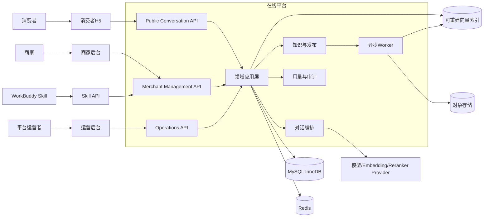
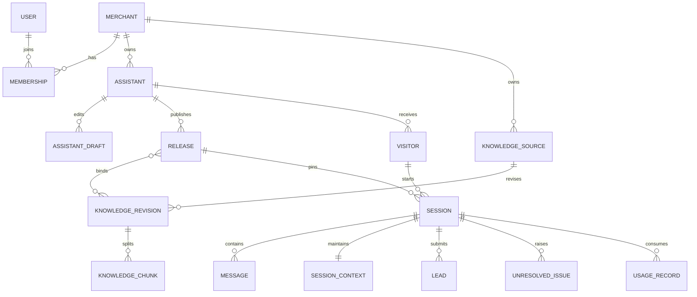
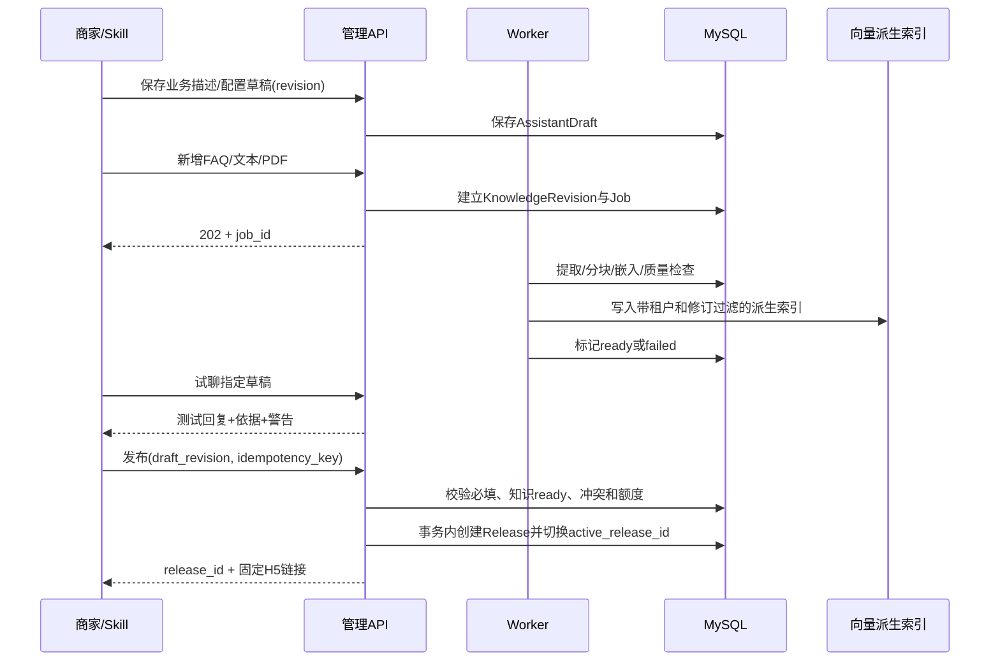
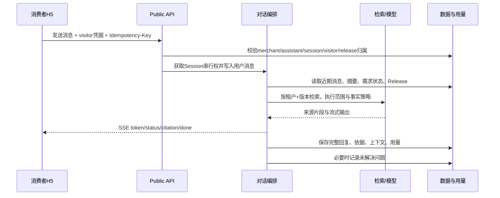

# H5 AI客服生成与管理平台：总体系统与软件架构设计

## 1. 设计结论

### 1.1 首版架构形态

首版采用 **前后端分离的模块化单体 + 独立异步Worker**，而不是微服务：

- 三个Web应用：商家后台、消费者H5、平台运营端。
- 一个管理与公共API应用：内部按领域模块隔离，统一处理认证、鉴权、租户上下文和事务。
- 一个异步Worker：处理文档解析、分块、嵌入、索引、质量检查、长任务与通知。
- MySQL InnoDB作为事实数据库，Transactional Outbox与Job表承载可靠任务真值；向量索引采用可重建派生层，不再默认`pgvector`；Redis只承载短期唤醒/流信号、可重建缓存、限流和会话串行锁；S3兼容对象存储保存原始文件。具体约束以`11-adr-mysql-storage.md`为准。
- 模型、Embedding、重排器均通过服务端Provider接口调用，任何密钥都不进入H5、前端配置或Skill包。

该形态能在首版控制部署和事务复杂度，同时保留把“对话、知识处理、用量计量”拆成独立服务的边界。

### 1.2 不可破坏的业务约束

1. **商家是数据隔离边界**：任何知识、客服、版本、会话、需求、用量都必须带有并校验`merchant_id`。
2. **消费者Session互相隔离**：公开客服标识只用于加载公开配置，不能读取会话；恢复会话必须同时持有有效访客凭据。
3. **线上版本不可被草稿直接修改**：配置与知识准备完成后生成不可变Release；Session建立时固定Release。
4. **回答必须可追溯**：商家事实来自当前Release绑定的有效知识；价格、库存、预约、订单和退款结果不得由模型补造。
5. **在线H5独立运行**：WorkBuddy Skill是受限管理客户端，关闭后不影响消费者咨询。
6. **失败不能伪装成功**：模型、检索、发布、需求提交、额度检查均返回真实状态，并保留可审计结果。

## 2. 范围与状态

### 2.1 P0设计范围

- 商家账号、一个商家一个客服入口，数据模型预留多客服。
- 客服创建、自然语言生成可编辑草稿、范围/风格/模式/页面/服务设置。
- FAQ、文本、可提取文字PDF，异步处理与状态展示。
- 测试、发布、固定H5链接、二维码、暂停、回滚。
- 匿名消费者H5、同Session连续对话、刷新恢复、新建咨询。
- 会话、需求、未解决问题、反馈、用量与限流管理。
- 平台商家/模板/用量/异常/审计管理。
- WorkBuddy Skill创建、修改、测试、发布最小闭环。

### 2.2 明确延期

- P1：多客服、多门店、团队协作、更多文档格式、完整付费自助化。
- P2：真人坐席、订单、实时预约、支付、退款等业务系统连接。
- 非首版：语音、数字人、跨Session个人长期记忆、自动学习消费者发言、全渠道接入。

### 2.3 仍需评审的默认值

以下设计使用建议默认值，但不把它们视为已确认产品承诺：首批行业、商家登录方式、30分钟会话无互动超时、数据留存天数、PDF大小限制、具体模型、首版联系渠道、额度与计费规则、WorkBuddy实际运行与凭据能力。

## 3. 系统上下文



### 3.1 信任边界

- 公网匿名区：消费者H5及其公开API，只允许读取已发布的公开展示字段和操作自己的Session。
- 商家管理区：登录后只允许访问当前商家资源；Skill令牌也必须绑定商家和Scopes。
- 平台运营区：单独角色、强认证、最小权限、敏感访问审计。
- 服务端受信区：数据库、缓存、对象存储、模型密钥和任务系统不暴露给前端。
- 外部模型区：只发送完成任务所需的最小数据；记录Provider请求ID与用量，不记录密钥。

## 4. 软件工程结构

建议使用TypeScript单仓库，统一类型、Schema和工程规范：

```text
apps/
  merchant-web/       商家后台
  consumer-h5/        消费者移动H5
  ops-web/            平台运营端
  api/                REST/SSE API与领域应用层
  worker/             文档、索引、质量检查和异步任务
packages/
  domain/             领域实体、值对象、策略与领域事件
  application/        用例、端口、事务边界
  contracts/          OpenAPI、事件Schema、错误码、DTO
  database/           Schema、迁移、Repository实现
  ai/                 模型、Embedding、检索、提示与安全策略适配器
  auth/               身份、租户上下文、RBAC和匿名凭据
  observability/      日志、指标、Trace和审计封装
  ui/                 管理端共享组件和Design Tokens
  config/             lint、TypeScript、测试和构建配置
docs/
  design/             本轮设计产物
  adr/                架构决策记录
  api/                生成的接口文档与调用样例
```

建议技术基线：

| 层 | 建议选型 | 原因 |
| --- | --- | --- |
| Web | React + Next.js + TypeScript | 三端共享能力，支持移动H5、按路由拆包和成熟工程生态 |
| API | NestJS或结构等价的Node框架 | 模块、鉴权、验证、OpenAPI、SSE和测试边界清晰 |
| 数据访问 | MySQL InnoDB +显式迁移；ORM可选Prisma/Drizzle | 关键复合约束需落到数据库，ORM不代替租户与唯一性设计 |
| 向量检索 | 独立/托管派生索引或经PoC验证的目标MySQL能力 | 索引可从MySQL和对象存储重建，不能成为唯一真值 |
| 任务/缓存 | MySQL Outbox + Job表；Redis短期信号与缓存 | 业务写入和任务创建可同事务；Redis丢失不丢任务，仍可用于限流、短锁和流事件 |
| 文件 | S3兼容对象存储 | 原始文件、派生物、生命周期和权限可独立管理 |
| API协议 | JSON REST；对话流使用SSE | 管理操作契约简单；SSE适合单向流式回复和微信内浏览器 |
| 契约 | OpenAPI + JSON Schema/Zod等单一Schema源 | 前端、Skill和测试共享明确契约 |

具体框架在编码前用一个“登录 + SSE + PDF任务 + MySQL事务任务 + 租户过滤检索”的技术尖峰验证后锁定。

## 5. 领域与模块边界

### 5.1 Identity & Tenancy

- `Merchant`：租户根；状态、服务计划、额度策略、保留策略。
- `User`、`Membership`、`Role`：商家用户和平台运营用户；首版也不得把运营角色混入商家角色。
- 职责：登录、令牌、租户上下文、RBAC/Scopes、访问撤销、审计主体。
- 规则：Repository查询不接受裸主键，必须接受`TenantContext`；使用`merchant_id + resource_id`复合约束与最小权限账号纵深防御。MySQL没有PostgreSQL RLS等价兜底，必须增加跨租户负向测试。

### 5.2 Assistant Configuration

- `Assistant`：稳定客服身份与公开`slug`，不随发布变化。
- `AssistantDraft`：可变草稿，使用`revision`乐观锁避免覆盖。
- 配置分区：身份与介绍、业务范围、对话风格、对话模式、欢迎与页面、联系渠道、服务与暂停设置。
- 自然语言生成只产出草稿；缺少的真实业务事实写入`missing_fields`，不能自动“补齐”。

### 5.3 Knowledge

- `KnowledgeSource`：FAQ、文本、PDF及来源元数据。
- `KnowledgeRevision`：不可变内容修订、有效期、确认状态。
- `KnowledgeChunk`与`Embedding`：只服务于确定版本和租户范围。
- `IngestionJob`：上传、提取、清洗、分块、嵌入、质量检查、可用/失败状态。
- 删除或修改先产生草稿修订；新索引就绪并发布后才影响新Session。

### 5.4 Release

- `Release`是不可变快照，包含配置快照、提示策略版本、知识清单/索引版本和创建者。
- `Assistant.active_release_id`原子切换到新Release，H5地址保持不变。
- 回滚不是修改旧Release，而是将当前指针切换到已验证Release，并记录审计。
- 新Session固定当前Release；进行中的Session继续使用建立时版本。
- 紧急暂停是Assistant级即时控制，优先于Session固定版本。

### 5.5 Conversation

- `VisitorCredential`：不可枚举、可撤销、与浏览器安全凭据关联；不代表自然人身份。
- `Session`：绑定`merchant_id + assistant_id + visitor_id + release_id`。
- `Message`：严格递增`seq_no`、角色、状态、`client_request_id`、用量与错误信息。
- `SessionContext`：当前Session摘要、需求槽位、每个槽位来源消息；不能跨Session合并。
- `Lead`：用户明确提交的需求记录，提交成功只代表已登记。
- `UnresolvedIssue`和`Feedback`：资料不足、需人工确认、故障、无帮助等，不直接成为正式知识。

### 5.6 Usage & Operations

- `UsageRecord`：模型、Embedding、检索等用量和成本归集，关联商家、Session、请求和Provider响应。
- `QuotaPolicy`与`RateLimitPolicy`：商家、访客、IP/设备风险维度与时间窗口。
- `AuditLog`：管理写操作、发布/回滚、运营敏感访问、权限变更和导出。
- `IndustryTemplate`：平台维护的创建提示与字段模板；不能覆盖商家事实。

## 6. 核心数据关系



数据库级最低约束：

- 所有租户业务表包含`merchant_id`，复合外键同时校验父记录的`merchant_id`。
- `UNIQUE(session_id, client_request_id)`防止网络重试重复写消息或计费。
- `UNIQUE(session_id, seq_no)`保证会话顺序。
- `UNIQUE(assistant_id, release_no)`和不可变Release约束。
- `Lead`提交接口使用幂等键，避免一次操作生成多条需求。
- 软删除只用于业务可恢复场景；隐私删除采用专门擦除任务并覆盖索引、缓存和派生物。

## 7. API分面

### 7.1 Public H5 API

建议统一采用`/api/v1/{surface}`，公共面前缀为`/api/v1/public`：

- `GET /assistants/{slug}`：只返回已发布且可公开的展示配置和当前可用状态。
- `POST /assistants/{slug}/visitors`：建立或刷新匿名访客凭据。
- `POST /assistants/{slug}/sessions`：创建/恢复当前客服下的有效Session。
- `GET /sessions/{id}/messages`：必须同时校验访客凭据、商家和客服归属。
- `POST /sessions/{id}/messages`：携带`Idempotency-Key`，返回SSE流或流句柄。
- `POST /sessions/{id}/end`：主动结束并新建咨询时不继承旧需求状态。
- `PUT /sessions/{id}/lead`：幂等提交需求。
- `POST /messages/{id}/feedback`：提交无帮助等反馈。

公开接口永远不接收`merchant_id`作为可信授权依据。

### 7.2 Merchant Management API

建议前缀`/api/v1/merchant`：

- 工作台、客服草稿、配置生成、知识来源/任务、测试对话、发布、回滚、暂停。
- 咨询列表/详情、需求状态、未解决问题、知识补充草稿。
- 用量、额度、联系渠道、保留设置与审计查询。
- 所有更新携带`revision`或`If-Match`，冲突返回`409`。

### 7.3 Operations API

建议前缀`/api/v1/ops`，使用独立角色和审计：商家状态、客服状态、行业模板、用量、失败任务、告警、额度开通。查看会话正文属于敏感操作，需要明确权限与访问理由。

### 7.4 Skill API

建议复用Merchant用例但使用`/api/v1/skill`和更窄Scopes：

- `assistant:read`、`assistant:draft:write`、`knowledge:write`、`test:run`、`release:publish`。
- 写操作必须使用幂等键；发布请求指定草稿revision、知识任务状态与预期当前Release。
- 返回任务ID、真实状态和可追踪错误；只有发布成功才返回正式H5链接。
- Skill凭据由受控配置注入，不写入`SKILL.md`、脚本、日志或公开包。

## 8. 关键运行流程

### 8.1 创建与发布



发布校验至少覆盖：商家/客服名称、业务范围、欢迎语、资料不足策略、至少一条可用业务知识、知识任务完成、无阻断级冲突、当前草稿revision未被覆盖。

### 8.2 消费者消息



顺序与一致性策略：

- 每个Session同一时刻只运行一个生成任务；后续消息排队或返回明确“上一条仍在处理”。
- 获取锁后再次检查`Idempotency-Key`；重复请求返回原结果/当前状态，不重复调用模型。
- 消息先持久化再调用模型；失败回复标记`failed`，不当成已完成事实加入摘要。
- 最终回复、需求状态、摘要版本和用量在可接受范围内原子提交；Provider计费但本地提交失败时进入对账任务。
- SSE断开后允许按消息状态重新获取最终结果；P0不要求从任意Token精确续流。

### 8.3 RAG与回答决策

处理链：输入验证 → 意图/范围判断 → 需求槽位更新 → 查询改写 → `merchant_id + release_id`过滤检索 → 可选重排 → 事实/冲突检查 → 生成 → 输出校验 → 引用与未解决分类。

回答策略优先级：

1. 系统安全与权限策略。
2. 当前Release中的回答范围和资料不足策略。
3. 商家确认且有效的结构化事实。
4. 商家确认的FAQ/文本/PDF片段。
5. 可选通用知识，仅在开关允许且不冒充商家事实时使用。

冲突、过期或依据不足时不输出确定承诺。后台保存使用的知识修订与片段ID；消费者端是否显示来源名称由产品评审决定，但后台必须可追溯。

## 9. 前端系统

### 9.1 商家后台

页面域：登录/入驻、工作台、创建与设置、知识库、测试与发布、咨询管理、账号与服务。

关键交互：

- 创建流程允许随时保存草稿，并把“缺失项、阻断项、建议项”分开展示。
- 知识任务展示排队/处理中/可用/失败及原因，不能用前端乐观状态冒充成功。
- 发布页显示草稿与线上Release差异、知识准备状态、测试入口和回滚历史。
- 咨询详情将原始消息、摘要、需求字段、依据、未解决原因和跟进状态区分展示。
- 对配置和跟进状态更新使用乐观锁；冲突时提示刷新与比较，不静默覆盖。

### 9.2 消费者H5

- Mobile First，重点验证微信内置浏览器、iOS Safari和Android主流浏览器的输入法、视口、滚动和SSE。
- 首屏只加载公开配置，不加载历史；建立访客凭据后再恢复自己的有效Session。
- 消息状态区分发送中、生成中、完成、失败、重试；生成期间禁止重复提交或明确排队。
- 多标签页使用`BroadcastChannel`，不支持时退化为storage事件；只同步当前客服下的Session状态。
- 新建咨询明确提示上下文重置；匿名凭据丢失不允许凭旧Session ID恢复内容。
- 暂停、额度不足、超时、网络中断、解析错误均提供用户可理解的下一步和真实联系渠道。

### 9.3 平台运营端

- 商家与客服状态、模板、额度、用量、失败任务、告警和审计。
- 敏感会话内容默认遮挡；查看全文、导出、权限变更和额度调整记录审计。
- 运营页面不复用消费者匿名API，使用独立入口、角色和路由守卫。

## 10. 安全与隐私

### 10.1 身份与会话

- 商家/运营令牌使用短期Access Token + 可撤销Refresh Session，优先HttpOnly、Secure Cookie。
- 匿名访客凭据为高熵不透明令牌；数据库只保存哈希或可轮换签名标识。
- CSRF、CORS、Cookie SameSite策略按实际独立域名部署验证；管理写操作启用CSRF保护。
- 对登录、公开消息、文件上传、需求提交、Skill调用分别限流。

### 10.2 租户与对象授权

- 鉴权不是只验证“已登录”，每次访问都校验对象是否属于当前`merchant_id`。
- 对`session_id`、`message_id`、`knowledge_id`替换执行自动化越权测试。
- 查询缓存键必须包含租户、客服、版本和资源维度；向量查询强制带`merchant_id + release_id`过滤。
- 对象存储使用短时签名URL并绑定路径前缀；上传文件从隔离桶进入扫描/解析流程。

### 10.3 提示注入与数据安全

- 用户消息和上传文档一律是不可信数据，不能改变系统权限、工具白名单或数据边界。
- P0对话不提供任意工具执行；未来业务工具必须Schema校验、服务端授权和结果验证。
- 敏感字段、令牌、模型密钥和完整联系方式不进入普通日志；展示和导出按角色脱敏。
- 定义消息、摘要、需求、文件、索引、缓存、备份的保留与删除链路；具体时长评审后配置化。

## 11. 可观测性与运维

每个请求生成`trace_id`，关键维度使用内部ID或哈希：`merchant_id`、`assistant_id`、`session_id`、`release_id`、`request_id`、Provider请求ID、耗时、错误码和Token用量。

核心指标：

- API成功率、P50/P95/P99延迟、SSE首段时间、完整生成时间。
- 模型/Embedding Provider错误率、超时率、限流率和成本。
- 知识任务队列深度、等待时长、失败/重试/死信数量。
- 会话创建、有效咨询、未解决、需求提交、反馈和重复请求命中率。
- 商家/访客限流命中、跨租户授权拒绝、敏感运营访问。

告警分级：公开咨询不可用或跨租户风险为最高级；模型错误/队列积压/数据库连接异常为高优先级；单个文件解析失败进入运营任务而非平台级事故。

备份基线：MySQL自动快照与binlog时间点恢复、对象存储版本/生命周期、Redis和向量索引不作为唯一事实来源；定期演练隔离恢复和派生索引重建。RPO/RTO需在试点前确认。

## 12. 测试与验收映射

| 验收 | 主要责任模块 | 自动化层级 |
| --- | --- | --- |
| A01 创建与生成 | Assistant、AI配置生成 | 用例测试 + API契约 + E2E |
| A02 知识失败 | Knowledge、Worker | 解析器测试 + 任务集成 + E2E |
| A03 发布与链接 | Release、Skill API | 事务/幂等集成 + E2E |
| A04 范围与不足 | Conversation、RAG策略 | 固定样本评测 + 回归E2E |
| A05 连续上下文 | SessionContext | 状态机测试 + 对话回归 |
| A06 同商家访客隔离 | Auth、Conversation | 属性测试 + 越权集成 |
| A07 跨商家隔离 | Tenancy、Knowledge | TenantContext Repository + 复合约束 + 攻击测试 |
| A08 刷新与新咨询 | Public API、H5 | API集成 + 浏览器E2E |
| A09 版本更新 | Release、Retrieval | 快照集成 + 并发E2E |
| A10 需求与联系 | Lead、H5 | 幂等集成 + E2E |
| A11 异常与暂停 | Conversation、Quota、H5 | 故障注入 + E2E |
| A12 Skill闭环 | Skill API | 契约测试 + 目标客户端验收 |
| A13 重试与并发 | Message、Usage | 并发/幂等/对账测试 |
| A14 权限与指令攻击 | Auth、AI安全 | 越权、注入和密钥泄漏测试 |

除常规单元、集成和E2E测试外，维护可版本化的“黄金对话集”：至少两家商家、多个匿名访客、同义问题、冲突/过期知识、价格条件、预约诱导、越界问题、提示注入和模型故障。模型或Prompt变更必须重跑事实正确率与越权安全回归。

性能目标“首段回复P95不超过5秒”只在明确模型、地区、网络、输入长度、并发和命中条件后验收；先建立基准脚本再承诺容量。

## 13. 部署拓扑与演进

### 13.1 P0部署

- CDN/WAF托管三端静态资源和公开域名防护。
- API运行至少两个无状态实例；SSE所需连接超时和反向代理缓冲策略单独配置。
- Worker独立伸缩，文档解析任务与低延迟任务使用不同队列。
- 托管私网MySQL、Redis、对象存储；密钥存入Secret Manager。
- 开发、测试、生产环境隔离；生产数据不得复制到开发环境。

### 13.2 拆分触发条件

只有出现明确压力再拆服务：

- 对话流量与管理API资源竞争明显 → 拆Conversation Service。
- 文档处理或Embedding吞吐独立扩容 → 拆Knowledge Pipeline。
- 多Provider计量、对账与套餐复杂 → 拆Usage/Billing Service。
- 当前向量派生层容量/延迟无法满足隔离检索SLO → 更换或拆分专用向量服务，MySQL真值不迁移。

拆分前通过模块端口、事件Schema和Outbox保留边界，首版不承担分布式事务成本。

## 14. 分阶段交付与后续任务

### 阶段0：决策与技术验证

- 确认首批行业、试点样本、商家登录、联系渠道、模型/部署、保留策略和WorkBuddy目标版本。
- 完成SSE/微信浏览器、PDF提取、MySQL事务/任务并发、向量派生层租户过滤、Provider延迟与Skill凭据技术尖峰。
- 冻结OpenAPI错误模型、ID策略、租户上下文和发布快照ADR。

### 阶段1：在线闭环

- 身份与租户、客服草稿、知识FAQ/文本/PDF、异步索引、测试、发布。
- 公共H5、匿名凭据、Session、流式对话、上下文与需求状态。
- 目标：真实资料可以连续咨询，并通过A01至A08核心隔离场景。

### 阶段2：试用保障

- 咨询与需求管理、未解决问题、回滚/暂停、额度/限流、审计、可观测性、删除链路。
- 目标：A09至A14、故障注入与基准测试通过，具备小规模试点运行条件。

### 阶段3：Skill接入

- 用目标WorkBuddy版本验证格式、脚本、网络和凭据。
- 完成创建、修改、导入、查询任务、测试、发布、回滚的最小闭环。
- Skill失败保留草稿并返回真实原因；不为兼容Skill破坏平台授权边界。

### 阶段4：试点学习

- 3至5家同类商家试用，按发布完成率、正确率、未解决比例、需求提交率和有效咨询成本评估。
- 只有指标与运营流程稳定后才评估多客服、多门店、团队和计费自助化。

## 15. 编码前必须确认或记录的ADR

| 决策 | 当前建议 | 未确认影响 |
| --- | --- | --- |
| 首批行业 | 选业务资料清晰、无实时库存/交易依赖的单一行业 | 模板、字段、评测集 |
| 工程形态 | TypeScript单仓库、模块化单体+Worker | 团队技能和部署平台 |
| 数据与向量 | MySQL InnoDB + 可重建向量派生层 | 托管产品、版本、规模、召回延迟与成本 |
| 会话版本 | Session固定建立时Release | 紧急知识失效策略 |
| 会话超时 | 30分钟无互动后新建 | 体验、成本、历史展示 |
| 匿名身份 | 浏览器安全凭据，不承诺跨设备识别 | 隐私告知和恢复体验 |
| 模型Provider | 服务端可替换适配器 | 质量、成本、地区和合规 |
| 数据留存 | 按数据类别配置，默认值待定 | 隐私、成本、备份擦除 |
| 商家登录 | 可插拔认证，试点选一种最小方案 | 找回、风控、通知 |
| WorkBuddy | 先验证后承诺可安装包 | Skill结构、网络、凭据与分发 |

## 16. 本轮完成标准

本轮设计完成后，应能直接进入以下下一层产物，而无需重新讨论系统边界：页面线框与交互状态、OpenAPI契约、数据库逻辑模型与迁移计划、Prompt/评测规范、威胁模型、测试计划、Epic与开发任务拆分。任何尚未确认的产品选项继续以配置或ADR候选存在，不应被代码中的隐式默认值锁死。
